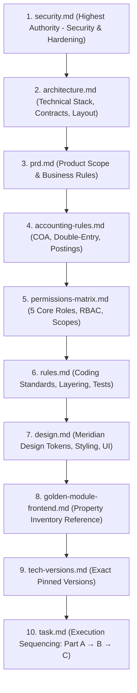

# AGENTS.md — ExzaEstate AI Agent Entry Point & System Constitution

> **Welcome, AI Agent / Cursor:** This document is your supreme entry point and operational manual for developing **ExzaEstate** — a multi-tenant enterprise real estate management, ERP, and accounting platform.

---

## 1. Document Reading Order & Precedence Hierarchy

Whenever there is an apparent contradiction or overlap between specifications, resolve it using this strict precedence hierarchy:

### Precedence Resolution Rules:

1. **Security & Data Hardening:** `security.md` wins over all other documents.
2. **Technical & Stack Decisions:** `architecture.md` wins over `prd.md`.
3. **Product & Business Rules:** `prd.md` wins over technical docs regarding business domain logic.
4. **Financial Operations:** `accounting-rules.md` is strictly binding for all ledger, journal, booking, and installment math.
5. **No Guessing Policy:** If a genuine conflict or ambiguity cannot be resolved by this hierarchy, **stop immediately and ask the human**. Never invent a pattern or guess.

---

## 2. Pinned Technology Stack (Zero "A or B" Choices)

All core architectural decisions are locked. **Do not substitute, replace, or debate these selections:**

| Layer / Concern        | Pinned Choice                                | Notes / Version Baseline                                             |
| :--------------------- | :------------------------------------------- | :------------------------------------------------------------------- |
| **Monorepo Engine**    | `pnpm` workspaces + Turborepo                | Pinned in `tech-versions.md`                                         |
| **Language**           | TypeScript (Strict mode)                     | `strict: true`, `noUncheckedIndexedAccess: true`, **NO `any`**       |
| **Backend Framework**  | **NestJS 12 (ESM)**                          | Modular monolith under `/api/v1`, `.js` import extensions            |
| **Database & ORM**     | PostgreSQL 18 + **Prisma 7**                 | Multi-file schema (`prisma/schema/*.prisma`), `@prisma/adapter-pg`   |
| **ID Generation**      | UUID                                         | `@default(uuid(7))` in Prisma, native `uuid` DB type                 |
| **Cache & Job Queues** | Redis 8 + BullMQ 6                           | Invalidation, worker process, outbox dispatcher                      |
| **Desktop App**        | **Tauri v2** + Vite + React 19               | Dual-mode: Cloud-Hosted or Offline Local Standalone (NestJS Sidecar) |
| **Web App**            | **Vite + React 19 SPA**                      | Thin shell mounting `packages/features`. **NO Next.js**              |
| **Styling & Design**   | **Tailwind CSS v4**                          | CSS-first configuration (`@theme`), design tokens in `design.md`     |
| **API Contract**       | OpenAPI 3.0 via NestJS Swagger               | Generated client & hooks via `orval` in `packages/api-client`        |
| **Server State**       | TanStack Query v5                            | Only via `@exzaestate/api-client`                                    |
| **Client UI State**    | Zustand                                      | Per-app ephemeral UI state only; never mirrors server data           |
| **Date & Timezone**    | `date-fns` v4 + `@date-fns/tz`               | Store UTC (`timestamptz`); display in `Asia/Dhaka`                   |
| **Money Handling**     | Integer **paisa** stored as `BigInt`         | Transported as string; formatted via `formatMoney` (`৳5,00,000`)     |
| **Lint & Format**      | `oxlint` + Prettier                          | Module boundaries via `dependency-cruiser`, cycles via `madge`       |
| **Testing**            | Vitest (unit/integration) + Playwright (e2e) | Tests co-located with implementation                                 |

---

## 3. Strict Non-Negotiable Invariants

1. **Strict TypeScript:** No `any` anywhere in the codebase. Use typed generics, discriminated unions, or `unknown` with type narrowing.
2. **Backend ESM Imports:** All relative imports in `apps/backend/` and packages must specify the `.js` extension (e.g., `import { BookingService } from './booking.service.js';`).
3. **Multi-Tenancy & RLS:** Every tenant table includes `company_id`. All tenant DB transactions must use `tenantDb.transaction(async (tx) => ...)`. **Never** use raw `prisma.$transaction` for tenant data, as it bypasses the PostgreSQL RLS session variable.
4. **Financial Immutability:** Posted journals, payments, receipts, and ledger rows are **append-only**. They can never be updated or deleted in code or database triggers. Corrections are made strictly via reversal entries (`RULE-IMMUTABLE`).
5. **Double-Entry Balance:** Every journal entry must enforce `debit === credit` before persistence (`RULE-DOUBLE-ENTRY`).
6. **No Mock Data in UI:** React components and pages must **never** hardcode mock data arrays (`const mockData = [...]`). The UI strictly consumes generated TanStack Query hooks. For development and visual testing, use real database seed data via `pnpm db:seed:demo` (`ARCH-SEED`).
7. **Bangladeshi Localization:** All currency displays must use `formatMoney` from `packages/shared` with lakh/crore grouping (`৳5,00,000` / `৳1,50,00,000`). Dates are displayed in `Asia/Dhaka` timezone. Primary font is **Inter** (`@fontsource/inter`).
8. **Layering & Repository Rule:** There is **NO repository layer**. Controllers handle HTTP validation and DTOs; Services own business logic and query `TenantPrisma` directly.
9. **One-Task Execution Discipline:** Agents execute strictly **one** task at a time from `task.md`. Log completion in `agent/PROGRESS.md` before stopping.

---

## 4. Execution Workflow for AI Agents (`task.md`)

Always check `task.md` before generating or modifying code:

- **Part A:** Backend modular monolith API, database schema, RLS, auth, and business logic.
- **Part B:** Tauri v2 Desktop client (cloud-connected shell and local standalone sidecar engine).
- **Part C:** Vite Web SPA client (thin responsive shell sharing `packages/features`).

**Execution Discipline:** Part A must be completed and tested before Part B, and Part B before Part C. Do not skip tasks or create frontend interfaces before their backend contracts are verified. Maintain `agent/PROGRESS.md`.

---

## 5. Documentation Directory Map

All specifications live in the `agent/` directory:

- `agent/prd.md`: Complete domain specifications, entity lifecycles, and business logic.
- `agent/architecture.md`: Master architectural blueprint, data model, APIs, and folder layout.
- `agent/accounting-rules.md`: Chart of accounts, posting matrix, and installment schedule math.
- `agent/permissions-matrix.md`: 5 Core roles, permission matrix (`<module>:<action>`), scopes (`OWN`, `TEAM`, `BRANCH`, `ALL`).
- `agent/security.md`: Production hardening checklist, 2FA, RLS verification, CSP.
- `agent/rules.md`: Daily coding standards, file conventions, and testing requirements.
- `agent/design.md`: Meridian design tokens (Slate/Charcoal/Warm Gold palette), typography (Inter/IBM Plex Sans), components.
- `agent/golden-module-frontend.md`: Golden reference architecture for property inventory.
- `agent/tech-versions.md`: Exact pinned version numbers for all dependencies.
- `agent/task.md`: Ordered implementation task checklist.
