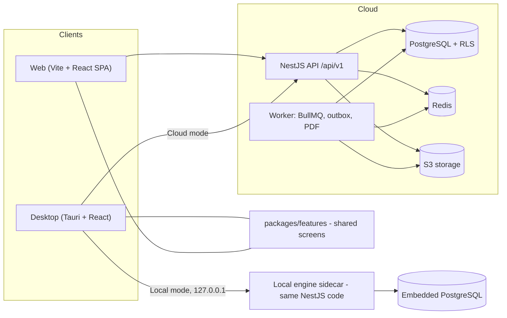
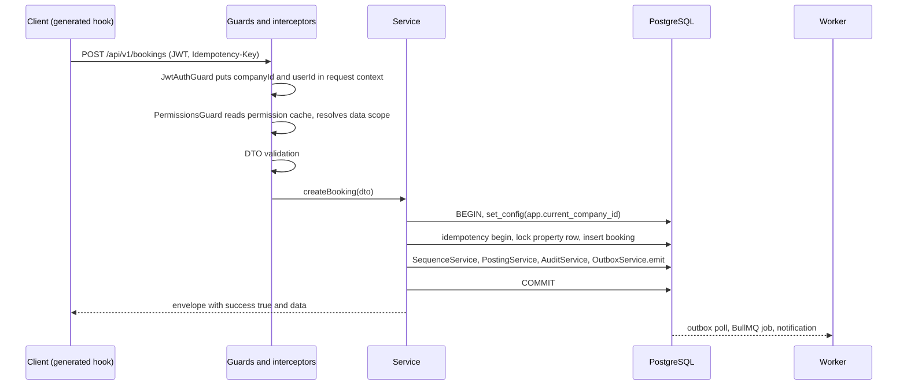

# architecture.md — ExzaEstate System Architecture (v4)

|                       |                                                                                                                                                                                 |
| --------------------- | ------------------------------------------------------------------------------------------------------------------------------------------------------------------------------- |
| **Status**            | v4 — architecture-review revision of v3. Items marked _Needs sign-off_ in §24 must be confirmed by the human owner.                                                             |
| **Last reviewed**     | 2026-10-03                                                                                                                                                                      |
| **Audience**          | Humans (onboarding, review, maintenance) **and** AI coding agents                                                                                                               |
| **Stability promise** | Every `ARCH-*` / `RULE-*` ID and every section number 0–19 from v3 is unchanged. New material is added as §20–§25 and as clearly labelled sub-sections. §25 lists every change. |

This file is the source of truth for **technical** decisions (stack, data model, API shape, folder layout). Precedence across all docs is defined once in `AGENTS.md`. It pairs with `prd.md` (product scope), `accounting-rules.md` (posting rules), `permissions-matrix.md` (roles), `security.md`, `rules.md`, `design.md`, `task.md`. **Cross-references use stable IDs** (`ARCH-*`, `RULE-*`) shown in brackets on headings — never bare section numbers.

---

## What is this system? (30-second version)

ExzaEstate is a multi-tenant ERP for real-estate developers in Bangladesh: land and project inventory, property booking and sales, installment collection, CRM, expenses / procurement / development, and a strict double-entry accounting core. It ships as a **Web app** and a **Desktop app** (Tauri). The Desktop app runs in **Cloud mode** (talks to the hosted API) or **Local Standalone mode** (runs the same backend on the user's own PC). There is **one** NestJS modular monolith that implements every business rule, and **one** set of React screens that both front-ends mount.

### Six ideas to understand before reading anything else

1. **One backend, one set of screens.** Desktop and Web are thin shells around `packages/features`. Business rules exist only in the backend.
2. **Tenant isolation is enforced by the database** (PostgreSQL Row-Level Security), not only by application code (§5).
3. **Money is an integer number of paisa** (`BigInt`), sent as a string in JSON, handled only by the `Money` helper (§9).
4. **Posted financial records are immutable.** Corrections are new rows (reversals), never edits (§10).
5. **The OpenAPI document is the contract.** Frontend types and hooks are generated, never hand-written (§12.2).
6. **Side effects go through a transactional outbox**, never inline (§8).

### Architecture at a glance



### Glossary

| Term                 | Meaning                                                                                                            |
| -------------------- | ------------------------------------------------------------------------------------------------------------------ |
| **Tenant / Company** | One customer organisation. Every business row carries its `company_id`.                                            |
| **Branch**           | An office/site inside a company. Users can be assigned to many branches; data scope can be limited to branch.      |
| **Paisa**            | 1/100 of a taka. All money is stored as integer paisa.                                                             |
| **Lakh / Crore**     | Bangladeshi digit grouping (`৳5,00,000`). Display only.                                                            |
| **RLS**              | PostgreSQL Row-Level Security: the database itself hides other tenants' rows.                                      |
| **Outbox**           | Table written in the same transaction as a business change; a worker turns rows into jobs (notifications, etc.).   |
| **Envelope**         | The fixed JSON wrapper (`success`, `data`, `meta` / `error`) around every API response.                            |
| **Golden module**    | The `property` module, built first and copied by every other module (§18.1).                                       |
| **Posting rule**     | Registry entry that says which accounts a business event debits/credits (`accounting-rules.md`).                   |
| **Maker-checker**    | The person who requests an approvable action can never approve it.                                                 |
| **Step-up**          | Re-verifying the user (TOTP) right before a sensitive action (§4.5).                                               |
| **Runtime mode**     | `cloud` or `local`: which infrastructure adapters the backend uses. Business code never knows (§20).               |
| **Sidecar**          | The backend process the Desktop app launches next to its window in Local mode.                                     |
| **Port / Adapter**   | An interface in `ports/` (what the app needs) and its per-mode implementation in `adapters/` (how it is provided). |

### Where does X go? (cheat sheet)

| I need to…                                        | Put it in                                                                                |
| ------------------------------------------------- | ---------------------------------------------------------------------------------------- |
| Add a REST endpoint                               | `apps/backend/src/modules/<feature>/` (controller → service → DTOs), then `pnpm gen:api` |
| Write a calculation or state machine (late fee…)  | `modules/<feature>/domain/*.ts` — pure functions, no Nest, no DB, with a `*.spec.ts`     |
| Add a permission / error code / event / status    | `packages/shared/src/{permissions,error-codes,events,statuses}.ts`                       |
| Create journal lines for a business event         | `modules/accounting/posting-rules/<event>.ts`, called via `PostingService.post()`        |
| Send an SMS / email / in-app message              | Emit an outbox event; listener in `modules/notifications/`                               |
| Run something nightly / on a schedule             | Processor in the owning module's `jobs/`; schedule registered by the worker              |
| Generate a document number                        | `SequenceService.next()`                                                                 |
| Build a screen                                    | `packages/features/src/<feature>/pages/`                                                 |
| Build a reusable visual component                 | `packages/ui`                                                                            |
| Use session, permissions, platform adapters       | `packages/app-core`                                                                      |
| Touch the OS / browser (files, keychain, updater) | Interface in `packages/app-core/platform`, implementation in `apps/*/src/platform/`      |
| Format money / dates / areas                      | `formatMoney`, `formatDate`, `formatArea` in `packages/shared`                           |
| Add an environment variable                       | `src/config/env.schema.ts` **and** `.env.example`                                        |
| Write RLS / trigger / partial index / grant SQL   | Hand-written SQL in the same Prisma migration folder as the table                        |
| Depend on Redis / S3 / BullMQ / Chromium          | Inject a **port** from `src/ports/` — never import an adapter or read `RUNTIME_MODE`     |

### Contents

| §   | Topic                                   | Stable ID(s)                                                                |
| --- | --------------------------------------- | --------------------------------------------------------------------------- |
| 0   | Build phases and repository layout      | `ARCH-REPO-LAYOUT`, `ARCH-PHASES`                                           |
| 1   | Locked decisions and versions           | `ARCH-DECISIONS`, `ARCH-LIBS`, `ARCH-VERSIONS`                              |
| 2   | Principles                              | `ARCH-PRINCIPLES`                                                           |
| 3   | System overview and request lifecycle   | `ARCH-SYSTEM`, `ARCH-LIFECYCLE`                                             |
| 4   | Authentication and authorization        | `ARCH-AUTH`, `ARCH-RBAC`, `ARCH-SESSION`                                    |
| 5   | Multi-tenancy and data isolation        | `ARCH-TENANCY`, `ARCH-AUTH-LOOKUP`, `ARCH-GLOBAL-DATA`, `ARCH-SYSTEM-SCOPE` |
| 6   | API standards                           | `ARCH-API`, `ARCH-IDEMPOTENCY`, `ARCH-API-CONVENTIONS`, `ARCH-API-COMPAT`   |
| 7   | Backend structure                       | `ARCH-BACKEND`, `ARCH-APPROVALS`, `ARCH-AUDIT`                              |
| 8   | Events, outbox, jobs, cache, realtime   | `ARCH-EVENTS`, `ARCH-REALTIME`                                              |
| 9   | Money, numbers, sequences               | `ARCH-MONEY`                                                                |
| 10  | Financial integrity rules               | `ARCH-FINANCE`, `RULE-*`                                                    |
| 11  | Database rules                          | `ARCH-DB`                                                                   |
| 12  | Frontend, Desktop, Web, Licensing       | `ARCH-FRONTEND`, `ARCH-DESKTOP-MODE`, `ARCH-LICENSE`                        |
| 13  | Code quality and reuse                  | `ARCH-QUALITY`                                                              |
| 14  | Security                                | `ARCH-SECURITY`                                                             |
| 15  | Storage and media                       | `ARCH-STORAGE`                                                              |
| 16  | Testing                                 | `ARCH-TESTING`                                                              |
| 17  | Operations and seeding                  | `ARCH-OPS`, `ARCH-SEED`                                                     |
| 18  | Golden reference and Definition of Done | `ARCH-DOD`                                                                  |
| 19  | Non-negotiable checklist                | `ARCH-CHECKLIST`                                                            |
| 20  | Runtime modes (Cloud / Local) _(new)_   | `ARCH-RUNTIME`, `ARCH-IMPORT`                                               |
| 21  | Scalability roadmap _(new)_             | `ARCH-SCALE`                                                                |
| 22  | Recipes and walkthroughs _(new)_        | `ARCH-RECIPES`                                                              |
| 23  | Anti-patterns _(new)_                   | `ARCH-ANTIPATTERNS`                                                         |
| 24  | Open decisions and assumptions _(new)_  | `ARCH-OPEN`                                                                 |
| 25  | Change log v3 → v4 _(new)_              | `ARCH-CHANGELOG`                                                            |

---

**How an AI agent must use this file**

1. Follow it exactly. Do not substitute another ORM, auth strategy, folder layout, router, state library or response format "because it is common".
2. This file contains **no "A or B" choices**. Every decision is locked in §1 (and §20 for runtime modes). If something is genuinely ambiguous or missing, **stop and ask the human** — never invent a pattern. Write the question to `agent/open-questions.md` (date, section ID, the options you see) so it is not lost, then continue with unrelated work.
3. Before using any API of a pinned library (§1.2), check the documentation for that **major version**. Never use removed or deprecated APIs from memory (example: Prisma `$use` middleware no longer exists — use Client Extensions; example 2: NestJS 12 packages are ESM-first — do not copy CommonJS-era snippets blindly).
4. Before writing a new module or feature, open the **golden reference** (§18) and the **recipes** (§22), and copy their shape.
5. If a requested change conflicts with this file, flag the conflict to the human instead of silently choosing a side.
6. When you implement a rule, name its ID in the code comment or commit message (e.g. `// RULE-IMMUTABLE`). It makes review and later maintenance far easier.
7. Items in §24 marked _Needs sign-off_ are already applied in this file but may still change. Do not build irreversible work (production migrations, released installers) that depends on them until the human confirms.

---

## 0. Build Sequencing [ARCH-REPO-LAYOUT]

The project is built in three parts, plus a fourth that is added later. (v4: the order of _work inside_ Parts A and B changed — see §0.1.)

| Part                                             | What                                                                   | Repo path                                                   |
| ------------------------------------------------ | ---------------------------------------------------------------------- | ----------------------------------------------------------- |
| **A — Backend**                                  | NestJS API, all modules, all business rules, OpenAPI contract          | `apps/backend/`                                             |
| **B — Shared packages + Desktop**                | `packages/*` written once, Tauri + Vite + React shell                  | `apps/desktop/`, `packages/*`                               |
| **C — Web**                                      | Vite + React SPA shell that mounts the **same** feature pages          | `apps/web/`                                                 |
| **D — Local Standalone mode** _(after Cloud GA)_ | `main.local.ts`, `adapters/local`, sidecar launcher — specified in §20 | `apps/backend/src/adapters/local`, `apps/desktop/src-tauri` |

Because Part C reuses the exact same page components as Part B (§12), Part C is a thin shell (routing entry, platform adapters, deployment) — not a second implementation.

### 0.1 Delivery phases [ARCH-PHASES]

v3 said "Part A is 100% complete before Part B". That conflicts with §18.1: the golden module spans **backend and frontend**, and a contract or UX mismatch discovered after 20 finished backend modules is expensive. v4 keeps the same parts but orders the work as vertical slices _(Needs sign-off, §24 D-04)_:

| Phase                           | Deliverable                                                                                                                                                                                                 | Exit gate                                                     |
| ------------------------------- | ----------------------------------------------------------------------------------------------------------------------------------------------------------------------------------------------------------- | ------------------------------------------------------------- |
| **A1 Foundations**              | Repo, CI, docker-compose, config, `TenantPrisma` + RLS + DB roles, auth/sessions, `platform/*` (audit, sequence, outbox, storage, idempotency), **ports/adapters skeleton (§20.2)**, envelope, error filter | CI green; tenant-isolation harness and RLS-coverage test pass |
| **A2+B1 Golden vertical slice** | `property` module end-to-end: backend, `pnpm gen:api`, `packages/shared`, `ui`, `app-core`, `features/property`, Desktop shell in Cloud mode                                                                | Human reviews and approves the golden module (§18.1)          |
| **A3 Remaining modules**        | accounting → sales/collection → the rest. Each module's pages are added to `packages/features` as soon as its API is stable (frontend may trail the backend by one module)                                  | Per-module Definition of Done (§18)                           |
| **C Web**                       | Thin web shell                                                                                                                                                                                              | Playwright critical flows pass on Web and Desktop             |
| **D Local mode**                | §20                                                                                                                                                                                                         | Local-mode e2e suite green in CI (§16)                        |

The ports/adapters skeleton is built in **A1** even though Local mode ships later — retrofitting infrastructure abstractions after 20 modules depend on BullMQ/Redis directly is the single most expensive mistake available.

### 0.2 Repository layout

```
exzaestate/                       (pnpm workspace root + Turborepo)
├── AGENTS.md                     # agent entry point; document precedence (defined once, here)
├── README.md                     # human quick start: prerequisites, pnpm dev, pnpm db:setup
├── .env.example                  # every environment variable, documented
├── .nvmrc  .editorconfig  .prettierrc  .husky/
├── .github/workflows/            # ci.yml (PR gate), release-desktop.yml, deploy-*.yml
├── apps/
│   ├── backend/                  # NestJS — Part A (structure in §7)
│   ├── desktop/                  # Tauri v2 + Vite + React — Part B
│   │   ├── src/                  #   entry, providers, platform/ (the ONLY place @tauri-apps/* is imported)
│   │   └── src-tauri/            #   Rust: window, sidecar launcher, secure storage, licensing.rs, updater
│   └── web/                      # Vite + React — Part C
├── packages/
│   ├── shared/                   # Pure TS, zero framework: constants, Money, i18n dictionary + t(), utils. BUILT with tsup.
│   ├── api-client/               # OpenAPI-GENERATED hooks/types + hand-written http mutator (+ test-only MSW mocks)
│   ├── ui/                       # Design-system components (design.md tokens). Knows nothing about auth or the API.
│   ├── app-core/                 # App runtime: session, permissions, platform-adapter contracts, error handler, ApiConfig
│   ├── features/                 # Business screens per feature: pages, components, hooks, schemas
│   └── config/                   # oxlint, tsconfig, tailwind, dependency-cruiser configs
├── agent/                        # prd.md, architecture.md, accounting-rules.md, permissions-matrix.md,
│                                 # security.md, rules.md, design.md, task.md (all lowercase filenames),
│                                 # tech-versions.md, open-questions.md
├── docker/                       # Dockerfile (targets: api, worker), compose helpers
├── scripts/                      # export-openapi, db-setup, check-* scripts
├── docker-compose.yml            # local Postgres + Redis + MinIO + Mailpit
├── package.json
├── turbo.json
└── pnpm-workspace.yaml
```

**How packages are consumed.** `packages/shared` is **built** (tsup → ESM + `.d.ts`) because the Node backend cannot execute TypeScript from `node_modules`. All other packages are consumed as TypeScript **source** by Vite (`exports` point at `src/index.ts`, no build step). Turborepo: `build` depends on `^build`. Package names are `@exzaestate/<folder>`.

---

## 1. Locked Decisions [ARCH-DECISIONS]

### 1.1 Decision table (no alternatives allowed) [ARCH-LIBS]

| Area                  | Decision                                                                                                                                                                                                                                                               |
| --------------------- | ---------------------------------------------------------------------------------------------------------------------------------------------------------------------------------------------------------------------------------------------------------------------- |
| Monorepo              | pnpm workspaces + Turborepo                                                                                                                                                                                                                                            |
| Language              | TypeScript, `strict: true`, `noUncheckedIndexedAccess: true`, **no `any`**                                                                                                                                                                                             |
| Backend               | NestJS, modular monolith, REST under `/api/v1`                                                                                                                                                                                                                         |
| ORM / DB              | Prisma (with `@prisma/adapter-pg` driver adapter) on PostgreSQL                                                                                                                                                                                                        |
| Prisma schema         | Multi-file schema: `prisma/schema/<module>.prisma` (one file per module, plus `base.prisma`)                                                                                                                                                                           |
| IDs                   | UUIDv7, generated by Prisma `@default(uuid(7))`, DB type `uuid`                                                                                                                                                                                                        |
| Cache / queues        | Redis + BullMQ                                                                                                                                                                                                                                                         |
| Object storage        | S3-compatible (MinIO locally), presigned URLs                                                                                                                                                                                                                          |
| Auth                  | JWT access token (15 min) + rotating opaque refresh token (30 days) with reuse detection                                                                                                                                                                               |
| Password hashing      | argon2id only                                                                                                                                                                                                                                                          |
| PDF                   | **Playwright/Chromium HTML→PDF** in the worker (consistent typography and print layout; pdfmake/pdfkit are NOT allowed)                                                                                                                                                |
| Excel / CSV           | `exceljs` (streaming writer)                                                                                                                                                                                                                                           |
| Dates                 | `date-fns` v4 + `@date-fns/tz` (`Asia/Dhaka`); no second date library                                                                                                                                                                                                  |
| Charts                | Custom React SVG charts built on `d3-scale`/`d3-shape`/`d3-array` only, inside `packages/ui/charts` (see `design.md`)                                                                                                                                                  |
| Icons / palette / DnD | `lucide-react` / `cmdk` / `@dnd-kit`                                                                                                                                                                                                                                   |
| Fonts                 | Self-hosted (bundled, no CDN): **Inter** (`@fontsource/inter`) for Latin **and Noto Sans Bengali** (`@fontsource/noto-sans-bengali`) as fallback — the UI is English-only but customer, nominee and address data is routinely entered in Bangla, in the UI and in PDFs |
| Request context       | `nestjs-cls` (AsyncLocalStorage). **Not** request-scoped Nest providers                                                                                                                                                                                                |
| Money                 | Integer **paisa** stored as `BigInt`; transported in JSON as **string**                                                                                                                                                                                                |
| Validation            | `class-validator` + `class-transformer` (backend); `zod` + `react-hook-form` (frontend forms)                                                                                                                                                                          |
| API contract          | OpenAPI generated from NestJS Swagger → `orval` generates `packages/api-client`                                                                                                                                                                                        |
| Desktop               | **Tauri v2** (Rust shell) + Vite 8 + React 19 with **Dual Mode** (`ARCH-DESKTOP-MODE`, details `ARCH-RUNTIME`): Cloud-Hosted OR Local Standalone (same NestJS code as a sidecar on embedded PostgreSQL)                                                                |
| Web                   | **Vite 8 + React 19 SPA + React Router 8** (same stack as Desktop). Next.js is **not used** (~100% code reuse).                                                                                                                                                        |
| Router (both apps)    | React Router 8 (data-router / library mode)                                                                                                                                                                                                                            |
| Server state          | TanStack Query v5 (only via `packages/api-client`)                                                                                                                                                                                                                     |
| Client UI state       | Zustand (per-app, never mirrors server data)                                                                                                                                                                                                                           |
| Tables                | TanStack Table v8 + `@tanstack/react-virtual`                                                                                                                                                                                                                          |
| Styling               | Tailwind CSS v4 + Radix primitives, tokens from `design.md`                                                                                                                                                                                                            |
| UI Language           | English only; UI dictionary in `packages/shared/src/i18n/en.json`                                                                                                                                                                                                      |
| Logging               | `pino` (structured JSON)                                                                                                                                                                                                                                               |
| Tests                 | **Vitest** everywhere (backend uses `unplugin-swc` for decorator metadata) + supertest; Testing Library (frontend); Playwright (e2e)                                                                                                                                   |
| Lint / format         | **oxlint** (lint) + Prettier (format) + `dependency-cruiser` (module boundaries) + `madge` (cycles)                                                                                                                                                                    |
| Time                  | **Instants** (`created_at`, `posted_at`) are `timestamptz` in UTC. **Business dates** (booking date, due date, posting date) are PostgreSQL `date` in the company timezone (default `Asia/Dhaka`). See §11                                                             |
| Currency display      | BDT, `৳` prefix, **lakh/crore grouping** (`৳5,00,000`) via `Intl.NumberFormat('en-BD')` inside the one shared `formatMoney`                                                                                                                                            |
| HTTP adapter          | NestJS Express adapter (`@nestjs/platform-express`)                                                                                                                                                                                                                    |
| Runtime ports         | `QueueDriver`, `CacheStore`, `PubSub`, `ObjectStorage`, `PdfRenderer`, `SmsProvider`, `EmailProvider` in `src/ports/`; implementations in `src/adapters/{cloud,local}` chosen by `RUNTIME_MODE` (§20)                                                                  |
| PII at rest           | Application-level AES-256-GCM for NID / passport / TIN / bank-account numbers and TOTP secrets; HMAC blind index for lookups (§14)                                                                                                                                     |
| Observability         | `pino` logs + Sentry errors + OpenTelemetry traces/metrics (§17)                                                                                                                                                                                                       |
| Package consumption   | `packages/shared` built with tsup; every other package consumed as TS source (§0.2)                                                                                                                                                                                    |

> If the human insists on Next.js for Web, that is a **change request to this file**, not something an agent may decide on its own.

### 1.2 Version pinning [ARCH-VERSIONS]

This file pins **majors only**. Exact versions live in exactly one place: `agent/tech-versions.md` (locked by `pnpm-lock.yaml`). Do not copy exact versions into this file — two sources of truth drift apart.

| Tool           | Major                                  |
| -------------- | -------------------------------------- |
| Node.js        | 24 LTS (`.nvmrc` + `engines`)          |
| pnpm           | 12                                     |
| TypeScript     | 7 (strict mode)                        |
| NestJS         | 12 (ESM; Vitest + oxlint defaults)     |
| Prisma         | 7 (driver adapters, multi-file schema) |
| PostgreSQL     | 18                                     |
| Redis          | 8 (Cloud mode only)                    |
| React          | 19                                     |
| Vite           | 8                                      |
| React Router   | 8                                      |
| TanStack Query | 5                                      |
| Tailwind CSS   | 4                                      |
| Tauri          | 2                                      |
| Zod            | 4                                      |

**Backend module format:** ESM (`"type": "module"`, `NodeNext`, `.js` import extensions). Because all official Nest packages are ESM, the backend is ESM from day one.

---

## 2. Architecture Principles [ARCH-PRINCIPLES]

1. **API-first, decoupled clients.** The backend never renders HTML and never knows which client called it (the only client-aware behavior is refresh-token delivery, §4.3).
2. **Tenant isolation is non-negotiable.** Every tenant-scoped table, query, cache key, queue job and log line carries `company_id`. A cross-tenant leak is a critical bug.
3. **Financial data is append-only.** Journals, posted payments, receipts and ledger rows are never updated or deleted — not in code, and (§10) not even permitted by DB grants.
4. **Fail loud, fail typed.** No silent `catch`, no `any`. Every failure returns the typed error envelope.
5. **One shape everywhere.** Every backend module and every frontend feature has an identical internal structure so it is predictable to humans and agents.
6. **Write once, reuse everywhere.** Logic is written at the lowest shared layer that can hold it (§12). Duplication is a defect.
7. **Contract-driven.** The backend OpenAPI document is the only source of API types and hooks. Nobody hand-writes an API type or endpoint call on the frontend.
8. **Human-readable over clever.** Small files, small functions, explicit names. Abstractions must earn their place (rule of three, §13).
9. **Same engine, every runtime.** Cloud and Local Standalone run the same domain code; only infrastructure _ports_ differ (§20). Business modules never read `RUNTIME_MODE`.
10. **Fail closed.** Missing tenant context, missing permission, missing posting rule, unknown filter key, unreachable revocation store → the request is rejected, never "best effort".

---

## 3. High-Level System [ARCH-SYSTEM]

```
[ Desktop — Tauri + React ]──┐
                             ├──> [ NestJS API /api/v1 ] ──> [ PostgreSQL ]
[ Web — Vite + React SPA ]───┘        │      │                (RLS enforced)
                                      │      └──> [ Redis: cache, BullMQ ]
   both mount the same                └────────> [ S3-compatible storage ]
   packages/features pages
                                [ Worker process (same codebase, separate entrypoint) ]
                                   consumes BullMQ queues + outbox dispatcher
```

- **Modular monolith.** One codebase, strictly separated modules (§7). Module boundaries are drawn so a module could be extracted later.
- **Two backend processes, one image:** `main.ts` (HTTP API) and `main.worker.ts` (BullMQ workers, outbox dispatcher, scheduled jobs). Scheduled jobs run **only in the worker**, and use BullMQ job schedulers with fixed scheduler IDs so running multiple replicas never duplicates a job.
- **Database:** single PostgreSQL, shared schema with `company_id` discriminator + RLS.
- **Object storage:** the DB stores only storage key + metadata, never binary files.
- **Runtime modes.** The diagram above is **Cloud mode**. In **Local Standalone mode** the Desktop app launches the same backend code as a sidecar bound to `127.0.0.1`, with embedded PostgreSQL and in-process replacements for Redis / BullMQ / S3 (§20). The API contract is identical.
- **Stateless API.** API replicas hold no state (sessions in Postgres, caches in Redis), so they scale horizontally. Realtime fan-out uses Redis pub/sub (§8.4).

### 3.1 Request lifecycle — read this once [ARCH-LIFECYCLE]



1. Guards establish **who** and **which tenant** from the verified JWT — never from client input.
2. The service runs **one** `tenantDb.transaction`; RLS sees the tenant because the variable is set at transaction start.
3. Audit row, outbox event, document number, journal and idempotency record all join that same transaction (`RULE-ATOMIC`). If anything fails, nothing is written.
4. Side effects (SMS, email, in-app) happen later, from the outbox, at-least-once.

---

## 4. Authentication & Authorization [ARCH-AUTH]

### 4.1 Passwords and account protection

- argon2id only. Never plaintext, never reversible encryption.
- Password policy: **min 12 chars**, checked against a common/breached-password list (details and hardening in `security.md`; if the two ever differ, the stricter rule applies).
- Account lockout: 5 consecutive failures → locked 15 minutes (counter in Redis, keyed `lockout:{email}`).
- Rate limiting (`@nestjs/throttler`, Redis store) on all `/auth/*` routes, per IP **and** per account.
- TOTP two-factor authentication is **mandatory** for any user holding **any** of these permissions: `journal:post`, `payment:refund`, `payment:reverse`, `period:close`, `period:reopen`, `audit:view`, `user:manage`, `role:manage`, `settings:manage`, `approval:override`; optional for others. Enforcement is permission-based, never role-name-based.
- Users are created by invitation (email link, single-use, 72 h expiry) — no public sign-up.

### 4.2 Tokens

- **Access token:** JWT, 15 minutes. Payload contains only `sub` (userId), `companyId`, `sid` (session id). **Roles, permissions and branchIds are NOT in the token.**
- **Permission resolution:** on each request the guard reads the user's resolved permissions + `branchIds` from Redis (`perm:{companyId}:{userId}`, TTL 5 min). On miss, it resolves from Postgres and repopulates. **Any change to a user's roles, role permissions or branch assignments deletes that cache key immediately.** This makes permission changes effective at once, not after token expiry.
- **Refresh token:** opaque random 256-bit string, 30 days, stored **hashed (SHA-256)** in `refresh_tokens` with `id, userId, sessionId, familyId, expiresAt, revokedAt, replacedById, userAgent, ipAddress`.
- **Rotation + reuse detection:** every refresh issues a new token in the same `familyId` and revokes the old one. If an **already-revoked** token is presented, the whole family is revoked (session terminated) and the event is audit-logged as `REFRESH_TOKEN_REUSE`.
- **Logout** revokes the current family. "Log out everywhere" revokes all families of the user.

### 4.3 Delivery per client

The client declares itself with header `X-Client: web | desktop` on `/auth/*` endpoints.

|               | Web                                                           | Desktop                                                                                                  |
| ------------- | ------------------------------------------------------------- | -------------------------------------------------------------------------------------------------------- |
| Access token  | In memory (JS variable) only                                  | In memory only                                                                                           |
| Refresh token | `httpOnly; Secure; SameSite=Strict; Path=/api/v1/auth` cookie | Returned in response body; stored via OS keychain (Tauri secure storage) through `SecureStorage` adapter |
| Refresh call  | Cookie sent automatically                                     | Token sent in request body                                                                               |

- Never `localStorage`/`sessionStorage` for any token, on either client.
- **Deployment requirement:** Web and API must be **same-site** (e.g. `app.example.com` and `api.example.com`) so `SameSite=Strict` works. Different registrable domains are not supported.
- **CSRF:** the cookie-based `/auth/refresh` and `/auth/logout` additionally require header `X-Client: web` (a custom header cannot be sent cross-site without CORS preflight) **and** an `Origin` header matching the CORS allow-list.
- **CORS allow-list** (no `*` in production): the Web origin, plus Tauri origins `tauri://localhost`, `http://tauri.localhost`, `https://tauri.localhost`, plus `http://localhost:5173` in development only.

### 4.4 RBAC and data scope [ARCH-RBAC]

- `users → roles (user_roles) → permissions (role_permissions)`.
- Permissions are strings from **one constant list** in `packages/shared/src/permissions.ts` (`PERMISSIONS.PROPERTY_CREATE = 'property:create'`). Backend `@RequirePermission(PERMISSIONS.X)` and frontend `usePermission(PERMISSIONS.X)` / `<PermissionGate>` import the same constant. Raw permission strings in code are forbidden by lint.
- Guards check permissions, **never role names**.
- **Data scope:** `role_permissions` has a `scope` column: `OWN | TEAM | BRANCH | ALL`. The permissions guard resolves the user's **highest** scope per permission (ALL > BRANCH > TEAM > OWN) and stores it in the request context (`ctx.scopeFor(permission)`). `TenantPrisma` applies it to models that declare ownership fields (`ownerId` / `assignedToId` / `createdById`, `branchId`): `OWN` → owner/assignee/creator = me; `TEAM` → owner in my supervisor subtree (from `employees.supervisorId`, resolved and cached with the permissions); `BRANCH` → `branchId IN ctx.branchIds`; `ALL` → no extra filter. The matrix of roles × permissions × scopes is `permissions-matrix.md`.
- **Users belong to exactly one company** (v1). `users.companyId` is unique per user; the same email cannot exist in two companies. Branch assignment is many-to-many (`user_branches`).
- Permission cache (`perm:{companyId}:{userId}`, 5 min TTL) holds `permissions[] + scopes + branchIds + teamUserIds`; it is deleted immediately when roles, role permissions, branch assignment or supervisor mapping change.

### 4.5 Sessions, step-up auth, 2FA lifecycle [ARCH-SESSION]

v3 named `STEP_UP_REQUIRED` and `TWO_FACTOR_REQUIRED` but never defined them, and a 15-minute JWT cannot be "revoked" by itself. This section closes both gaps.

- **Sessions.** `sessions` table (`id` = the `sid` in the JWT, `userId`, `familyId`, `createdAt`, `lastSeenAt`, `revokedAt`, `userAgent`, `ipAddress`). Logout, "log out everywhere", user deactivation and `REFRESH_TOKEN_REUSE` all (a) set `sessions.revokedAt` and (b) write a Redis revocation key `session-revoked:{companyId}:{sid}` (TTL = access-token lifetime). `JwtAuthGuard` rejects tokens whose `sid` is revoked and users whose `status` is not `ACTIVE` (status comes from the cached permission entry). Result: revocation is effective immediately, not after token expiry. If Redis is unreachable the guard falls back to Postgres — it never "allows by default".
- **Step-up.** Endpoints for sensitive actions carry `@StepUp()` (period close/reopen, journal/payment reversal, refunds, role and user management, `approval:override`, tenant import). The client calls `POST /auth/step-up` with a fresh TOTP code; the server records `stepUpUntil = now + 5 min` against the `sid`. Without it the endpoint returns `STEP_UP_REQUIRED`. A user can only hold step-up-protected permissions if 2FA is enrolled (§4.1).
- **2FA lifecycle.** Enrollment = QR + verification code. On enrollment the user receives 10 single-use **recovery codes** (stored hashed). Losing the device is handled by an admin with `user:manage` + step-up resetting the enrollment (audit-logged); the user re-enrolls at next login. A user who is granted a 2FA-mandatory permission gets `TWO_FACTOR_REQUIRED` until enrolled — there is no grace period. TOTP secrets are encrypted at rest (§14).
- **Lockout refinement.** The failure counter is keyed by email **and** by IP, because an email-only counter lets an attacker lock any victim out. Responses and timing are identical for unknown email and wrong password (no account enumeration). Auto-unlock after 15 minutes, or manual unlock by `user:manage`.
- **Rate limits.** Beyond `/auth/*`: a default per-user limit and per-tenant ceiling on all routes, with stricter classes for writes and for report/export endpoints. Values are configuration.

### 4.6 Authentication in Local Standalone mode

Same argon2id, JWT, RBAC and 2FA — with two differences caused by having no email/SMS: (1) the **first-launch wizard** creates the company and the first administrator directly (no invitation); (2) other users are created by an administrator with a temporary password (forced change at first login), and password reset is performed by an administrator with `user:manage`. Tokens are kept in memory / OS keychain exactly as in Cloud mode. See §20.

---

## 5. Multi-Tenancy & Data Isolation [ARCH-TENANCY]

**Model:** shared database, shared schema, `company_id uuid NOT NULL` on every tenant-owned table; branch-level tables also carry nullable `branch_id`.

### 5.1 Context propagation

1. `JwtAuthGuard` verifies the token; a `TenantContextInterceptor` writes `companyId`, `userId`, `branchIds`, `requestId` into **`nestjs-cls`** (AsyncLocalStorage).
2. Services read context via a single injectable `RequestContext` service (`ctx.companyId`). **Never** from body, query, or headers supplied by the client.
3. **Workers have no HTTP request.** Every BullMQ job payload carries `companyId` (and `actorId` if any); the worker wrapper sets the same CLS context before running the handler. A job without `companyId` fails immediately.

### 5.2 Database access: `TenantPrisma`

All tenant-scoped access goes through **one** Prisma Client Extension (`$extends`), exposed as `TenantPrisma`. It:

- injects `companyId` into `where`/`data` for tenant-scoped models,
- applies `deletedAt: null` default filtering for soft-delete models,
- fills `createdById`/`updatedById` from context,
- opens the query in a transaction that first runs `SELECT set_config('app.current_company_id', $1, true)` so Postgres RLS sees the tenant.

Services never use the raw `PrismaClient` for tenant data. Explicit multi-statement work uses `tenantDb.transaction(async (tx) => { ... })`, which sets the tenant variable **once at transaction start** on the same connection.

> **RLS is the enforcement layer; `TenantPrisma` is the ergonomics layer.** Prisma client extensions do not intercept `$queryRaw`, and nested writes / relation filters are not rewritten reliably. Never rely on the extension alone: RLS (§5.3) must make a cross-tenant read or write impossible even if the extension is bypassed. Prefer **one** `tenantDb.transaction` per request for writes (one `set_config` round trip); single reads may use the per-query wrapper. If PgBouncer is used it must be in **transaction pooling** mode — the tenant variable is transaction-local, so this is safe.

### 5.3 Row-Level Security (mandatory, Part A Phase 1)

- Every tenant table: `ENABLE ROW LEVEL SECURITY` **and** `FORCE ROW LEVEL SECURITY`, with one policy `USING (company_id = nullif(current_setting('app.current_company_id', true), '')::uuid) WITH CHECK (company_id = nullif(current_setting('app.current_company_id', true), '')::uuid)`. With the variable unset the expression is `NULL` → **zero rows and no error** (fail closed), and inserts with a foreign `company_id` are rejected by `WITH CHECK`.
- The variable is always set with `set_config(..., true)` (transaction-local) — **never** session-level `SET`, which would leak across pooled connections.
- **Two DB roles:**
  - `exza_migrator` — owns tables, runs migrations only.
  - `exza_app` — used by the running app; **not** the owner, not superuser, `NOBYPASSRLS`. If the app connects as the table owner, RLS is silently bypassed.
- Cross-tenant system tasks (tenant onboarding, super-admin) use a separate, explicitly named `SystemPrisma` client with its own role and audit logging. Its use requires a code-review comment `// SYSTEM-SCOPE: <reason>`.
- A CI test (ARCH-TESTING) verifies: with company A context, company B rows are invisible even if the app-level `where` is deliberately removed.

### 5.4 Pre-tenant lookups (login, invitation accept, password reset) [ARCH-AUTH-LOOKUP]

Before login the tenant is unknown, and under `FORCE ROW LEVEL SECURITY` a normal query returns nothing. Therefore these three flows use **narrow `SECURITY DEFINER` SQL functions** owned by `exza_migrator`, with `EXECUTE` granted to `exza_app` and nothing else: `auth_find_user_by_email(email citext)`, `auth_find_invitation_by_token_hash(hash)`, `auth_find_reset_by_token_hash(hash)`. Each returns only the minimal columns needed (id, companyId, passwordHash, status, lockout fields, 2FA flag). Email is globally unique (one company per user). After the lookup, the service sets the CLS tenant context from the returned `companyId` and continues with `TenantPrisma`. No other code path may read `users` without a tenant.

**Never:** trust a `company_id` sent by the client for scoping.

### 5.5 Global (non-tenant) reference data [ARCH-GLOBAL-DATA]

Some data has no owner company: Bangladesh geography (division / district / upazila), banks and bank branches, the system permission catalog, the notification event catalog. These tables have **no `company_id`**, are **SELECT-only** for `exza_app` (written by migrations/seeds under `exza_migrator`), and are listed in a `GLOBAL_TABLES` constant. The RLS-coverage test (§16) fails for any table that has neither `company_id` nor an entry in `GLOBAL_TABLES`. A company's own records that point at global data (its bank accounts) are normal tenant tables referencing the global row.

### 5.6 Cross-tenant execution: worker, scheduler, system admin [ARCH-SYSTEM-SCOPE]

Under `FORCE ROW LEVEL SECURITY` even a worker sees nothing without a tenant. v3 mentioned `SystemPrisma` and a "super-admin" without defining who that is. Three cross-tenant cases, each with its own path:

| Case                                                                | Mechanism                                                                                                                                                                                                                                                                                      |
| ------------------------------------------------------------------- | ---------------------------------------------------------------------------------------------------------------------------------------------------------------------------------------------------------------------------------------------------------------------------------------------- |
| **Outbox dispatcher** (must read events of every tenant)            | Dedicated DB role `exza_worker`: `NOBYPASSRLS`, with an extra policy **only on `outbox_events`**. It enqueues jobs; job handlers then run as `exza_app` with the event's `companyId` in the CLS context.                                                                                       |
| **Scheduled per-company jobs** (nightly aging, approval expiry)     | The scheduler job lists active company IDs through `SystemPrisma` (read-only access to `companies`) and enqueues **one job per company**. Each job is tenant-scoped like any other.                                                                                                            |
| **Onboarding, license issuing, tenant import, platform operations** | `SystemPrisma` (role `exza_system`) used only from CLI scripts and `modules/system-admin`, protected by a separate **system realm** — its own credential, not a tenant user, not reachable on the public API route prefix. Every call is audit-logged and carries `// SYSTEM-SCOPE: <reason>`. |

There is no "super-admin tenant user": users belong to exactly one company (§4.4), so a cross-tenant identity must live outside the tenant user model _(Needs sign-off, §24 D-09)_.

---

## 6. API Design Standards [ARCH-API]

- **Base path:** `/api/v1/...`; breaking changes ship as `/api/v2`.
- **Envelope** (every endpoint):

```json
{
  "success": true,
  "data": {},
  "meta": { "page": 1, "pageSize": 20, "total": 134 }
}
```

```json
{
  "success": false,
  "error": { "code": "DUPLICATE_BOOKING", "message": "…", "details": {} }
}
```

- **Error codes** (stable strings, defined once in `packages/shared/src/error-codes.ts`). The table below is the contract; `HttpExceptionFilter` implements exactly this mapping. Clients switch on `error.code`, **never** `error.message`. New codes require a row here.

| Code                       | HTTP | Meaning                                                                  |
| -------------------------- | ---- | ------------------------------------------------------------------------ |
| `VALIDATION_ERROR`         | 400  | DTO / query / unknown filter key invalid (`details` lists fields)        |
| `UNAUTHORIZED`             | 401  | Missing, expired or revoked token                                        |
| `FORBIDDEN`                | 403  | Authenticated but lacks the permission or data scope                     |
| `TENANT_MISMATCH`          | 403  | Resource belongs to another tenant (should be unreachable thanks to RLS) |
| `STEP_UP_REQUIRED`         | 403  | Recent TOTP verification needed (§4.5)                                   |
| `TWO_FACTOR_REQUIRED`      | 403  | User holds a 2FA-mandatory permission but is not enrolled                |
| `SELF_APPROVAL_FORBIDDEN`  | 403  | Maker-checker violation                                                  |
| `NOT_FOUND`                | 404  | Resource does not exist (or is invisible to this tenant/scope)           |
| `CONFLICT`                 | 409  | Generic optimistic-concurrency / uniqueness conflict                     |
| `DUPLICATE_BOOKING`        | 409  | Property already has an active booking                                   |
| `INVALID_STATE_TRANSITION` | 409  | State machine does not allow this transition                             |
| `REQUEST_IN_PROGRESS`      | 409  | Same idempotency key still being processed                               |
| `APPROVAL_REQUIRED`        | 409  | Action was **not** executed; approval created (`details.approvalId`)     |
| `IDEMPOTENCY_KEY_REUSED`   | 422  | Same key, different request body                                         |
| `JOURNAL_UNBALANCED`       | 422  | Debits ≠ credits                                                         |
| `PERIOD_CLOSED`            | 422  | Posting into a non-`OPEN` accounting period                              |
| `POSTING_RULE_MISSING`     | 422  | No posting rule mapped for the business event                            |
| `FILE_REJECTED`            | 422  | Upload failed MIME/size/virus check                                      |
| `ACCOUNT_LOCKED`           | 423  | Too many failed logins                                                   |
| `RATE_LIMITED`             | 429  | Throttled                                                                |
| `CLIENT_UPGRADE_REQUIRED`  | 426  | Client older than `minSupportedClientVersion` (§6.3)                     |
| `LICENSE_INVALID`          | 403  | Desktop license signature/machine mismatch (§12.8)                       |
| `LICENSE_EXPIRED`          | 403  | License past `valid_until` + grace                                       |
| `CLOCK_TAMPERED`           | 403  | System clock earlier than the recorded high-water mark                   |
| `INTERNAL_ERROR`           | 500  | Unexpected failure (details only in logs/Sentry)                         |

- **Pagination:**
  - Standard lists: offset — `?page=1&pageSize=20&sortBy=createdAt&sortOrder=desc`, `pageSize` max 100. Implemented once in `paginate()`.
  - Large/append-only data (ledger lines, audit logs, payments history): **cursor** — `?cursor=<opaque>&limit=50`, meta returns `nextCursor`.
  - No endpoint ever returns an unbounded list.
- **Filtering:** `?filter[status]=overdue&filter[projectId]=…`, parsed once by `parseFilter()` against a per-module allow-list (unknown filter keys → `VALIDATION_ERROR`).
- **Validation:** every body/query is a typed DTO (`class-validator`). Controllers never read `req.body` directly.
- **Money in JSON:** integer paisa as **string** (`"amount": "1250000"`). Never a JSON number. Percentages/rates as decimal strings.
- **Dates in JSON:** _instants_ (`createdAt`, `postedAt`) are ISO-8601 UTC strings; _calendar dates_ (`dueDate`, `bookingDate`, `postingDate`) are `YYYY-MM-DD` strings in the company's business timezone and are **never** converted through UTC (§11).
- **OpenAPI:** `@nestjs/swagger` with the CLI plugin on every DTO/controller; UI at `/api/docs` in non-production. Responses are declared with the shared `@ApiOkEnvelope(Dto)` / `@ApiPaginatedResponse(Dto)` decorators so generated client types match the envelope.
- **Idempotency** (§6.1) on `POST /bookings`, `/payments`, `/journals`, `/refunds` and any other state-changing endpoint marked `@Idempotent()`.

### 6.1 Idempotency spec [ARCH-IDEMPOTENCY]

- Header `Idempotency-Key: <uuid>` (required on `@Idempotent()` endpoints; missing → `VALIDATION_ERROR`).
- Stored in **Postgres** table `idempotency_keys` (durable — money endpoints must not depend on Redis): unique `(companyId, userId, method, routePattern, key)`, plus `requestHash` (SHA-256 of canonical body), `responseStatus`, `responseBody`, `expiresAt` (24 h). **A row exists only if its business transaction committed.**
- **Mechanism (v4 clarification).** The service calls `IdempotencyService.begin(tx, key, hash)` as the first statement of its `tenantDb.transaction` (`INSERT … ON CONFLICT DO NOTHING RETURNING`) and `complete(tx, response)` as the last. The unique index is held by the first request's uncommitted insert, so a concurrent duplicate **blocks on the index** (with `lock_timeout = 5 s`) and, once the first commits, reads the stored row. v3's separate `IN_PROGRESS` status could never be observed from outside a single transaction, so it is removed.
  - Same key + same hash, row exists → return the stored response (header `Idempotent-Replayed: true`).
  - Same key + **different** hash → `422 IDEMPOTENCY_KEY_REUSED`.
  - First request still running when `lock_timeout` expires → `409 REQUEST_IN_PROGRESS` (client retries with backoff).
  - First request failed / rolled back → no row exists; the retry executes normally.
- `IdempotencyInterceptor` only validates the header and does a fast-path read for already-completed keys. All writes go through the service's `tx`, so the key row commits atomically with the business write.

### 6.2 API conventions [ARCH-API-CONVENTIONS]

- **URLs:** plural kebab-case nouns (`/installment-schedules`), ids in the path. **Actions are sub-resource POSTs** (`POST /bookings/:id/cancel`) — never a generic status `PATCH` (`RULE-PROPERTY-STATUS`).
- **Verbs:** `GET` list / `GET :id`, `POST` create or action, `PATCH` partial update (non-financial, pre-posting records only), `DELETE` only for soft-delete master data. No `PUT`.
- **Status codes:** create → `201` + the created resource; action → `200` + updated resource; asynchronous work (report export, import) → `202` + `jobId`.
- **Responses are DTO classes** (`*-response.dto.ts`). Never return a Prisma model: it leaks internal columns and contains `BigInt`, which JSON cannot carry. A global serializer converts `BigInt` → string; DTOs declare money fields as `string`.
- **Search / filter / sort** use per-module allow-lists (`parseFilter`). Free-text search (`?q=`) is implemented by the module with an index named in the PR (`pg_trgm`, §11).
- Every endpoint declares: permission, data scope, idempotency, rate-limit class, and the index serving its default sort/filter.

### 6.3 Compatibility and client versions [ARCH-API-COMPAT]

Desktop installs update on their own schedule, so the API must serve clients older than itself _(Needs sign-off, §24 D-13)_.

- Inside `/api/v1`, changes are **additive only** (new optional fields, new endpoints). Removing or renaming a field, or changing its meaning, is `/api/v2`.
- Clients send `X-Client-Version`. `/health` and `/auth/*` responses include `minSupportedClientVersion`. A client below it receives `426 CLIENT_UPGRADE_REQUIRED`; Desktop shows a blocking "update required" screen and triggers the updater.
- Deprecated fields/endpoints are marked `deprecated: true` in OpenAPI and kept for at least 90 days (planning assumption) before removal.
- CI compares the freshly exported `openapi.json` with the last released tag using an OpenAPI breaking-change checker (e.g. `oasdiff`) and fails on breaking changes inside `/v1`.

---

## 7. Backend Structure (NestJS) [ARCH-BACKEND]

```
apps/backend/
├── src/
│   ├── common/                   # framework plumbing — NO database access, NO business rules
│   │   ├── context/              #   RequestContext (nestjs-cls wrapper)
│   │   ├── decorators/           #   @CurrentUser, @RequirePermission, @Idempotent, @StepUp, @Public, @ApiOkEnvelope, @ApiPaginatedResponse
│   │   ├── guards/               #   JwtAuthGuard, PermissionsGuard, LocalSecretGuard (Local mode only)
│   │   ├── interceptors/         #   ResponseEnvelopeInterceptor, IdempotencyInterceptor, LoggingInterceptor
│   │   ├── filters/              #   HttpExceptionFilter (error code → HTTP table, §6)
│   │   ├── pagination/           #   paginate(), cursorPaginate(), parseFilter()
│   │   ├── money/                #   Money helper (§9)
│   │   ├── serializers/          #   BigInt → string, date serialization
│   │   └── pipes/
│   ├── config/                   # env schema (zod-validated) + typed ConfigService
│   ├── database/                 # PrismaService, TenantPrisma extension, SystemPrisma  (seeds live in prisma/, not here)
│   ├── ports/                    # interfaces the app NEEDS: QueueDriver, CacheStore, PubSub, ObjectStorage, PdfRenderer, SmsProvider, EmailProvider
│   ├── adapters/                 # how each mode PROVIDES them (chosen by RUNTIME_MODE, §20)
│   │   ├── cloud/                #   BullMQ + Redis, S3, Chromium worker
│   │   └── local/                #   DB-polling queue, in-memory cache, filesystem storage, bundled-Chromium renderer
│   ├── platform/                 # cross-cutting services WITH database access, used by all modules:
│   │   ├── audit/                #   AuditService.record()
│   │   ├── sequence/             #   SequenceService.next() — gapless document numbers
│   │   ├── outbox/               #   OutboxService.emit() + dispatcher
│   │   ├── idempotency/          #   IdempotencyService.begin()/complete()
│   │   ├── storage/              #   presign wrapper over the ObjectStorage port
│   │   └── tenant-provisioning/  #   idempotent company onboarding (used by system-admin, seeds, Local first launch)
│   ├── jobs/                     # queue NAMES and registry only — processors live in the owning module's jobs/
│   ├── modules/
│   │   ├── auth/ company/ settings/ land/ project/ property/ crm/
│   │   ├── sales/                # quotations, bookings, agreements, cancellations, refunds
│   │   ├── collection/           # installments, payments, allocations, receipts
│   │   ├── accounting/           # COA, fiscal periods, journals, posting rules, ledgers, cash/bank, AR/AP
│   │   ├── expense/ procurement/ development/ maintenance/ assets/ employee/ commission/
│   │   ├── documents/            # presigned upload, versioning; used by all modules
│   │   ├── notifications/        # templates + dispatch (SMS/email/in-app)
│   │   ├── approvals/            # generic approval engine
│   │   ├── audit/                # READ-only audit query endpoints
│   │   ├── realtime/             # SSE stream (was `events/` in v3; URL /api/v1/events/stream unchanged)
│   │   ├── reports/ dashboard/   # read models (§7.2)
│   │   ├── license/              # desktop licensing, server side (§12.8)
│   │   └── system-admin/         # SYSTEM realm only: onboarding, license issuing, tenant import (§5.6)
│   ├── app.module.ts
│   ├── main.ts                   # HTTP entrypoint (Cloud)
│   ├── main.worker.ts            # worker entrypoint (Cloud)
│   ├── main.local.ts             # API + in-process worker in ONE process (Local mode, §20)
│   └── openapi-export.ts         # boots the DI graph without a DB and writes openapi.json (pnpm gen:api)
├── prisma/
│   ├── schema/                   # base.prisma + one .prisma per module
│   ├── migrations/               # includes hand-written SQL (RLS, partial indexes, grants, triggers)
│   ├── seed.ts                   # baseline: calls tenant-provisioning (ARCH-SEED)
│   └── seed.demo.ts              # realistic development & demo data (ARCH-SEED)
├── prisma.config.ts
├── test/
│   ├── e2e/                      # supertest suites
│   ├── tenant-isolation/         # isolation registry + RLS-coverage test
│   ├── factories/                # test data builders — never hand-build rows
│   └── helpers/
└── package.json
```

### 7.1 Every feature module has this exact shape

```
modules/<feature>/
├── dto/                          # create-*.dto.ts, update-*.dto.ts, query-*.dto.ts, *-response.dto.ts
├── <feature>.controller.ts       # thin: DTO in → service call → data out
├── <feature>.service.ts          # orchestration + all DB calls
├── <feature>-<concern>.service.ts # optional: split when a service exceeds ~300 lines
├── <feature>.module.ts
├── <feature>.events.ts           # domain event names/payloads this module emits (if any)
├── domain/                       # optional: PURE functions — no Nest, no Prisma (calculations, state machines)
├── listeners/                    # optional: outbox-event consumers owned by this module
├── jobs/                         # optional: queue processors owned by this module
├── approval-handlers/            # optional: ApprovalHandler implementations (§7.3)
└── <feature>.service.spec.ts     # unit tests
```

Controllers contain no business logic and no DB calls. If a service exceeds ~300 lines, split it into `<feature>-<concern>.service.ts` files inside the same module.

**`domain/` rule.** Anything computable without the database lives in `domain/` as pure functions with their own `*.spec.ts`: installment schedules, late fees, commission, and **state machines** (a table of allowed transitions → `INVALID_STATE_TRANSITION`; the booking state machine of `prd.md` §6.10.1 is the model). Services call them; controllers never do. This keeps the 300-line service limit realistic and makes the riskiest logic trivially testable.

### 7.2 Inter-module rules (modular-monolith discipline)

- A module imports another module **only through its exported `Service` public methods or by emitting/listening to domain events** — never by touching another module's Prisma models directly for writes.
- **Modules are arranged in layers.** A module may import only from its own layer (where an edge is listed) or a lower layer, never upward. Upward interaction happens **only through outbox/domain events** (example: `property` reacts to booking events; it never imports `sales`).

| Layer               | Modules                                                                                       | May depend on                                                        |
| ------------------- | --------------------------------------------------------------------------------------------- | -------------------------------------------------------------------- |
| **L0 Platform**     | `common`, `config`, `database`, `ports`, `adapters`, `platform/*`                             | nothing above                                                        |
| **L1 Foundation**   | `auth`, `company`, `settings`, `documents`, `notifications`, `approvals`, `audit`, `realtime` | L0                                                                   |
| **L2 Master data**  | `land`, `project`, `property`, `crm`, `employee`, `assets`                                    | L0–L1                                                                |
| **L3 Accounting**   | `accounting`                                                                                  | L0–L1                                                                |
| **L4 Transactions** | `sales`, `collection`, `expense`, `procurement`, `development`, `maintenance`, `commission`   | L0–L3; plus the single edge `sales → collection`                     |
| **L5 Read models**  | `reports`, `dashboard`                                                                        | read-only queries over everything (see "Reads across modules" below) |

`approvals` never imports the modules it approves for: each approvable action _registers_ an `ApprovalHandler` at bootstrap (dependency inversion). `license` and `system-admin` sit outside the tenant layers and may depend only on L0 and `SystemPrisma`.

- Circular module dependencies are forbidden (`madge` check in CI). If two modules need each other, one of them communicates via an outbox event.
- Prisma schema files are per-module; cross-module foreign keys are allowed but the referenced module's **service** owns the writes.
- **Reads across modules** go through the owning module's exported service. `reports/` and `dashboard/` are the one exception: they may read any model through **read-only query classes** in `reports/queries/` (SELECT only, via `TenantPrisma`, never imported by another module), because routing every report join through services is impractical. Heavy aggregates move to views or summary tables (§21).

### 7.3 Approval Engine (`approvals/`) [ARCH-APPROVALS]

Generic, reusable — not copy-pasted per feature.

1. A feature calls `approvalsService.request({ type, amount, projectId, branchId, payload })` — the only entry point. `payload` is the **already-validated DTO snapshot** of the action.
2. The engine resolves the rule from seed-data table `approval_rules` (type + amount range + project/branch + required_permission) — thresholds (e.g. `prd.md` discount tiers) are data, never `if` statements. Matching uses permissions per `ARCH-RBAC`.
3. If no approval is needed → returns `{ required: false }` and the caller proceeds.
4. Otherwise creates `approvals` (+ `approval_steps` for multi-level) in `PENDING`; the caller's action is **not** executed; the API returns `APPROVAL_REQUIRED` with the `approvalId`.
5. **Resume:** each approvable action registers an `ApprovalHandler` (`type → execute(payload)`). When the final step is approved, the engine runs the handler **inside one transaction** using the stored payload. The client never has to retry.
6. **Maker-checker:** requester can never approve their own request. Requests expire (`expiresAt`, default 7 days) → `EXPIRED`.
7. Every step and outcome is audit-logged.

### 7.4 Notification Engine (`notifications/`)

Owns `notification_templates` (per event type, English only) and `notification_logs`. Other modules **never send notifications directly** — they write an outbox event (§8); a listener in `notifications/` renders the template and pushes to the `notifications` queue. Channels sit behind interfaces: `SmsProvider` (Bangladesh gateway adapter), `EmailProvider`, `InAppProvider`. Real-time delivery to clients uses **SSE** at `GET /api/v1/events/stream` (JWT-authenticated, tenant-filtered; fan-out and client rules in §8.4). Every notification is also persisted as an in-app inbox item, so SSE is a hint and never the source of truth.

### 7.5 Audit (`platform/audit` + `modules/audit`) [ARCH-AUDIT]

```
audit_logs
├── id UUIDv7 PK
├── company_id UUID (indexed)
├── actor_id UUID nullable        -- null = system
├── module varchar                -- 'accounting','property','auth',…
├── record_type varchar           -- 'Booking','Journal','Payment',…
├── record_id UUID
├── action varchar                -- CREATE, UPDATE, DELETE, APPROVE, REVERSE, STATUS_OVERRIDE, REFRESH_TOKEN_REUSE, …
├── old_value jsonb nullable
├── new_value jsonb nullable
├── reason text nullable          -- mandatory for manual overrides
├── ip_address varchar nullable
├── request_id varchar
└── created_at timestamptz
```

- **Audit rows are written synchronously in the same DB transaction** as the change they describe (via `AuditService.record(tx, …)`). A financial change without its audit row must be impossible. There is no audit queue.
- The `exza_app` role has **INSERT and SELECT only** on `audit_logs` (UPDATE/DELETE revoked, plus a trigger that raises on UPDATE/DELETE). Same treatment for journal, payment and receipt tables (§10).
- `modules/audit` exposes **read-only** endpoints (`audit:view`, cursor-paginated).

---

## 8. Events, Outbox, Background Jobs, Caching [ARCH-EVENTS]

### 8.1 Transactional Outbox

Side effects (notifications, report generation, downstream projections) are triggered by **outbox events**, not by in-process calls made before commit.

- `OutboxService.emit(tx, eventName, payload)` inserts into `outbox_events` (`id, companyId, eventName, payload, status, attempts, createdAt, processedAt`) **in the same transaction** as the business change. If the transaction rolls back, the event disappears — no phantom notifications.
- The worker's dispatcher polls with `SELECT … FOR UPDATE SKIP LOCKED`, enqueues the matching BullMQ job, marks the event processed. Delivery is **at-least-once** → every consumer must be idempotent (use `outbox_events.id` as the dedupe key).
- Event names are constants in `packages/shared/src/events.ts` (e.g. `INSTALLMENT_OVERDUE`, `PAYMENT_POSTED`).
- **Dispatcher identity:** runs as DB role `exza_worker` (§5.6). Poll interval 1 s (configurable), batch of 100. If enqueueing fails the row stays `PENDING` and `attempts` increments; after 10 attempts it becomes `FAILED`, shows in the admin dead-letter view and raises an alert (§17).
- **Retention:** processed events are deleted (or archived) after 14 days by a scheduled maintenance job; the table is time-partitioned (§11).
- **Consumers** live in the module that owns the reaction (`modules/<x>/listeners/`) and are idempotent via `outbox_events.id`.
- **Ordering:** there is no global ordering guarantee. Events about one aggregate carry `aggregateId` and `version`; consumers that care ignore stale versions.

### 8.2 BullMQ queues (retry: 3 attempts, exponential backoff; failed jobs go to a dead-letter view visible to admins)

Queue names are defined once in `jobs/`; processors live in the owning module. In Local mode the same names are served by the DB-polling `QueueDriver` (§20).

| Queue                 | Purpose                                                                                                     |
| --------------------- | ----------------------------------------------------------------------------------------------------------- |
| `notifications`       | Email/SMS/in-app dispatch                                                                                   |
| `overdue-calculation` | Nightly installment aging per company (scheduled, worker only; "today" is computed in the company timezone) |
| `report-export`       | Long PDF/Excel generation → object storage → notify user                                                    |
| `approval-expiry`     | Hourly expiry of stale approvals                                                                            |
| `document-scan`       | Virus scan hook before a document becomes downloadable                                                      |
| `outbox-maintenance`  | Prune processed outbox events, retention jobs                                                               |
| `tenant-import`       | Chunked import of a Local-mode export into a new tenant (§20.6)                                             |

### 8.3 Redis caching

- Only for read-heavy, slow-changing data: dashboard KPI aggregates, COA tree, resolved permissions (§4.2). Explicit TTL 60 s–5 min.
- Keys are namespaced `{domain}:{companyId}:{…}`. Redis is never a source of truth.
- **Invalidation rule:** whoever writes the source data deletes the affected keys in the same service method (after commit). TTL is a safety net, not the strategy.

### 8.4 Realtime (SSE) delivery [ARCH-REALTIME]

- `GET /api/v1/events/stream` is served by API replicas. Listeners publish to Redis pub/sub channel `rt:{companyId}` (or `rt:{companyId}:{userId}`); every replica forwards messages to its connected clients. Local mode uses an in-process emitter.
- The browser `EventSource` cannot send an `Authorization` header, so clients use a **fetch-based SSE reader** with the bearer token, reconnect after a token refresh, and send `Last-Event-ID`; the server keeps a short replay buffer (last 100 events per user).
- Heartbeat comment every 25 s. Proxies and CDNs must not buffer the stream (`X-Accel-Buffering: no`).

---

## 9. Money, Numbers, Sequences [ARCH-MONEY]

### 9.1 Money

- Stored as `BigInt` paisa (`amount_paisa`). Never `float`/`double`/`Decimal` for currency.
- All arithmetic goes through **one** `Money` helper (backend: `common/money`; frontend formatting: `packages/shared`): `add`, `subtract`, `multiplyByRate`, `allocate` (split with largest-remainder so parts always sum exactly), `format`.
- Rounding rule: **round half away from zero** (half up for positives; −0.5 → −1 for refunds and adjustments) to the nearest paisa, applied once at the end of a calculation, never per intermediate step. Implemented only in `Money`, covered by property-based tests (§16).
- Rates/percentages: `Decimal(7,4)` in DB, decimal string in JSON.
- Frontend receives money as string, converts via `Money.fromApi()`, and formats only with the shared formatter — never `Number(amount)` arithmetic.
- Installment schedules, late fees and commission calculations live in dedicated, unit-tested pure functions (no DB inside), with the rules documented in `accounting-rules.md`.
- **Display:** `formatMoney(paisa)` groups in lakh/crore (`৳5,00,000`), uses English digits and tabular figures; `formatNumber`/`formatArea` live beside it. **Land area** is stored as canonical `area_sqft Decimal(18,4)`; unit factors come from company settings (see `prd.md` §6.4).

### 9.2 Gapless document sequences

Receipt, voucher, booking and agreement numbers come only from `SequenceService.next(tx, { type, fiscalYear, scopeKey })`, backed by `document_sequences (company_id, type, fiscal_year, scope_key, last_value)` with a unique key on the first four columns. `scope_key` is `'ALL'` or a `branchId`, per configuration. It runs `INSERT … ON CONFLICT (company_id, type, fiscal_year, scope_key) DO UPDATE SET last_value = document_sequences.last_value + 1 RETURNING last_value` **inside the caller's transaction**: the counter is created on first use of a new fiscal year, and a rolled-back operation does not burn a number. The row lock is held until commit, which serialises numbering per sequence by design — keep these transactions short (§11). Formats (prefix, padding) are configuration, not code.

---

## 10. Financial & Accounting Integrity Rules [ARCH-FINANCE]

These override general rules where they conflict.

1. **[RULE-DOUBLE-ENTRY]** Journal posting validates `sum(debit) === sum(credit)` inside the persisting transaction; violation → `JOURNAL_UNBALANCED`, nothing written. A deferred constraint trigger re-checks the balance at commit as a second layer.
2. **[RULE-IMMUTABLE] Immutability — precise design (no "trigger-controlled" hand-waving):**
   - `journals`, `payments`, `receipts` have a `status`. **Only rows whose status is a pre-posting status (`DRAFT`, `REVIEW`, `RECEIVED`) may be UPDATED.** A `BEFORE UPDATE OR DELETE` trigger raises an exception when `OLD.status` is `POSTED` (or later), _including_ the single transition to `POSTED` being the last permitted update. `DELETE` is revoked from `exza_app` on these tables entirely.
   - `journal_lines` rows are insert-only; a trigger rejects insert/update/delete unless the parent journal is `DRAFT`/`REVIEW` (posting locks them).
   - **Everything that happens after posting is a NEW row, never an update:** reversal = new journal with `reversal_of_id` plus a row in `journal_reversals`; payment reversal = row in `payment_reversals`; receipt void = row in `receipt_voids` (a replacement receipt is a new row). Effective status shown to users (`REVERSED`, `VOID`) is **derived** by a view/join. Period `LOCKED` (see rule 3) is also derived from the period, not from mutating journals.
   - No `PATCH`/`DELETE` route exists for posted records; corrections happen only via `reverseAndCorrect`.
   - `audit_logs`: INSERT/SELECT only (UPDATE/DELETE revoked + trigger).
3. **[RULE-PERIOD]** Tables `fiscal_years` and `accounting_periods` (`OPEN | CLOSED | LOCKED`). Posting into a non-`OPEN` period → `PERIOD_CLOSED`. Closing requires `period:close`; **reopening a CLOSED period requires `period:reopen`** (a `LOCKED` period cannot be reopened, only by a documented DB-admin procedure). Both are audit-logged and require step-up re-auth.
4. **[RULE-POSTING]** Which business event debits/credits which account is defined in the posting-rule registry (`accounting/posting-rules/`, one small file per event) and documented in `accounting-rules.md`. Other modules never build journal lines by hand — they call `PostingService.post(eventType, payload)` inside their own transaction. A missing mapping → the business transaction is rejected (`POSTING_RULE_MISSING`).
5. **[RULE-BOOKING-RACE]** Booking creation runs in a transaction that locks the property row (`SELECT … FROM properties WHERE id = $1 AND company_id = $2 FOR UPDATE` via `$queryRaw` inside `tenantDb.transaction`) **and** the database enforces a hand-written partial unique index: `CREATE UNIQUE INDEX … ON bookings (property_id) WHERE status IN ('REQUESTED','PENDING_APPROVAL','CONFIRMED','AGREEMENT_PENDING','AGREEMENT_COMPLETED','COMPLETED') AND deleted_at IS NULL` — exactly the active statuses of the booking state machine in `prd.md` §6.10.1. The index lives in a raw SQL migration and a CI test asserts it exists **and** that its status list equals the `ACTIVE_BOOKING_STATUSES` constant in `packages/shared`. The losing concurrent request gets `DUPLICATE_BOOKING`.
6. **[RULE-PROPERTY-STATUS]** Property status is changed only by service methods reacting to booking events using the mapping in `prd.md` §6.10.1. No generic `PATCH /properties/:id` may touch status. Manual correction: `PATCH /properties/:id/status/override` requires `property:override-status`, mandatory `reason`, and writes `audit_logs` with `action: 'STATUS_OVERRIDE'`.
7. **[RULE-ATOMIC]** Any operation touching multiple tables runs in one `tenantDb.transaction`. Audit row, outbox event, sequence number and idempotency record all join that same transaction. Raw `$transaction` on the base client is forbidden for tenant data (it would not set the RLS variable).

---

## 11. Database Rules [ARCH-DB]

- **Primary keys:** UUIDv7 on every table.
- **Naming:** DB tables/columns `snake_case` (Prisma `@@map`/`@map`); Prisma/TS `camelCase`; models singular PascalCase.
- **Standard columns** on every business table: `created_at`, `updated_at` (`timestamptz`), `created_by_id`, `updated_by_id` (nullable FK → users).
- **Soft delete:** customers, properties, bookings (and similar master data) use `deleted_at`; default filtering happens in `TenantPrisma`. Financial records are never deleted, soft or hard.
- **Unique constraints on soft-delete tables are partial** (`… WHERE deleted_at IS NULL`) via raw SQL migration.
- **Indexing:** `id` is already the PK (no `(company_id, id)` index). Every tenant table gets `(company_id, …)` composite indexes matching real query patterns, e.g. `(company_id, status, created_at)`, `(company_id, project_id)`. Foreign keys are indexed. Any new list endpoint must state which index serves its default sort/filter.
- **Migrations:** Prisma Migrate, one migration per logical change, committed. Hand-written SQL (RLS policies, partial indexes, grants, triggers) lives in the same migration folder and is reviewed like code. A new tenant table **must** ship with its RLS policy in the same migration.
- **Queries:** no N+1 — use `select`/`include` deliberately; never fetch whole rows when a projection suffices. No raw SQL except `$queryRaw` tagged templates (never string concatenation).
- **Transactions:** default isolation is `READ COMMITTED` plus explicit row locks where §10 requires; long transactions (> a few seconds) are forbidden — move slow work to a queue.
- **Instants vs business dates.** An _instant_ (`created_at`, `posted_at`) is `timestamptz` (UTC). A _business date_ (booking date, installment due date, voucher/posting date, cheque date) is PostgreSQL **`date`**, interpreted in the company timezone (`companies.timezone`, default `Asia/Dhaka`) and exchanged as `YYYY-MM-DD`. Dhaka midnight is 18:00 UTC of the previous day, so storing business dates as UTC timestamps produces off-by-one dates, wrong overdue aging and wrong fiscal-period assignment. "Today" for jobs and validation is computed in the company timezone with `@date-fns/tz`, never server-local time.
- **Fiscal year** start month is a company setting (default per `accounting-rules.md`); the fiscal period of a posting is derived from its business date.
- **Bangla text.** The database is UTF-8. Name/address search uses `pg_trgm` indexes for `ILIKE`/similarity; sorting uses an ICU collation. Seeds (`seed.demo.ts`) must contain Bangla names so this is exercised in development.
- **Large append-only tables.** `audit_logs`, `outbox_events` and `notification_logs` are created as **monthly time-partitioned tables from the first migration** (partition key `created_at`, primary key `(id, created_at)`), because retrofitting partitions later means a table rewrite. `journal_lines` and `payments` follow the plan in §21 when volume demands _(Needs sign-off, §24 D-11)_.

---

## 12. Frontend Architecture (Parts B and C) [ARCH-FRONTEND]

### 12.1 Layering (what lives where)

```
packages/
├── shared/                         # pure TS, no React — BUILT with tsup (backend consumes it too)
│   └── src/ permissions.ts, error-codes.ts, events.ts, statuses.ts (enums),
│            money.ts, date.ts, i18n/{en.json,t.ts}, utils/
├── api-client/
│   ├── src/generated/              # ORVAL OUTPUT — never edited by hand, committed
│   ├── src/mocks/                  # orval-generated MSW handlers — TEST-ONLY, never imported by production code
│   ├── src/http.ts                 # axios instance + mutator: attaches JWT, unwraps envelope,
│   │                               #   401 → single refresh attempt → retry once, maps errors to {code,message}
│   ├── src/query-client.ts         # TanStack Query defaults
│   └── orval.config.ts
├── ui/                             # design system; depends only on shared
│   ├── components/                 # Button, Input, Select, DataTable, Dialog, Drawer, Badge, Toast, FormField…
│   ├── charts/                     # custom SVG charts (d3-scale/shape/array)
│   ├── layout/                     # AppShell, Sidebar, Header, Breadcrumbs, CommandPalette
│   └── hooks/                      # generic only: useDebounce, useMediaQuery…
├── app-core/                       # app runtime, no screens; depends on shared, api-client, ui
│   └── src/ session/               #   AuthProvider, token-store contract
│            permissions/           #   usePermission, PermissionGate (resolved permissions + scopes)
│            platform/              #   PlatformProvider + adapter interfaces (§12.3)
│            errors/                #   global API-error handler (toast by error.code)
│            runtime/                #   ApiConfig (base URL, runtime mode), company settings → useCurrency/useDateFormat
├── features/
│   └── src/<feature>/
│       ├── pages/                  # <Feature>ListPage, <Feature>DetailPage, <Feature>FormPage
│       ├── components/             # feature-specific pieces
│       ├── hooks/                  # thin wrappers/compositions over generated hooks
│       ├── schemas/                # zod form schemas
│       ├── <feature>.routes.tsx    # route objects for this feature
│       └── index.ts
│   └── src/routes.tsx              # composes every feature's routes into ONE route tree
│   (there is NO `packages/types`: types come from `api-client/generated` and `shared`)
└── config/
```

`usePermission` / `PermissionGate` and anything that needs the signed-in user or company settings live in `app-core`, **not** `ui`: a design system that knows about authentication cannot be reused or tested in isolation _(Needs sign-off, §24 D-06)_.

- **Screens live in `packages/features`, not in the apps.** `apps/desktop` and `apps/web` import the single route tree from `packages/features` and mount it. That is what makes Part C a thin shell.
- **Rule for the agent:** never write a component, hook, formatter or business utility inside `apps/desktop` or `apps/web` unless it is genuinely platform-specific (§12.3).

### 12.2 Contract-driven API layer

- `pnpm gen:api` = export `openapi.json` from the backend → run `orval` → regenerate `packages/api-client/src/generated` (TanStack Query hooks + TypeScript types). Generated code is committed; **CI fails if regeneration produces a diff**.
- Nobody hand-writes an API type, URL, or `useQuery` for an endpoint that exists in OpenAPI.
- Mutations invalidate queries through a shared helper keyed by resource, so cache invalidation is uniform.
- **Test mocks.** Orval also generates MSW handlers into `packages/api-client/src/mocks/`. They are used **only** by Vitest and similar tests and are excluded from production bundles (lint: non-test files must not import `mocks/`). This is the only permitted "mock data" in the frontend (see `ARCH-SEED`).

### 12.3 Platform adapters

Anything OS/browser-specific sits behind an interface defined in `packages/app-core/platform` (`PlatformProvider` context), implemented separately per app in `apps/*/src/platform/`:

| Interface                                          | Desktop (Tauri)                                                                                                        | Web                                           |
| -------------------------------------------------- | ---------------------------------------------------------------------------------------------------------------------- | --------------------------------------------- |
| `SecureStorage` (refresh token)                    | OS keychain                                                                                                            | not used (httpOnly cookie handled by browser) |
| `FileDialog` (open/save)                           | native dialog                                                                                                          | `<input type=file>` / download link           |
| `Updater`                                          | Tauri auto-updater                                                                                                     | no-op                                         |
| `openExternal(url)`                                | Tauri shell                                                                                                            | `window.open`                                 |
| `Notifier`                                         | native notification                                                                                                    | Notification API / toast                      |
| `ApiConfig` (base URL, runtime mode, local secret) | Resolved at runtime from the first-launch choice: Cloud URL, or sidecar `127.0.0.1:<port>` + per-launch secret (§20.4) | Build-time / env `VITE_API_BASE_URL`          |
| `SidecarControl` (start / stop / health)           | Tauri commands (Local mode only)                                                                                       | not used                                      |

Shared components only call the interface; they never import `@tauri-apps/*` or touch `window` directly.

### 12.4 Reusable frontend building blocks (must exist before feature pages are written)

- `DataTable` — server-side pagination/sort/filter driven by column config; virtualization for large sets.
- `FormField` wrapper (react-hook-form + zod) so every form is built the same way.
- `useResourceList` / `useResourceMutation` — thin helpers over generated hooks for common list/CRUD patterns (only where they remove real repetition).
- `PermissionGate` + `usePermission`.
- `ErrorBoundary` + one global API-error handler (toast by `error.code` → message from the `t()` dictionary, keyed `errors.<CODE>`).
- Formatting: `formatMoney`, `formatDate`, `formatNumber`, `formatArea` (lakh/crore grouping, English digits) — **only** from `packages/shared`. Never format inline.
- Charts: only components from `packages/ui/charts`; no third-party chart framework.

### 12.5 State, i18n, performance

- Server data → TanStack Query only. UI-only state (sidebar, active tab) → Zustand, per app. Never copy server data into Zustand.
- All user-facing strings go through `t('key')`; no hard-coded literals in JSX. The UI is English only.
- Route-level code splitting (`lazy`) for every feature; tables > 100 rows are virtualized; images are lazy-loaded WebP.
- **Connectivity.** In Cloud mode the clients are online-only: no offline writes and no sync engine (a deliberate v1 non-goal). Show a persistent offline banner, disable mutations, keep TanStack Query read caches. Local mode needs no network.

### 12.6 Desktop specifics (`apps/desktop/`) [ARCH-DESKTOP-MODE]

The Desktop application is designed with **Dual-Mode Architecture** to accommodate both cloud-connected organizations and privacy-focused clients who demand zero cloud data transmission:

1. **First-launch wizard.** The user chooses **Cloud-Hosted** (v1 primary target; multi-user, web access, cloud backups) or **Local Standalone** (single PC; data stays on the machine). The choice only selects the `ApiConfig`; no feature page knows which mode it is in. Changing later is **Settings → Migrate to Cloud** (§20.6).
2. **One API contract, two backends.** Features talk only to the generated `api-client`. Cloud: `https://api.exzaestate.com/api/v1`. Local: `http://127.0.0.1:<port>/api/v1`. There is zero business logic in React.
3. **Everything about the local engine** — embedded database, adapters, sidecar lifecycle, local API security, backups, migrations, migration to cloud — is specified in **§20 [ARCH-RUNTIME]**. (v3's "embedded SQLite/PostgreSQL" choice and "atomic one-transaction import" were not implementable as written; see §20.1 and §20.6.)
4. **Tauri hardening.** Least-privilege capability files (only the commands the app actually uses), strict CSP, no remote URL ever loaded into the webview, sidecar started only through an allow-listed command with fixed arguments, `single-instance` plugin enabled.
5. **Desktop Packaging & Auto-Updater:**
   - Tauri v2 config, code signing, and auto-updater (signing key in CI secrets, never in the repo). Builds: Windows `.msi`/`.exe`, macOS `.dmg`, Linux `.AppImage`/`.deb`.
   - Update checks query only the release manifest to download software updates; no user or financial data is ever transmitted during update checks.

### 12.7 Web specifics (`apps/web/`)

Vite build, static hosting behind a CDN, SPA fallback to `index.html`, same-site with the API (§4.3). Contains only: entry point, `platform/` implementations, deployment config. Set up only when Part C begins.

### 12.8 Commercial Licensing, Hardware Binding & Subscription Protection [ARCH-LICENSE]

To prevent unauthorized copying, pendrive distribution, or reselling of the desktop software across multiple computers, the application implements a hardware-enforced licensing architecture backed by the backend License Module (`POST /api/v1/license/verify`):

1. **Hardware Fingerprinting (`MachineFingerprint`):**
   - The native Rust core in `apps/desktop/src-tauri/src/platform/licensing.rs` generates a deterministic SHA-256 `machine_id` by hashing immutable hardware identifiers (Motherboard UUID + CPU Serial + Primary Disk Serial).
   - The license key is bound specifically to this `machine_id` upon initial activation.
   - If the software executable or database is copied to a different PC or laptop, the newly calculated `machine_id` fails verification, and the application immediately locks into activation mode.
2. **Cryptographically Signed Offline License Keys (`Ed25519`):**
   - The central licensing server/module (`apps/backend/src/modules/license/`) signs the activation payload (`company_id`, `machine_id`, `plan`, `valid_until`, `max_seats`) using an **Ed25519 Private Key**. Super Admin generates these keys via `SystemPrisma`.
   - The desktop app verifies the license using an embedded **Ed25519 Public Key**.
   - Offline verification: Works completely without internet. The desktop app verifies that the digital signature is mathematically valid and that `current_time <= valid_until`. Any tampering with dates or text invalidates the signature and locks the application.
3. **Anti-Clock-Tampering (Clock Rollback Defense):**
   - The application writes a monotonic high-water mark timestamp into the local database on every transaction and launch.
   - If the system clock is manipulated to a date prior to the high-water mark (`current_time < last_recorded_timestamp - 1_hour`), the app flags `CLOCK_TAMPERED`, disallows write operations, and requires license re-verification.
4. **Subscription Lifecycle & Renewal (Monthly / Yearly):**
   - **Connected / Cloud Mode:** Background heartbeat check (`POST /api/v1/license/verify`) runs every 14 days. If the subscription is lapsed or expired, the app provides a 7-day grace period followed by write-lock with a renewal modal.
   - **Offline Standalone Mode:** 14 days before `valid_until`, the app displays a renewal banner with a machine-specific renewal request code. Upon paying the annual fee on the website, the user is issued a renewed license key for the next billing cycle.
5. **Secure Local Credential Storage:**
   - Active license tokens and signatures are stored in the operating system's native secure credential vault (Windows Credential Manager / macOS Keychain / Linux Secret Service via Tauri `SecureStorage`), never in plain text files.
6. **Data is never held hostage.** An expired, invalid or tampered license may lock _writes_, never _reads or export_. A license-locked app still opens read-only and offers **Export all data** (§20.5), so a hardware change or a lapsed payment can never destroy a client's only copy of their books.
7. **Hardware-change flow.** `machine_id` changes after a motherboard/disk replacement are expected. Provide a self-service "transfer license" request limited to N per year (planning assumption: 2), audit-logged server-side; offline customers use the renewal-request-code flow. Fingerprint matching tolerates a partial change (accept when ≥ 2 of 3 components match) because modern CPUs rarely expose a serial number and some boards ship duplicate UUIDs.
8. **Honest threat model.** Client-side checks (fingerprint, clock high-water mark, embedded public key) deter casual copying; they are not DRM. A determined attacker holding the binary can patch them, and the high-water mark lives in a database the user can edit. Real enforcement is server-side (Cloud mode, heartbeat). Do not add client-side complexity beyond this without a business case.
9. **Key management.** The Ed25519 private key lives in a KMS/HSM or an offline signing machine — never in the repository or on application servers. Licenses carry a `kid`; the app embeds a key set so keys can rotate.
10. **Seats.** `max_seats` counts active users of the company; the backend enforces it on user creation (Cloud) and the local engine enforces it in Local mode.

---

## 13. Code Quality & Reuse Rules [ARCH-QUALITY]

**Reuse hierarchy.** Before writing code, look for it in this order: (1) generated client → (2) `packages/shared` → (3) `packages/ui` → (4) `packages/features` → (5) write it at the lowest layer that can hold it.

**Rule of three.** Do not create a generic abstraction until the same logic exists three times. Prefer small, named, single-purpose functions over inheritance. **Forbidden:** god classes such as a universal `BaseService<T>`/`BaseController<T>` wrapping all CRUD. **Allowed and required** shared building blocks: `TenantPrisma`, `paginate`, `parseFilter`, `Money`, `SequenceService`, `AuditService`, `OutboxService`, the frontend blocks in §12.4.

**Readability limits (enforced by lint):** file ≤ 300 lines, function ≤ 50 lines, cyclomatic complexity ≤ 10, no nested ternaries, no magic strings for permissions/error codes/events/statuses (import constants), comments explain _why_, not _what_.

**Naming:** files `kebab-case`; classes `PascalCase`; DTOs `Create<Thing>Dto`; React components `PascalCase.tsx`; hooks `useThing`; tests beside code (`*.spec.ts` backend, `*.test.tsx` frontend).

**Enforced by tooling, not by good intentions:**

- **oxlint** rules: `no-explicit-any`, `max-lines`, `complexity`, no nested ternary; type-aware rules (`no-floating-promises`, `no-misused-promises`) enabled through oxlint's type-aware mode — Task A0 must confirm this works, and if not, run `typescript-eslint` for those two rules only.
- `dependency-cruiser` boundary rules:
  - `apps/*` may import `packages/*` only; apps never import each other.
  - `packages/shared` imports nothing internal; `ui` → `shared`; `api-client` → `shared`; `app-core` → `shared`, `api-client`, `ui`; `features` → `app-core`, `ui`, `api-client`, `shared`.
  - Backend modules obey §7.2; controllers cannot import Prisma.
  - Backend `modules/*` may import `ports/*` but **never** `adapters/*`; `RUNTIME_MODE` may be read only in `config/`, `adapters/` and `main*.ts`.
  - `@tauri-apps/*` importable only under `apps/desktop/src/platform`.
- Husky + lint-staged (lint, typecheck, format on commit); Prettier for formatting.
- CI gate on every PR: lint → typecheck → unit tests → tenant-isolation suite → `gen:api` no-diff check → `madge` (no cycles) → build.

---

## 14. Security [ARCH-SECURITY]

- `JwtAuthGuard` applied globally; public routes (login, refresh, health, invitation accept) are explicitly whitelisted with `@Public()`.
- `helmet`, strict CORS (§4.3), response compression, request body size limits.
- Upload safety: presigned URL restricted by allowed MIME types and max size; server confirms real MIME/size after upload; virus scan hook (ClamAV) before a document becomes downloadable.
- Secrets only in environment variables / secrets manager; never committed, never logged. Log redaction for `password`, `token`, `authorization`, `refresh`.
- Env schema is validated at boot (zod); the app refuses to start on missing/invalid config. Full variable list is maintained in `.env.example`.
- Dependency auditing (`pnpm audit`, Dependabot/Renovate) in CI.
- **Personal data (PII).** NID, passport, TIN, bank-account numbers and TOTP secrets are encrypted at the application layer (AES-256-GCM; per-tenant data key wrapped by a master key from the KMS/secrets manager; in Local mode the master key lives in the OS keychain). Lookup uses an HMAC blind-index column. PII is never logged and is masked in API responses unless the caller holds a dedicated permission (to be added to `permissions-matrix.md`); revealing it writes an audit row _(Needs sign-off, §24 D-10)_.
- **Web hardening.** CSP (no inline scripts), HSTS, `frame-ancestors 'none'`, `Referrer-Policy`, `Permissions-Policy` are set at the static host/CDN.
- **Local engine.** Loopback-only bind, random port, per-launch secret required on every request (§20.4).
- **Rate-limit classes.** `auth`, `default`, `write`, `report` — values in configuration (§4.5).
- **Data-subject requests.** Documented procedure: export and anonymise personal fields; financial records are legal-retention data and are never deleted. Retention periods to be confirmed with legal counsel.

---

## 15. Storage & Media [ARCH-STORAGE]

- Path: `{companyId}/{module}/{entityId}/{uuid}-{filename}`.
- Flow owned by `documents/`: client requests presigned upload URL (permission + tenant checked) → uploads directly to storage → calls confirm → backend records `fileKey, mimeType, sizeBytes, uploadedById, version`. The API never proxies file bytes.
- Downloads use short-lived presigned GET URLs. Images stored as WebP where possible.
- Generated PDFs embed **Inter** (Latin) and **Noto Sans Bengali** (names, addresses and nominee details are routinely written in Bangla) for consistent print output; the worker image installs both fonts. HTML→PDF renders with JavaScript disabled and **all network requests aborted** (only `data:` URIs and local assets allowed), so user-supplied text can never trigger SSRF or data exfiltration. Concurrency is capped (default 2 renders per worker).

---

## 16. Testing Strategy [ARCH-TESTING]

- **Unit (Vitest):** every service method with business logic — especially permissions, §10 rules, `Money`, installment/late-fee math, posting rules.
- **Tenant-isolation suite (mandatory):** for **every** tenant endpoint, an automated test proves a user of company B cannot read, list, update or delete company A's records, and that RLS blocks rows even when the app-level `where` is removed. A new endpoint without its isolation test fails CI.
- **Concurrency tests:** simultaneous booking of one property (exactly one succeeds); duplicate `Idempotency-Key` requests (one write); refresh-token reuse (family revoked).
- **e2e (Vitest + supertest)** on a disposable Postgres (docker): auth, booking → payment → receipt → journal, approval flow, period close.
- **Frontend (Vitest + Testing Library)** for `packages/ui` and complex `packages/features` components.
- **Playwright** for critical flows (each flow's spec is written in the **same task** that builds the flow, not at the end) (login, create booking, record payment, post journal). Written once against `packages/features` behavior; run against Desktop (Tauri-driver) and Web with only base-URL/selector adaptation.
- **RLS-coverage test:** inspects `pg_class` / `pg_policies` — every table with a `company_id` column has RLS enabled **and forced** plus a policy; every table without one is in `GLOBAL_TABLES`. It also asserts the triggers and revoked grants of `RULE-IMMUTABLE` and the partial index of `RULE-BOOKING-RACE`.
- **Route-registry test:** enumerates every route from the Nest router and fails if a tenant endpoint has no entry in the tenant-isolation registry. This is the mechanism behind "a new endpoint without its isolation test fails CI".
- **Property-based tests** (`fast-check`) for `Money.allocate` (parts always sum exactly), rounding, and installment schedules (installments sum to the principal).
- **Migration tests:** apply all migrations to an empty database and to a snapshot of the previous release; in Local mode, upgrade the previous version's data directory.
- **Contract tests:** `gen:api` produces no diff, and the OpenAPI breaking-change check passes (§6.3).
- **Local-mode CI job:** the e2e suite also runs with `RUNTIME_MODE=local` (embedded PostgreSQL, in-process queue) so the two modes cannot drift apart.
- **Test data** comes from factories in `apps/backend/test/factories`, never hand-built rows.

---

## 17. Observability, Environments, Operations [ARCH-OPS]

- **Logging:** `pino` JSON, one line per request: `requestId, companyId, userId, route, status, durationMs`. `requestId` is returned in the `X-Request-Id` header and included in error envelopes' `details`.
- **Errors:** uncaught exceptions and 5xx go to Sentry with `companyId/userId` context (both backend and frontends).
- **Health:** `GET /api/v1/health` (DB + Redis + storage reachability).
- **Metrics and tracing:** OpenTelemetry (traces + metrics, OTLP export). Minimum dashboards: request rate / latency / 5xx per route; DB pool saturation; BullMQ queue depth and failures; **outbox lag** (age of the oldest `PENDING` event); PDF render time; login failures and lockouts.
- **Alerts:** outbox lag > 2 min, any dead-letter job on money-related queues, 5xx rate, backup failure, `REFRESH_TOKEN_REUSE` spikes, TLS certificate expiry.
- **Environments:** `development`, `staging`, `production`, each with its own DB, Redis, bucket.
- **Local dev:** `docker-compose up` starts Postgres, Redis, MinIO, Mailpit; `pnpm dev` runs everything via Turborepo; `pnpm db:setup` migrates and seeds.
- **Deployment:** one codebase, one multi-stage `docker/Dockerfile` with two targets: `api` (slim) and `worker` (adds Chromium and fonts for PDF). Both run the same code with different entrypoints (`main.ts`, `main.worker.ts`). CI/CD (GitHub Actions): lint → typecheck → tests → build → deploy. In Cloud mode migrations run as an explicit deploy step using `exza_migrator` (`prisma migrate deploy`), **never** on app boot. The only exception is Local mode, where the launcher migrates after an automatic backup (§20.5).
- **Backups:** automated daily backups + point-in-time recovery (WAL archiving, RPO ≤ 5 min, RTO ≤ 4 h per `prd.md` §7); a restore drill is performed and documented at least quarterly. Object storage has versioning enabled.
- **Tenant onboarding:** one idempotent `SystemPrisma` service creates a company, default branch, default roles/permissions (from `permissions-matrix.md`), chart of accounts and posting rules (from `accounting-rules.md`), fiscal year + periods, approval rules, sequences, land-unit settings, and the first invitation for the Managing Director (Owner / Admin). There is no public sign-up.
- **Database Seeding Strategy [ARCH-SEED]:**
  - **No hardcoded UI mocks:** Frontend components, hooks, and feature pages **must never** contain hardcoded mock data arrays (`const mockData = [...]`). The UI always communicates with real API endpoints and PostgreSQL.
  - **Core system seed (`pnpm db:seed` / `prisma/seed.ts`):** Seeds baseline company, branches, system roles, permissions, chart of accounts, and default settings (used for production onboarding and clean CI runs).
  - **Demo database seeder (`pnpm db:seed:demo` / `prisma/seed.demo.ts`):** Populates PostgreSQL with rich, realistic, interconnected business data for development, UI review, and demo purposes:
    - Realistic projects (e.g. residential model town, commercial tower) with blocks, floors, and 50+ units across all statuses (`Available`, `Booked`, `Sold`, `Hold`).
    - Customers, contacts, and leads across CRM pipeline stages.
    - Active bookings with installment schedules, paid installments, overdue installments, and money receipts.
    - Balanced double-entry accounting journals with real debit/credit ledger lines to populate dashboards, KPI cards, and reports.
  - This ensures developers and visual testers see a fully functional, live ecosystem without polluting frontend code with dummy arrays. Switching to production simply uses a fresh database with `pnpm db:seed`.
  - **One provisioning path.** `pnpm db:seed`, `modules/system-admin` onboarding and the Local first-launch wizard all call the same idempotent `TenantProvisioningService` (`platform/tenant-provisioning`). No second implementation of "create a company with its defaults" may exist.
  - **Test-only mocks.** The "no mocks" rule applies to production UI code. Vitest may use the orval-generated MSW handlers in `packages/api-client/src/mocks` (§12.2).
- **Bangladesh specifics:** SMS through a `SmsProvider` interface (swap gateway without touching callers); `Asia/Dhaka` display timezone; BDT currency formatting with lakh/crore grouping (`৳5,00,000`); Playwright HTML→PDF rendering.

---

## 18. Golden Reference & Definition of Done [ARCH-DOD]

### 18.1 Golden reference module

The `property` module (backend: `modules/property`, frontend: `packages/features/src/property`) is built first, reviewed by a human, and becomes the **copy-from reference**. New modules/features are created by replicating its structure, naming, DTO style, test style, tenant scoping, audit calls and route shape. When this file and the golden module ever disagree, ask the human.

### 18.2 Definition of Done (every backend endpoint)

- [ ] DTO validated with `class-validator`; Swagger decorators + envelope decorator present
- [ ] Permission declared with `@RequirePermission(PERMISSIONS.…)`
- [ ] All DB access via `TenantPrisma`; multi-table work in one `transaction`
- [ ] New tenant table ships with `company_id`, indexes, **RLS policy** (same migration)
- [ ] Financial/state change writes audit row (same transaction) and outbox event if it has side effects
- [ ] Money uses `Money` + paisa strings; no `float`
- [ ] Unit tests + tenant-isolation test added
- [ ] Idempotency applied where §6 requires
- [ ] `pnpm gen:api` run and generated client committed
- [ ] Business dates use `date` columns and `YYYY-MM-DD` in JSON; instants use `timestamptz` (§11)
- [ ] List endpoints state the index serving the default sort/filter; responses are DTO classes (no Prisma model leaks)
- [ ] New env vars are in `env.schema.ts` and `.env.example`; new error codes are in `packages/shared` **and** the §6 mapping table
- [ ] Works in both runtime modes: uses only `ports/*`, never `adapters/*` or `RUNTIME_MODE` (§20)

### 18.3 Definition of Done (every frontend feature)

- [ ] Lives in `packages/features`; app shells only mount it
- [ ] Uses generated hooks — no hand-written API calls/types
- [ ] Uses `packages/ui` components; nothing platform-specific outside `platform/`
- [ ] Branches on `error.code`; all strings via `t()`; money/dates via shared formatters
- [ ] Permission-gated actions use `PermissionGate`/`usePermission`
- [ ] Route is lazy-loaded; large tables virtualized
- [ ] Component/hook tests added; critical flow covered by Playwright
- [ ] No assumption about the API base URL or runtime mode; tests use generated MSW mocks, production code has no mock data

---

## 19. Non-Negotiable Checklist for the AI Agent [ARCH-CHECKLIST]

**Backend**

- [ ] `companyId` comes only from `RequestContext` (verified JWT / job payload), never client input.
- [ ] Only `TenantPrisma` for tenant data; `SystemPrisma` only with a `SYSTEM-SCOPE` comment.
- [ ] Every response uses the envelope; errors use codes from `packages/shared`.
- [ ] Money = paisa `BigInt`, string in JSON; no floats.
- [ ] Journals validate debit = credit in-transaction; posted journals/payments/receipts have no update/delete path.
- [ ] Property status changes only via workflow events or the audited override endpoint.
- [ ] Approvable actions go through `approvals/`; thresholds are data.
- [ ] Audit rows are written in the same transaction; side effects go through the outbox.
- [ ] Document numbers only via `SequenceService`.
- [ ] Posting into a closed period is impossible (`PERIOD_CLOSED`).
- [ ] New modules copy the golden module's shape; business logic only in services.
- [ ] File uploads only through the presigned flow.
- [ ] Never use removed APIs of pinned libraries; check docs for the pinned major.
- [ ] Business dates are `date` / `YYYY-MM-DD`, never converted through UTC.
- [ ] Module imports respect the layer table (§7.2); processors, listeners and approval handlers live in the owning module.
- [ ] Infrastructure only through `ports/*`; no `RUNTIME_MODE` checks in modules.

**Frontend (Desktop and Web)**

- [ ] No platform-agnostic code inside `apps/*`; screens live in `packages/features`.
- [ ] API types/hooks come only from generated `packages/api-client`.
- [ ] Server state in TanStack Query only; UI state in Zustand only.
- [ ] Branch on `error.code`, never `error.message`.
- [ ] Permissions, error codes, statuses, events imported from `packages/shared` — no magic strings.
- [ ] Money/date formatting only through shared formatters; strings only through `t()`.
- [ ] Before building anything new, search `packages/ui` and `packages/features` first.
- [ ] No mock data arrays; no token in `localStorage`/`sessionStorage`; no hard-coded API URL.

If a requested change conflicts with any item above, flag the conflict to the human instead of silently choosing a side.

---

## 20. Runtime Modes — Cloud and Local Standalone [ARCH-RUNTIME]

### 20.1 Why this section exists

v3 promised a Desktop mode that runs "100% offline" on "embedded SQLite/PostgreSQL" — an "A or B" choice that also contradicted the rest of the file. The architecture depends on PostgreSQL-only features: Row-Level Security, DB roles and grants, `SECURITY DEFINER` functions, immutability triggers, deferred constraint triggers, partial unique indexes, `FOR UPDATE SKIP LOCKED`, `citext`, `timestamptz`, `BigInt`. SQLite offers none of the security-critical ones, and a Prisma schema has a single fixed `provider`, so SQLite would mean a second schema and a second, weaker tenancy/immutability model. v4 resolves this: **Local mode runs embedded PostgreSQL 18 — the same engine as Cloud** _(Needs sign-off, §24 D-01)_.

| Capability                               | Cloud mode                      | Local Standalone mode                                                                                           |
| ---------------------------------------- | ------------------------------- | --------------------------------------------------------------------------------------------------------------- |
| Database (RLS, roles, triggers, grants)  | Managed PostgreSQL 18           | **Bundled PostgreSQL 18 binaries**, data directory in `AppData/ExzaEstate/pgdata/`                              |
| Queues, scheduled jobs, outbox dispatch  | BullMQ + Redis, separate worker | DB-polling `QueueDriver`, worker runs **inside** the API process                                                |
| Cache, lockout counters, throttler store | Redis                           | In-memory                                                                                                       |
| Realtime pub/sub                         | Redis                           | In-process emitter                                                                                              |
| File storage                             | S3 / MinIO                      | Filesystem under `AppData/ExzaEstate/files/` with the same key scheme                                           |
| PDF rendering                            | Chromium in the worker image    | Bundled headless Chromium (installer grows by roughly 150 MB — accepted to keep one layout engine) _(§24 D-02)_ |
| Email / SMS                              | Providers                       | Disabled unless the user configures a gateway; notifications are in-app only                                    |
| Virus scan (ClamAV)                      | Yes                             | Skipped (MIME and size checks only)                                                                             |
| Sentry / OpenTelemetry                   | On                              | Off by default (opt-in)                                                                                         |
| Entry point                              | `main.ts` + `main.worker.ts`    | `main.local.ts`                                                                                                 |

### 20.2 Ports and adapters

Business modules depend on **ports** (interfaces in `src/ports/`), injected by DI token. `AdaptersModule.forRoot(mode)` binds the right **adapter** from `src/adapters/{cloud,local}`.

| Port                           | Contract (summary)                                                                                                                |
| ------------------------------ | --------------------------------------------------------------------------------------------------------------------------------- |
| `QueueDriver`                  | `enqueue(queue, payload{companyId})`, `schedule(id, cron)`, `process(queue, handler)`; same retry/backoff semantics in both modes |
| `CacheStore`                   | `get / set(ttl) / del / incr` (used by permission cache, lockout, throttler)                                                      |
| `PubSub`                       | `publish(channel, msg)`, `subscribe(channel)`                                                                                     |
| `ObjectStorage`                | `presignPut / presignGet / head / delete`                                                                                         |
| `PdfRenderer`                  | `render(html, options) → Buffer`                                                                                                  |
| `SmsProvider`, `EmailProvider` | `send(message)`                                                                                                                   |

Rules: (1) `RUNTIME_MODE` is read only in `config/`, `adapters/` and `main*.ts`; (2) `modules/*` import ports, never adapters (dependency-cruiser); (3) every port has a shared **contract test suite** run against each adapter, so behaviour cannot drift; (4) ports exist from Phase A1 (§0.1).

### 20.3 Process model and sidecar lifecycle

1. Tauri starts; the `single-instance` plugin refuses a second instance (two instances on one data directory would corrupt it).
2. The Rust launcher picks a free loopback port, generates a 256-bit **per-launch secret**, starts embedded PostgreSQL (initialising `pgdata` on first run, handling a stale `postmaster.pid`), runs migrations (§20.5), then starts the backend sidecar (`main.local.ts`) with the port and secret in its environment.
3. The launcher polls `GET /api/v1/health` (timeout 30 s) and then hands `ApiConfig { baseUrl, secret }` to the webview through a Tauri command.
4. On exit: stop accepting requests, drain in-process jobs, `pg_ctl stop -m fast`. If the sidecar crashes the launcher restarts it up to 3 times with backoff, then shows an error screen with a link to the log folder (`AppData/ExzaEstate/logs/`, rotated).
5. Packaging: the sidecar is a single bundled JS file plus a bundled Node runtime (no separate Node install) _(§24 D-03)_. Prisma 7 uses driver adapters, so no query-engine binary should need shipping — Task B0 must verify this on all three OSes.

### 20.4 Local API security

The sidecar is a real HTTP server on the user's PC, so it must not be reachable by anything except the app window.

- Bind to `127.0.0.1` only — never `0.0.0.0`; random port per launch.
- A global `LocalSecretGuard` rejects any request lacking `X-Local-Secret` (checked before JWT). This blocks other local users/processes and malicious web pages (DNS-rebinding, localhost CSRF).
- The `Host` header must equal `127.0.0.1:<port>`; CORS allows only the Tauri origins.
- Local Standalone is **single-machine**. Multi-user across computers is Cloud mode; LAN sharing is out of scope for v1.

### 20.5 Local data lifecycle

- **Location:** `AppData/ExzaEstate/{pgdata,files,logs,backups}`.
- **Migrations:** the one exception to "never migrate on boot" (§17). On app update the launcher (1) takes an automatic pre-upgrade backup, (2) runs `prisma migrate deploy` as `exza_migrator`, (3) on failure restores the backup and tells the user the update could not be applied. Downgrades are blocked.
- **Backups:** a single disk is the only copy of the user's books, so backups are a product feature: scheduled daily (keep 14) and manual "Back up now" — `pg_dump` custom format plus a files archive, encrypted, written to a user-chosen folder. "Restore from backup" exists in the first-launch wizard and in Settings. The app warns when no backup exists for 7 days.
- **Export always works:** "Export all data" (`.exzabackup` + CSV/Excel) is available even when the license is locked (§12.8).
- **What "offline" means:** no business data ever leaves the machine. The network is used only, and only if available, for the update-manifest check and license renewal, neither of which carries business data. Telemetry is off.
- **Time:** the company timezone setting (default `Asia/Dhaka`) is used for business dates regardless of the PC's timezone.

### 20.6 Local → Cloud migration [ARCH-IMPORT]

v3 specified "one atomic transaction" for importing a whole company. That cannot work: long transactions are forbidden (§11), a company's ledger is large, immutability triggers reject inserting `POSTED` rows, and sequences / user emails may collide. v4 design _(Needs sign-off, §24 D-12)_:

1. The Local app writes an **export bundle** (`.exzaexport`): NDJSON per table, files, and a manifest (schema version, checksums, row counts, per-account balances, trial-balance totals).
2. The bundle is uploaded through the presigned flow; `POST /api/v1/tenant/import` (requires `tenant:import` + step-up) creates a **new tenant in state `IMPORTING`** — invisible to users — and enqueues a `tenant-import` job.
3. The job loads tables in dependency order in **chunks, each its own short transaction**, through a dedicated import path: `SystemPrisma` with the session flag `app.import_mode`, which the immutability triggers honour **only** while the tenant is `IMPORTING`. IDs are preserved (UUIDv7); document sequences are set to the imported maximum.
4. **Validation:** row counts, FK integrity, every account balance and the trial balance equal the manifest, sequence continuity. Failure → the half-built tenant is deleted and nothing was ever visible.
5. Success → one atomic `UPDATE` flips the tenant to `ACTIVE` and an `IMPORT_COMPLETED` audit row is written.
6. **Conflicts:** an email that already exists in another company blocks the import with an explicit list (the user must change it first). Password hashes (argon2id) are portable; 2FA is re-enrolled.
7. The Local data stays read-only for 30 days, then the user may purge it.

### 20.7 Capability differences users will notice

| Capability                   | Cloud | Local                                |
| ---------------------------- | ----- | ------------------------------------ |
| Multiple users on many PCs   | Yes   | No                                   |
| Web app access               | Yes   | No                                   |
| Email / SMS notifications    | Yes   | No (in-app only)                     |
| Automatic backups            | Cloud | User-managed (scheduled to a folder) |
| Realtime updates from others | Yes   | Not applicable (single user machine) |

---

## 21. Scalability Roadmap [ARCH-SCALE]

The design already scales horizontally where it matters: stateless API replicas, worker replicas protected by fixed scheduler IDs, `company_id` on every row (so tenants can later be sharded), strict module boundaries (so a module can be extracted). This section says **what to do when a signal appears**, so nobody over-builds early or is surprised late.

**Planning assumptions** _(unconfirmed — verify against `prd.md` §7, see §24)_: tens to low hundreds of tenants; 5–200 users per tenant; up to roughly 10^5–10^6 journal lines per tenant per year; report exports are occasional, not continuous.

| Signal                                                | Action                                                                                                                                                                              |
| ----------------------------------------------------- | ----------------------------------------------------------------------------------------------------------------------------------------------------------------------------------- |
| Reports / dashboards slow the OLTP database           | Add a read replica; route `reports/` and `dashboard/` through a read-only Prisma client                                                                                             |
| Trial balance / ledger balances slow                  | Maintain an `account_period_balances` summary table inside the `PostingService` transaction (derived data; ledger rows stay immutable) or use materialized views refreshed by a job |
| `journal_lines`, `payments` grow very large           | Monthly partitions (same pattern as `audit_logs`, §11); archive old partitions to read-only storage — financial records are archived, never deleted                                 |
| DB connection exhaustion                              | PgBouncer in transaction pooling mode (compatible with `set_config(…, true)`, §5.2)                                                                                                 |
| API CPU saturated                                     | More `api` replicas (stateless)                                                                                                                                                     |
| PDF/Excel exports starve other jobs                   | Dedicated `worker` deployment and concurrency limit for `report-export`                                                                                                             |
| One tenant dominates load                             | Per-tenant rate limits (§4.5) and per-company job grouping in the queue                                                                                                             |
| A module is a hotspot or needs independent deployment | Extract it (`notifications`, `reports` first): new service consuming outbox events, owning its tables; the layer rules of §7.2 are what make this possible                          |
| Frontend typecheck/build time hurts                   | Split `packages/features` into per-domain packages (sales, accounting, …) — only when measured, never pre-emptively                                                                 |

---

## 22. Recipes and Walkthroughs [ARCH-RECIPES]

### 22.1 Add a backend module

1. Copy the shape of `modules/property` (§7.1, §18.1); add it to the layer table in §7.2 if it is new.
2. Add `prisma/schema/<module>.prisma`: `company_id`, standard columns, indexes for the real query patterns.
3. Write the migration **including** RLS policy, grants and any trigger/partial index SQL.
4. Add permissions to `packages/shared/src/permissions.ts` and `permissions-matrix.md`; error codes to `error-codes.ts` **and** the §6 table.
5. Write DTOs (validation + Swagger); put calculations and state machines in `domain/`.
6. Write the service using `TenantPrisma` / `tenantDb.transaction`; call `AuditService`, `OutboxService`, `SequenceService`, `PostingService`, `IdempotencyService` as needed inside that transaction.
7. Write the thin controller; register the module in `app.module.ts`.
8. Add unit tests, the tenant-isolation registry entry, and (if it posts money) a posting-rule file with its test.
9. Run `pnpm gen:api`; commit the generated client.
10. Walk through the Definition of Done (§18.2).

### 22.2 Add a frontend feature

1. Confirm the generated hooks exist (`pnpm gen:api`); if an endpoint is missing, fix the backend, not the frontend.
2. Create `packages/features/src/<feature>/` with `pages/`, `components/`, `hooks/`, `schemas/`, `<feature>.routes.tsx`, `index.ts`.
3. Register the lazy route in `packages/features/src/routes.tsx`.
4. Build forms with `FormField` + zod; tables with `DataTable`; strings via `t()` (add keys to `en.json`); money/dates via shared formatters.
5. Gate actions with `PermissionGate` / `usePermission`; handle failures by `error.code`.
6. Add component/hook tests (MSW mocks) and a Playwright spec for any critical flow, in the same task.

### 22.3 Worked example: booking → payment → receipt

| Step                         | Module (layer)       | What happens                                                                                                      | Rules                                                     |
| ---------------------------- | -------------------- | ----------------------------------------------------------------------------------------------------------------- | --------------------------------------------------------- |
| Create booking               | `sales` (L4)         | Locks the property row, inserts booking, gets a booking number, requests approval if a discount threshold applies | `RULE-BOOKING-RACE`, `ARCH-APPROVALS`, `ARCH-IDEMPOTENCY` |
| Property becomes Booked      | `property` (L2)      | Reacts to the booking event; no generic status endpoint exists                                                    | `RULE-PROPERTY-STATUS`                                    |
| Installment schedule created | `collection` (L4)    | Pure function in `domain/` builds the schedule; rows inserted in the same transaction                             | `ARCH-MONEY`                                              |
| Customer pays                | `collection` (L4)    | Allocates the payment to installments (`Money.allocate`), issues receipt number                                   | `ARCH-MONEY`, `ARCH-IDEMPOTENCY`                          |
| Journal posted               | `accounting` (L3)    | `PostingService.post('PAYMENT_POSTED', …)` builds and validates the balanced journal                              | `RULE-POSTING`, `RULE-DOUBLE-ENTRY`, `RULE-PERIOD`        |
| Notification sent            | `notifications` (L1) | Listener on the outbox event renders the template and enqueues SMS/in-app                                         | `ARCH-EVENTS`                                             |
| Audit trail                  | `platform/audit`     | Row written in the same transaction as every step above                                                           | `ARCH-AUDIT`, `RULE-ATOMIC`                               |

### 22.4 Where each guarantee is enforced (defense in depth)

| Guarantee                 | Application layer                     | Database layer                                                | CI layer                                                |
| ------------------------- | ------------------------------------- | ------------------------------------------------------------- | ------------------------------------------------------- |
| Tenant isolation          | `TenantPrisma`, `RequestContext`      | `FORCE ROW LEVEL SECURITY` + `WITH CHECK`, `NOBYPASSRLS` role | Isolation suite, RLS-coverage test, route-registry test |
| Posted records immutable  | No PATCH/DELETE route, service guards | `BEFORE UPDATE OR DELETE` trigger, revoked grants             | RLS-coverage test asserts triggers/grants               |
| Balanced journals         | `PostingService` validation           | Deferred constraint trigger at commit                         | Unit + property tests                                   |
| No double booking         | Row lock in transaction               | Partial unique index on active statuses                       | Concurrency test; index-vs-constant check               |
| No duplicate money writes | `IdempotencyService`                  | Unique key `(company, user, method, route, key)`              | Concurrency test                                        |
| No closed-period posting  | `PostingService` period check         | —                                                             | e2e period-close test                                   |
| API contract not drifting | Generated client only                 | —                                                             | `gen:api` no-diff + breaking-change check               |

---

## 23. Anti-patterns [ARCH-ANTIPATTERNS]

| Don't                                                   | Do instead                                 | Why                                               |
| ------------------------------------------------------- | ------------------------------------------ | ------------------------------------------------- |
| Use `PrismaClient` directly for tenant data             | `TenantPrisma`                             | Tenant context, soft-delete filter, audit columns |
| Accept `companyId` from a DTO, query or header          | `RequestContext`                           | Client-supplied tenant IDs are an attack          |
| Call base-client `$transaction` for tenant data         | `tenantDb.transaction`                     | Otherwise RLS variable is not set                 |
| `Number(amount)` or floats for money                    | `Money` helper, paisa strings              | Rounding errors in accounting                     |
| Store a due date as a UTC timestamp                     | `date` column, `YYYY-MM-DD`                | Off-by-one days around Dhaka midnight             |
| Hand-write an axios call / API type                     | Generated hook from `api-client`           | Contract drift                                    |
| Put a token in `localStorage`                           | Memory (+ OS keychain on desktop)          | XSS token theft                                   |
| Type `'journal:post'` as a string literal               | `PERMISSIONS.JOURNAL_POST`                 | Typos silently grant or deny                      |
| Check `role === 'admin'`                                | Check a permission                         | Roles are data and change                         |
| Put business logic in a controller or a React component | Service / `domain/` function               | Testability, one implementation of each rule      |
| Import another module's Prisma models for writes        | Call its exported service or emit an event | Keeps modules extractable                         |
| Send an SMS/email inside the request                    | `OutboxService.emit`                       | No phantom messages; retries; request latency     |
| Build journal lines by hand                             | `PostingService.post(eventType, payload)`  | Posting rules live in one registry                |
| `UPDATE` a posted journal/payment/receipt               | Reversal / void as a new row               | Immutability                                      |
| Put mock arrays in UI code                              | `pnpm db:seed:demo`; MSW only in tests     | UI must exercise the real API                     |
| Check `RUNTIME_MODE` inside a module                    | Use a port                                 | Keeps Cloud and Local identical                   |
| Create `BaseService<T>` / `BaseController<T>`           | Small named functions; rule of three       | God-class coupling                                |
| Write exact library versions in this file               | `agent/tech-versions.md`                   | Two sources of truth drift                        |
| Catch an error and ignore it, or use `any`              | Typed error / `unknown` + narrowing        | Fail loud, fail typed                             |

---

## 24. Open Decisions and Assumptions [ARCH-OPEN]

Items below are **applied in this version** but need the human owner's confirmation. Status values: _Needs sign-off_ → _Confirmed_ → (then move to the relevant section as a locked decision and delete the row).

| ID   | Decision (applied in v4)                                                                                   | Where | Alternative / risk                                                                                     | Status         |
| ---- | ---------------------------------------------------------------------------------------------------------- | ----- | ------------------------------------------------------------------------------------------------------ | -------------- |
| D-01 | Local mode uses **bundled PostgreSQL 18**, not SQLite                                                      | §20.1 | PGlite (WASM Postgres): smaller, but single-connection and partial role/RLS parity → higher drift risk | Needs sign-off |
| D-02 | Local PDFs use **bundled Chromium**                                                                        | §20.1 | OS webview print: smaller installer but different layout engine than Cloud PDFs                        | Needs sign-off |
| D-03 | Sidecar = bundled Node runtime + single JS bundle                                                          | §20.3 | Node SEA single executable: simpler, newer, verify native-module and Prisma compatibility              | Needs sign-off |
| D-04 | Work ordered as **vertical slices** (golden module end-to-end before the other backend modules)            | §0.1  | Strict "backend 100% first": contract/UX mismatches found late                                         | Needs sign-off |
| D-05 | NestJS **Express** adapter                                                                                 | §1.1  | Fastify: faster, but fewer middleware/plugin examples for cookies, throttler, helmet                   | Needs sign-off |
| D-06 | New `packages/app-core` (session, permissions, platform, errors, ApiConfig); `ui` stays auth-free          | §12.1 | Keep in `ui`: fewer packages, but design system depends on auth                                        | Needs sign-off |
| D-07 | Idempotency: insert key row first in the business transaction, block on unique index, remove `IN_PROGRESS` | §6.1  | Separate committed `IN_PROGRESS` row: observable status but needs stale-row recovery                   | Needs sign-off |
| D-08 | `APPROVAL_REQUIRED` returns HTTP 409 (action not executed)                                                 | §6    | HTTP 202 with `success: true` and `approvalId`                                                         | Needs sign-off |
| D-09 | Cross-tenant admin uses a separate **system realm**, not a tenant user                                     | §5.6  | A "platform" tenant with super-admin users: simpler but breaks the one-company-per-user rule           | Needs sign-off |
| D-10 | App-level encryption + blind index for NID/passport/TIN/bank numbers; masked unless a PII permission       | §14   | Rely on disk/DB encryption only: simpler, weaker against DB-level access                               | Needs sign-off |
| D-11 | `audit_logs`, `outbox_events`, `notification_logs` partitioned monthly from the first migration            | §11   | Plain tables now, partition later: needs a table rewrite                                               | Needs sign-off |
| D-12 | Local→Cloud import via chunked, validated load into an `IMPORTING` tenant with a guarded trigger bypass    | §20.6 | Re-post every business event through the normal path: loses fidelity of historical journals            | Needs sign-off |
| D-13 | Additive-only `/v1`, `X-Client-Version`, 90-day deprecation window, `426` on unsupported clients           | §6.3  | Force-update all clients on every release                                                              | Needs sign-off |
| D-14 | Module `events/` renamed `realtime/` (URL unchanged)                                                       | §7    | Keep the name: collides with outbox "events" vocabulary                                                | Needs sign-off |
| D-15 | License transfer limit (2/yr) and fingerprint tolerance (≥ 2 of 3 components)                              | §12.8 | Strict exact-match fingerprint: more lock-outs after hardware repair                                   | Needs sign-off |

**Planning assumptions / facts to confirm against `prd.md` and the business** (not architecture decisions, but several decisions above depend on them): number of tenants and users (§21); fiscal-year start month and whether it is configurable per company; legal retention period for financial records and personal data; whether the Web app must support Bangla UI later (the dictionary is key-based so adding a second language is additive); whether Local mode must ever support more than one PC.

---

## 25. Change Log v3 → v4 [ARCH-CHANGELOG]

Types: **Fix** = contradiction or defect in v3; **Gap** = something v3 left undefined; **Clarify** = same decision, clearer; **Restructure** = readability/maintainability.

| Type        | Section       | Change                                                                                                                                                         |
| ----------- | ------------- | -------------------------------------------------------------------------------------------------------------------------------------------------------------- |
| Restructure | Top           | Added document control, 30-second overview, architecture diagram, glossary, "Where does X go?" cheat sheet, contents table with IDs                            |
| Restructure | All headings  | Every top-level section now has a stable `ARCH-*` ID (v3 had IDs on only some)                                                                                 |
| Restructure | §22, §23      | Added recipes (new module / new feature / worked example / defense-in-depth table) and an anti-pattern table                                                   |
| Fix         | §1.1, §12.6   | "Embedded SQLite/PostgreSQL" was an A-or-B choice that contradicted RLS/triggers/grants; resolved to embedded PostgreSQL (§20)                                 |
| Fix         | §1.1          | `unplugin-swc`/OXC A-or-B resolved to `unplugin-swc`                                                                                                           |
| Fix         | §1.1, §1.2    | Exact versions were duplicated in the decision table and §1.2; §1.2 now lists majors only, exact versions only in `agent/tech-versions.md`                     |
| Fix         | §0, §18.1     | "Backend 100% before frontend" contradicted the golden module spanning both; replaced by phased vertical slices (§0.1)                                         |
| Fix         | §6.1          | Idempotency `IN_PROGRESS` status could not be observed inside a single transaction; mechanism redefined with unique-index blocking and `lock_timeout`          |
| Fix         | §1.1, §6, §11 | "UTC everywhere" would shift business dates by a day in `Asia/Dhaka`; introduced `date` columns for business dates                                             |
| Fix         | §12.6         | "Zero external network" contradicted updater/license/Sentry; clarified to "no business data leaves the machine" (§20.5)                                        |
| Fix         | §12.6         | "One atomic transaction" import contradicted the no-long-transactions rule and immutability triggers; replaced by chunked validated import (§20.6)             |
| Fix         | §17           | "Never migrate on boot" had no answer for Local mode; documented the guarded exception (§20.5)                                                                 |
| Fix         | §12.1         | `usePermission`/`useCurrency` were in the design-system package; moved to new `app-core`                                                                       |
| Fix         | §7.3, §12.4   | Removed historical remarks ("older docs said…") from the source of truth; they belong here                                                                     |
| Gap         | §5.3          | RLS policy specified with `WITH CHECK`, fail-closed `current_setting(…, true)`                                                                                 |
| Gap         | §5.5, §5.6    | Global reference data; how the outbox dispatcher, schedulers and system admin read across tenants under FORCE RLS; who "super-admin" is                        |
| Gap         | §4.5, §4.6    | Session revocation, step-up auth, 2FA enrollment/recovery, lockout DoS, rate-limit classes, Local-mode auth without email                                      |
| Gap         | §6            | Error-code → HTTP table; new codes (`INVALID_STATE_TRANSITION`, `SELF_APPROVAL_FORBIDDEN`, `FILE_REJECTED`, license and client-version codes)                  |
| Gap         | §6.2, §6.3    | API conventions; client-version compatibility policy and breaking-change check                                                                                 |
| Gap         | §7            | Ports/adapters, `platform/idempotency`, `tenant-provisioning`, `settings`, `dashboard`, `license`, `system-admin`, `main.local.ts`, `openapi-export.ts`        |
| Gap         | §7.1, §7.2    | `domain/`, `listeners/`, `jobs/`, `approval-handlers/` in the module shape; explicit module layers; rule for cross-module reads by `reports`                   |
| Gap         | §8            | Outbox dispatcher role, retry/dead-letter, retention, ordering; extra queues; SSE fan-out via pub/sub and fetch-based SSE with auth                            |
| Gap         | §9            | Rounding for negative amounts; sequence upsert for new fiscal year; per-branch `scope_key`                                                                     |
| Gap         | §11           | Business dates, fiscal year, Bangla search/collation, partitioning of append-only tables                                                                       |
| Gap         | §12.1, §0.2   | Package consumption rule (`shared` built, others source); `AGENTS.md`, `README.md`, `.env.example`, `.github`, `docker/`, `scripts/`, `src-tauri/` in the tree |
| Gap         | §12.3         | `ApiConfig` and `SidecarControl` platform adapters (base URL is runtime in Desktop)                                                                            |
| Gap         | §12.5         | Explicit online-only, no-sync non-goal for Cloud clients                                                                                                       |
| Gap         | §12.8         | Data never held hostage by licensing; hardware-change flow; honest threat model; key management; seats                                                         |
| Gap         | §14, §15      | PII encryption, web hardening, Tauri hardening, localhost sidecar protection, Bangla font in PDFs, SSRF-safe PDF rendering                                     |
| Gap         | §16           | RLS-coverage test, route-registry test, property-based money tests, migration tests, contract tests, Local-mode CI job                                         |
| Gap         | §17           | OpenTelemetry metrics/alerts, two-target Docker build, one provisioning path for seeds/onboarding/first launch, test-only MSW exception                        |
| Gap         | §21           | Scalability roadmap with triggers and actions                                                                                                                  |
| Clarify     | §18, §19      | Definition of Done and checklists extended for dates, indexes, DTOs, ports, mocks                                                                              |

**Deprecated names (do not use):** `requireApproval` → `approvalsService.request`; `formatCurrency` in `packages/ui` → `formatMoney` in `packages/shared`; module `events/` → `realtime/`; idempotency status `IN_PROGRESS` (removed); "embedded SQLite" (removed).
