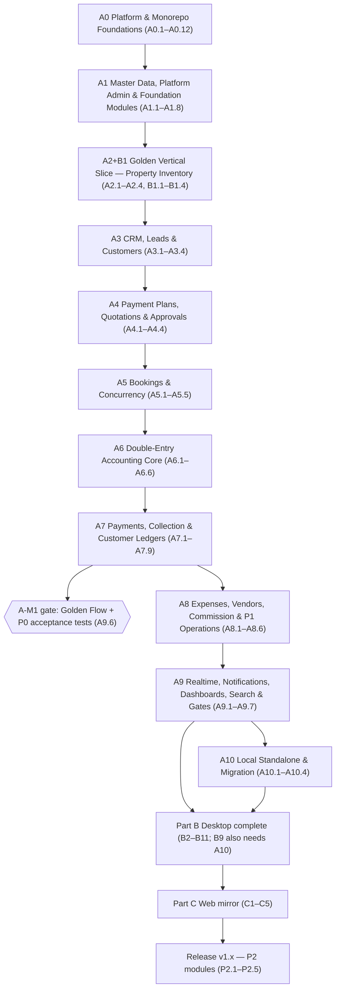

# task.md — ExzaEstate Ordered Implementation Task Checklist (v6 Execution Format)

> **Precedence:** `AGENTS.md` (defines the chain) → `security.md` > `architecture.md` > `prd.md` > `accounting-rules.md` > `permissions-matrix.md` > `rules.md` > `design.md` > `golden-module-frontend.md` > `tech-versions.md` > `task.md`.
> Domain tie-breakers from `prd.md` §0.2 still apply: product behaviour → `prd.md`; technical choices → `architecture.md`; account codes and postings → `accounting-rules.md`; permission grid → `permissions-matrix.md`.
> **Single source of truth:** never copy rules or schemas into task cards. Reference rule IDs (`ARCH-*`, `RULE-*`, `BR-*`, `AT-*`) and sections. If a card conflicts with a higher file, **stop and flag it** (`prd.md` §0.2 "Never guess").
> **Notation used in Verify commands:** `{be}` = `pnpm --filter @exzaestate/backend` · `{shared}` = `pnpm --filter @exzaestate/shared` · `{ui}` = `pnpm --filter @exzaestate/ui` · `{features}` = `pnpm --filter @exzaestate/features` · `{desktop}` = `pnpm --filter @exzaestate/desktop` · `{web}` = `pnpm --filter @exzaestate/web` · `{api}` = `pnpm --filter @exzaestate/api-client`. (Package names are `@exzaestate/<folder>`, `architecture.md` §0.2.)

---

## 1. Ground Rules for AI Agents

1. **One task per session, steps in order.** A session executes exactly **one task card** (`A0.5`, not `A0.5 + A0.6`), step by step `S1 → Sn`. A task of Size L/XL may be split across sessions **only at a step boundary**: stop after a fully verified step, log `S<n> done`, and resume at `S<n+1>` in a new session. Never start a second task in the same session.
2. **Next task = lowest-numbered unchecked task whose `Depends:` tasks are all `[x]`.** `Depends:` is the only dependency declaration (there is no separate `Blocks:` field, to avoid drift).
3. **Start of session:**
   - Read `AGENTS.md`, `agent/PROGRESS.md` and the target task card.
   - Load **only** the files/sections listed under the task's `Reads:`.
   - Confirm every `Depends:` task is `[x]` in `agent/PROGRESS.md`; confirm `git status` is clean.
   - If the card has a 🔒 gate (see §4), confirm the owner sign-off is recorded before writing code.
4. **Tiers (decide how strict the test discipline is):**
   - **Tier 1** — security, tenancy, money, accounting, state machines, concurrency, idempotency. **Write the failing test first**, then implement.
   - **Tier 2** — other backend and shared-library work. Tests ship in the same commit.
   - **Tier 3** — frontend and presentation work. Component tests plus the DoD-UI checks.
5. **Sizes:** S = 1–2 steps · M = 3 · L = 4–5 · XL = 5+ (expect more than one session).
6. **Stay inside `Touches:`.** Edit only the paths declared. If another file must change, stop and flag it in the log (do not edit it silently). Adding a **provisioning step** or **demo-seed step** for the task's own entities is always allowed (see rule 8) and is listed in `Touches:` of those tasks.
7. **Seed discipline (replaces the old "one big seed task").** Every task that introduces a tenant entity with default data registers a `ProvisioningStep` (A0.10), and every task that introduces user-visible business data registers a `DemoSeedStep`, in the same task. `pnpm db:seed:demo` must stay runnable after every task (no frontend mock arrays, `ARCH-SEED`).
8. **Mandatory pre-completion verification.** Run every step's `Verify:` and the task's DoD checks. A task is complete only when all pass with zero errors. Never mark `[x]` on a skipped or failing check.
9. **Commit convention:** `<type>(<scope>): <TaskID> 
`, e.g. `feat(infra): A0.1 setup monorepo foundation`. One commit per completed task; if a task is split over sessions, one commit per completed step with `<TaskID>.S<n>`.
10. **Log in `agent/PROGRESS.md`** before ending the turn — append exactly five lines (the earlier "Specification Alignment" entry stays as is):
    1. Task ID & status (`[x]` / `S<n> done` / blocked)
    2. Files created / modified
    3. Verification command & result
    4. Open questions (if any — also add to §4.2 below if they affect the spec)
    5. Next task ID
11. **Stop-and-halt.** Report completion to the user and wait for approval before starting the next task.
12. **Never invent.** Missing accounting mapping, missing permission, missing error code, unclear rule → stop and ask (`RULE-POSTING`, `prd.md` §0.2). New error codes need a row in `architecture.md` §6 first.

---

## 2. Definitions of Done (DoD)

- **DoD-BE (backend):** TypeScript strict (zero `any`, `.js` ESM extensions) · unit tests passing · tenant-isolation test registered for every new tenant table (`ARCH-TENANCY`) · RLS policy shipped in the same migration as the table · every route has `@RequirePermission` + declared scope/idempotency/rate-limit class · Swagger decorators complete (`@ApiOkEnvelope`/`@ApiPaginatedResponse`) · `{be}` lint/typecheck clean · `AuditService` and `OutboxService` called on every mutation, in the caller's transaction (`RULE-ATOMIC`) · Bruno request added under `bruno/` · `pnpm gen:api` diff-free **(applies from A2.3 onward, when the script exists)**.
- **DoD-UI (frontend):** only `@exzaestate/ui` tokens/components (no arbitrary Tailwind classes, no feature-local badges) · all **6 screen states** built (loading, empty, filtered-empty, error, offline, no-permission) · WCAG contrast passing · formatters from `@exzaestate/shared` only · permission-gated actions · no hardcoded mock data (real API + `pnpm db:seed:demo`) · all strings through `t()` · component tests passing.
- **DoD-LIB (shared packages):** fully typed API · unit + property-based tests with edge cases · zero I/O · `tsup` ESM build clean (for `@exzaestate/shared`).
- **DoD-OPS (infrastructure / release):** reproducible from a clean clone · documented in `README.md`/`.env.example` · no secret in the repo (secret scan clean) · CI green.

---

## 3. Delivery Roadmap (`ARCH-PHASES`, `prd.md` §1.2)

**Ordering changes versus v5 (and why):**

- **Accounting core is now A6 and Payments are A7.** Payment posting calls `PostingService.post('PAYMENT_POSTED', …)`, so the posting engine, periods and journal engine must exist first. (v5 had them the other way round, which made A6.1 impossible to complete.)
- **A3.4 "Customer Statement" moved to A7.5** — a statement must equal the AR ledger (`BR-15`), which does not exist before A6/A7.
- **A0.10 provisioning is a registry**: later phases add their own default data (COA, posting rules, periods, approval rules, land factors) as `ProvisioningStep`s, because those tables do not exist at A0.10.
- **New tasks** close gaps found in the spec audit: CI/CD (A0.11), security hardening (A0.12), platform admin + licensing (A1.5), documents (A1.6), audit query (A1.7), notifications core (A1.8), reservation expiry (A5.5), go-live migration (A7.9), overdue job (A7.8), budgets (A8.4), booking transfer (A8.5), profitability (A8.6), global search (A9.4), CSV import (A9.5), Golden Flow gate (A9.6), Desktop Local launcher (B9), Desktop licensing (B10), pre-launch gate (C5), P2 cards.
- **Milestones:** **A-M1 (P0)** closes at A9.6 (Golden Flow via Bruno + all P0 `AT-*` green). **A-M2 (P1)** closes at A9.7 together with all P1 `AT-*` (`prd.md` §1.2).
- **Part B vs Part A.** `prd.md` §1.1 says Part A is finished before Part B; `architecture.md` §0.1/D-04 inserts the golden vertical slice (A2+B1) first. This file follows `architecture.md` for B1 only; B2+ start after the Part A P0/P1 gates (A9.7) as in `prd.md`; only B9 (Local launcher) additionally needs A10. Owner confirmation is recorded in §4.1 (D-04).

---

## 4. Pre-Start Sign-offs and Open Questions

### 4.1 `architecture.md` §24 decisions that gate tasks (🔒)

These are applied as defaults in `architecture.md` v4 but are still **"Needs sign-off"**. At the start of a gated task the agent asks the owner **once**, records the answer in `agent/PROGRESS.md`, and only then proceeds. If the owner says "use the default", proceed with the v4 choice.

| ID                 | Decision (default)                                              | Gated tasks |
| ------------------ | --------------------------------------------------------------- | ----------- |
| D-04               | Vertical slices (golden module first)                           | A2.1        |
| D-05               | NestJS Express adapter                                          | A0.3        |
| D-06               | `packages/app-core` separate from `ui`                          | A0.1        |
| D-07               | Idempotency row inserted inside the business transaction        | A0.6        |
| D-08               | `APPROVAL_REQUIRED` = HTTP 409                                  | A4.4        |
| D-09               | Separate system realm for Super Admin                           | A0.5, A1.5  |
| D-10               | App-level encryption + blind index for NID/bank no.             | A0.12, A3.3 |
| D-11               | Monthly partitions for audit/outbox/notification logs           | A0.6        |
| D-12               | Local→Cloud import via chunked load into `IMPORTING` tenant     | A10.4       |
| D-13               | Additive-only `/v1`, `X-Client-Version`, 426                    | A2.3, A9.7  |
| D-14               | Module `events/` renamed `realtime/`                            | A9.1        |
| D-15               | License transfer limit 2/yr, fingerprint ≥ 2 of 3               | A1.5, B8    |
| D-01 / D-02 / D-03 | Bundled PostgreSQL 18 / bundled Chromium / Node-runtime sidecar | A10.1, B7   |

### 4.2 Spec conflicts found in the audit (resolved here; the owner should fix the source files)

| ID    | Conflict                                                                                                                                                                                                            | How this file resolves it                                                                                                                                                                                                                       | Source file to correct                    |
| ----- | ------------------------------------------------------------------------------------------------------------------------------------------------------------------------------------------------------------------- | ----------------------------------------------------------------------------------------------------------------------------------------------------------------------------------------------------------------------------------------------- | ----------------------------------------- |
| OQ-01 | `rules.md` (§1.1, §2.1) imports `defineConfig` from `@prisma/config`; the Prisma 7 documentation imports it from **`prisma/config`**.                                                                               | Cards use `prisma/config`.                                                                                                                                                                                                                      | `rules.md`                                |
| OQ-02 | Lockout key: `architecture.md` §4.1 and `security.md` §15 say `lockout:{email}`; `architecture.md` §4.5 says the counter is keyed by email **and** IP (an email-only counter lets an attacker lock any victim out). | Follow §4.5 (stricter): counter per `(email, ip)` plus a per-IP throttle; `lockout:{email}` is kept only as the aggregate lock flag used by progressive lockout (A0.12).                                                                        | `architecture.md` §4.1, `security.md` §15 |
| OQ-03 | Licence grace: `prd.md` `license_grace_days` = 15; `architecture.md` §12.8 says 7 days (connected mode).                                                                                                            | `prd.md` wins (`prd.md` §0.2): configurable, default 15.                                                                                                                                                                                        | `architecture.md` §12.8                   |
| OQ-04 | `sales → collection` is the only L4 edge, yet AT-12 requires booking confirmation **in the same transaction** as the booking-money payment posting.                                                                 | `collection` exposes an in-transaction `PaymentPostedHook` registry; `sales` registers its handler (dependency inversion, same pattern as `ApprovalHandler`, `ARCH-APPROVALS`). No import from `collection` into `sales`. **Owner to confirm.** | `architecture.md` §7.2                    |
| OQ-05 | `architecture.md`/`accounting-rules.md` cite old PRD numbers (`prd.md` §6.10.1, §6.4, §6.9, §6.14, §12, §13). Booking states are now `prd.md` §9.1, configuration §17, acceptance tests §19.                        | Cards cite the **current** section numbers.                                                                                                                                                                                                     | `architecture.md`, `accounting-rules.md`  |
| OQ-06 | AT-04b (`prd.md`) says `ON_HANDOVER` payments go to _Customer Advances_; `accounting-rules.md` §3.1 credits _Unearned Sales Revenue (2600)_ and keeps the receivable.                                               | `accounting-rules.md` wins for postings (`prd.md` §0.2); the AT-04b test asserts the 2600 behaviour. **Accountant sign-off needed.**                                                                                                            | `prd.md` AT-04b                           |
| OQ-07 | `security.md` §15 requires CAPTCHA after the first lock but names no provider.                                                                                                                                      | `CaptchaVerifier` port, Cloudflare Turnstile adapter as default. **Owner to confirm.**                                                                                                                                                          | `security.md`                             |
| OQ-08 | `prd.md` §5 says "5 core roles including Super Admin", but Super Admin lives in the system realm (`ARCH-SYSTEM-SCOPE`), not in a tenant.                                                                            | Tenant provisioning creates **4 tenant roles** (MD, GM, Accountant, Executive); Super Admin is a system-realm identity (A1.5).                                                                                                                  | `prd.md` §5, `permissions-matrix.md`      |

---

## 5. Phase A0 — Monorepo, Shared Packages & Core Platform

### A0.1 — Monorepo & Tooling Foundation

- **Status:** [ ] · **Tier:** 2 · **Size:** M (3 steps) · **Priority:** P0
- **Depends:** None
- **Goal:** Initialise Turborepo + pnpm workspaces, the directory structure, strict TypeScript base configs, oxlint, prettier, Git hooks and architecture-boundary rules.
- **Reads:** `architecture.md` §0.2, §1.1, §1.2, §7.2, §13; `rules.md` §1, §5, §10, §11; `tech-versions.md` §1–§3.
- **Touches:** `package.json`, `pnpm-workspace.yaml`, `turbo.json`, `.prettierrc`, `.editorconfig`, `.nvmrc`, `.gitignore`, `.husky/**`, `packages/config/**`, and skeleton `package.json` + `tsconfig.json` in every `apps/*` and `packages/*`.
- **Contract:**
  - Apps: `apps/backend`, `apps/desktop`, `apps/web`. Packages: `packages/shared`, `api-client`, `ui`, `app-core`, `features`, `config`. Package names `@exzaestate/<folder>`.
  - Root scripts: `build`, `lint`, `format`, `typecheck`, `test`. `packageManager: pnpm@12.8.2`, `.nvmrc` = `24.21.0`, `engines.node >= 24.0.0` (`tech-versions.md`).
  - `packages/config`: `tsconfig.base.json` (`strict`, `noUncheckedIndexedAccess`, `module/moduleResolution: NodeNext`), `oxlint.json`, `.dependency-cruiser.cjs` encoding the layer rules of `architecture.md` §7.2 and the ports rule (modules never import `adapters/`), and a `madge` circular-dependency check.
  - Only `packages/shared` is built (tsup); other packages are consumed as TS source (`architecture.md` §0.2).
- **Steps:**
  - **S1:** Root `package.json`, `pnpm-workspace.yaml`, `turbo.json` (`build` depends on `^build`), Husky pre-commit (lint-staged, format). Verify: `pnpm -v && pnpm install --frozen-lockfile=false`.
  - **S2:** `packages/config` (tsconfig base, oxlint, dependency-cruiser rules, madge script). Verify: `pnpm lint`.
  - **S3:** Skeleton `package.json` + `tsconfig.json` for every app/package (including `packages/app-core`). Verify: `pnpm typecheck && pnpm build`.
- **Acceptance:** `pnpm install` succeeds across all workspaces with no peer/dependency warnings; `pnpm lint`, `pnpm typecheck`, `pnpm build` run clean; a deliberate circular import and a deliberate `modules/* → adapters/*` import both fail the boundary check.
- **Traps:** forgetting `packages/app-core`; missing NodeNext `.js` extension settings; creating a Tailwind v3 `tailwind.config.js` (`tech-versions.md` §2.6); using floating dependency versions for build tools.
- **Done:** DoD-OPS.

---

### A0.2 — Shared Package: Constants, Types, Money, Localisation

- **Status:** [ ] · **Tier:** 1 · **Size:** L (4 steps) · **Priority:** P0
- **Depends:** A0.1
- **Goal:** Build `@exzaestate/shared`: immutable constants, error codes, domain events, the BigInt-paisa `Money` engine and Bangladeshi formatters.
- **Reads:** `architecture.md` §1.1, §6 (error-code table), §9.1, §11 (business dates), §12.1; `accounting-rules.md` §5; `permissions-matrix.md` §1, §3; `prd.md` §10; `design.md` §3.1.
- **Touches:** `packages/shared/**`.
- **Contract:**
  - Exports: `PERMISSIONS` (every permission in `permissions-matrix.md` §1/§3), `ERROR_CODES` (exactly the table in `architecture.md` §6), `DOMAIN_EVENTS`, `BOOKING_STATUSES`, `ACTIVE_BOOKING_STATUSES` (the six active statuses of `prd.md` §9.1), `PROPERTY_STATUSES` (`Available, Hold, Reserved, Booked, Sold, Blocked`), `PAYMENT_STATUSES`, `APPROVAL_STATUSES`, `MANDATORY_2FA_PERMISSIONS` (list in `architecture.md` §4.1).
  - `Money`: `add`, `subtract`, `multiplyByRate`, `allocate`, `fromPaisa`, `toPaisa`, `fromApi`. BigInt paisa only. **Rounding: round half away from zero** (−0.5 → −1), applied once at the end of a calculation (`ARCH-MONEY`). (v5 said "banker's rounding away from zero", which is contradictory — banker's rounding is half-to-even and is **not** used.)
  - `allocate`: largest-remainder; the integer quotient goes to each part and the remainder is handed out one paisa at a time to the earliest parts.
  - `formatMoney` (`৳5,00,000.00`, lakh/crore, English digits), `formatNumber`, `formatArea`, `formatDate(date, 'Asia/Dhaka')` (business dates are `YYYY-MM-DD` and never pass through UTC, `architecture.md` §11), `t()` + `i18n/en.json`.
  - Build output: ESM bundle via `tsup` (`dist/index.js` + `dist/index.d.ts`).
- **Steps:**
  - **S1 Enums & constants:** `permissions.ts`, `error-codes.ts`, `events.ts`, `statuses.ts`. Verify: `{shared} build`.
  - **S2 Money engine** (failing tests first, incl. property-based tests with `fast-check`): Verify: `{shared} test money`.
  - **S3 Formatters & i18n:** Verify: `{shared} test format`.
  - **S4 Packaging:** tsup config, `exports` map. Verify: `{shared} build && {shared} test`.
- **Acceptance:**
  - `Money.allocate(10000000n, [1,1,1])` returns `[3333334n, 3333333n, 3333333n]` — i.e. ৳33,333.34 + ৳33,333.33 + ৳33,333.33 (**AT-23**); property test: parts always sum to the whole for random inputs.
  - `formatMoney(50000000n)` returns `৳5,00,000.00` (**AT-19**); rounding of −0.5 paisa → −1 paisa.
  - Every permission string in `permissions-matrix.md` exists as a constant; a test fails if one is missing.
- **Traps:** floating-point division; missing remainder distribution; missing `en-BD` grouping; formatting dates via `Date` in the server timezone.
- **Done:** DoD-LIB.

---

### A0.3 — Backend Foundations: NestJS 12 ESM, Config, Envelope

- **Status:** [ ] · **Tier:** 2 · **Size:** M (3 steps) · **Priority:** P0 · 🔒 D-05
- **Depends:** A0.1, A0.2
- **Goal:** `apps/backend` on NestJS 12 (pure ESM, Express adapter) with Zod-validated config, structured Pino logging, the API response envelope and production-safe Swagger.
- **Reads:** `architecture.md` §1.1, §6, §6.2, §7, §17; `security.md` §4, §7; `rules.md` §2.
- **Touches:** `apps/backend/**`, `.env.example`.
- **Contract:**
  - All relative imports carry `.js`. Envelope `{ success, data, meta }` / `{ success:false, error:{ code, message, details } }`. `HttpExceptionFilter` implements exactly the table in `architecture.md` §6.
  - Zod env schema refuses to boot on missing variables (port, `DATABASE_URL`, `REDIS_URL`, JWT secrets, `RUNTIME_MODE`, storage). `.env.example` documents every variable.
  - Pino JSON log line per request (`requestId, companyId, userId, route, status, durationMs`) with redaction of `authorization`, cookies, passwords, tokens; `X-Request-Id` header returned and included in error `details`.
  - BigInt → string serializer; Helmet; Swagger at `/api/docs` **disabled or auth-gated when `NODE_ENV=production`** (`security.md` §16); no stack traces in production responses.
  - `GET /api/v1/health` returns `{ status: "ok" }` (DB/Redis/storage checks are added in A0.12).
- **Steps:**
  - **S1 ESM bootstrap:** NestJS 12, `"type": "module"`, NodeNext, Pino, Helmet, request-id. Verify: `{be} build`.
  - **S2 Zod ConfigService + `.env.example`:** Verify: `{be} test config`.
  - **S3 Envelope, filters, serializer, Swagger gating:** Verify: `{be} test envelope`.
- **Acceptance:** `GET /api/v1/health` → 200 `{ success:true, data:{ status:"ok" } }`; throwing `VALIDATION_ERROR` → 400 with that code; a BigInt in a response is serialised as a string; app refuses to start when `DATABASE_URL` is missing; `/api/docs` is not reachable anonymously with `NODE_ENV=production`.
- **Traps:** missing `.js` in imports (runtime ESM crash); raw BigInt in JSON; logging secrets.
- **Done:** DoD-BE.

---

### A0.4 — Database: Docker Compose & Prisma 7 Multi-File Schema

- **Status:** [ ] · **Tier:** 2 · **Size:** M (3 steps) · **Priority:** P0
- **Depends:** A0.1, A0.3
- **Goal:** Local PostgreSQL 18, Redis 8, **MinIO and Mailpit** in Docker; Prisma 7 with multi-file schema, `prisma.config.ts` and the `@prisma/adapter-pg` driver adapter.
- **Reads:** `architecture.md` §0.2, §1.1, §7, §11, §17; `rules.md` §1.1, §2.1; `tech-versions.md` §1–§2.
- **Touches:** `docker-compose.yml`, `.env.example`, `apps/backend/prisma.config.ts`, `apps/backend/prisma/schema/**`, `apps/backend/src/database/**`.
- **Contract:**
  - `docker-compose.yml`: `postgres:18.6-alpine`, `redis:8-alpine`, MinIO (S3), Mailpit (SMTP) — all required by `architecture.md` §0.2/§17 and by A0.6 S5, A0.12.
  - Schemas in `apps/backend/prisma/schema/*.prisma`; `base.prisma` holds generator + datasource **provider only** (zero connection strings).
  - `prisma.config.ts`: `import { defineConfig, env } from "prisma/config"` (**not** `@prisma/config` — OQ-01); datasource URL, migrations path and seed command are set here, using the migrator URL.
  - Runtime client built with `@prisma/adapter-pg` and a `pg.Pool` (app-role URL).
- **Steps:**
  - **S1 Docker Compose:** Verify: `docker compose up -d && docker compose ps`.
  - **S2 Prisma 7 config:** Verify: `{be} exec prisma validate`.
  - **S3 `PrismaService`/database module:** Verify: `{be} test db-connection`.
- **Acceptance:** `prisma validate` passes on the multi-file directory; `PrismaService` runs `SELECT 1` against the PostgreSQL 18 container; MinIO console and Mailpit UI are reachable locally.
- **Traps:** datasource URL inside a `.prisma` file; legacy `$use` middleware (use Client Extensions); migrations running on app boot (Cloud runs them as an explicit deploy step, `architecture.md` §17).
- **Done:** DoD-BE.

---

### A0.5 — Multi-Tenancy: RLS, DB Roles, TenantPrisma, SystemPrisma

- **Status:** [ ] · **Tier:** 1 · **Size:** L (5 steps) · **Priority:** P0 · 🔒 D-09
- **Depends:** A0.4
- **Goal:** Database-level tenant isolation with PostgreSQL RLS, dedicated roles, the `TenantPrisma` extension, `tenantDb.transaction`, a guarded `SystemPrisma`, and the RLS-coverage test.
- **Reads:** `architecture.md` §5.1–§5.6, §10 (RULE-ATOMIC), §22.4; `security.md` §3; `rules.md` §1.1, §2.
- **Touches:** `apps/backend/src/database/**`, `apps/backend/src/common/context/**`, `apps/backend/prisma/migrations/**`, `apps/backend/test/tenant-isolation/**`.
- **Contract:**
  - Roles: `exza_migrator` (owner/DDL), `exza_app` (`NOBYPASSRLS`, DML only, **no DELETE** on financial tables), `exza_worker` (`NOBYPASSRLS`; its extra outbox policy is added in A0.6), `exza_system` (cross-tenant platform operations, used only by `SystemPrisma`).
  - Every tenant table: `ENABLE` + `FORCE ROW LEVEL SECURITY`; policy `USING/WITH CHECK (company_id = nullif(current_setting('app.current_company_id', true), '')::uuid)`. Unset variable fails closed (0 rows, no error).
  - `tenantDb.transaction(async tx => …)` runs `set_config('app.current_company_id', companyId, true)` (transaction-local). Raw `prisma.$transaction` on tenant data is forbidden (`RULE-ATOMIC`).
  - `SystemPrisma` carries a mandatory `// SYSTEM-SCOPE: <reason>` marker and audit hook; it is never reachable from the public route prefix.
  - `GLOBAL_TABLES` constant for non-tenant reference data (`ARCH-GLOBAL-DATA`); the RLS-coverage test fails for any table that has neither `company_id` nor an entry in `GLOBAL_TABLES`, and also asserts RLS is forced and (later) immutability triggers/grants exist.
- **Steps:**
  - **S1 Migration & roles:** roles, grants, a test tenant table with forced RLS. Verify: `{be} exec prisma migrate deploy`.
  - **S2 CLS context & `TenantPrisma` extension.** Verify: `{be} test tenant-context`.
  - **S3 `tenantDb.transaction` wrapper.** Verify: `{be} test tenant-transaction`.
  - **S4 `SystemPrisma` + `GLOBAL_TABLES`.** Verify: `{be} test system-prisma`.
  - **S5 Isolation suite + RLS-coverage test** (Tenant B can never read/write Tenant A rows). Verify: `{be} test tenant-isolation`.
- **Acceptance:**
  - With the variable unset, `SELECT * FROM tenant_table` returns 0 rows. Inside `transaction(companyA)`, inserting a row with `company_id = companyB` is rejected by `WITH CHECK`.
  - Adding a tenant table without RLS (or a non-global table without `company_id`) fails the coverage test.
- **Traps:** session-level `SET` instead of transaction-local `set_config(…, true)`; using the owner role at runtime (owners bypass RLS unless `FORCE` is set); forgetting `WITH CHECK`.
- **Done:** DoD-BE.

---

### A0.6 — Platform Services: Audit, Sequence, Outbox, Idempotency, Storage

- **Status:** [ ] · **Tier:** 1 · **Size:** L (5 steps) · **Priority:** P0 · 🔒 D-07, D-11
- **Depends:** A0.5
- **Goal:** Cross-cutting services that run **inside the caller's transaction**: `AuditService`, `SequenceService`, `OutboxService`, `IdempotencyService`, `StorageService`.
- **Reads:** `architecture.md` §6.1, §7.5, §8.1, §9.2, §10 (RULE-ATOMIC, RULE-IMMUTABLE), §11, §15; `security.md` §4, §5; `prd.md` §19 (AT-32).
- **Touches:** `apps/backend/src/platform/**`, `apps/backend/prisma/schema/platform.prisma`, `apps/backend/prisma/migrations/**`, `apps/backend/test/**`.
- **Contract:**
  - `AuditService.record(tx, { action, entity, entityId, before, after })` → append-only `audit_logs` (INSERT/SELECT only: UPDATE/DELETE revoked **and** blocked by trigger).
  - `SequenceService.next(tx, { type, fiscalYear, scopeKey })` — `INSERT … ON CONFLICT (company_id,type,fiscal_year,scope_key) DO UPDATE SET last_value = last_value + 1 RETURNING`.
  - `OutboxService.emit(tx, eventName, payload)` → `outbox_events`; `exza_worker` gets a dedicated read policy on this table only (`ARCH-SYSTEM-SCOPE`).
  - `IdempotencyService.begin(tx, key, hash)` / `complete(tx, response)`: unique `(companyId, userId, method, routePattern, key)`, `lock_timeout = 5s`, 24 h expiry; same key + same hash → stored response (`Idempotent-Replayed: true`); different hash → `IDEMPOTENCY_KEY_REUSED`; blocked > 5 s → `REQUEST_IN_PROGRESS`.
  - `StorageService.presignPut/presignGet` over the `ObjectStorage` port (S3/MinIO, AWS SDK v3); MIME/size checks → `FILE_REJECTED`.
  - `audit_logs`, `outbox_events`, `notification_logs` are **monthly-partitioned from the first migration** (key `created_at`, PK `(id, created_at)`); partitions are created by hand-written SQL (Prisma does not manage partitions) with a scheduled "create next partitions" routine and a default partition.
- **Steps:**
  - **S1 Platform schemas & partitioned tables (raw SQL migration).** Verify: `{be} exec prisma migrate deploy`.
  - **S2 Audit + Outbox services.** Verify: `{be} test audit-outbox`.
  - **S3 Gapless sequence service** with concurrency test. Verify: `{be} test sequence`.
  - **S4 Idempotency service.** Verify: `{be} test idempotency`.
  - **S5 Storage service (MinIO).** Verify: `{be} test storage`.
- **Acceptance:**
  - A rolled-back transaction burns **zero** sequence numbers and leaves **zero** audit rows and outbox events (`RULE-ATOMIC`).
  - 10 concurrent `next()` calls return 1…10 with no duplicates or gaps.
  - **AT-32:** forcing the audit write to fail rolls the business change back.
  - Two concurrent requests with the same idempotency key produce one business row and one stored response.
- **Traps:** writing audit/outbox/sequence outside the business transaction; relying on Redis for money idempotency; expecting Prisma Migrate to create partitions.
- **Done:** DoD-BE.

---

### A0.7 — Ports & Adapters Skeleton, Outbox Dispatcher, Worker Entrypoint

- **Status:** [ ] · **Tier:** 1 · **Size:** L (4 steps) · **Priority:** P0
- **Depends:** A0.3, A0.6
- **Goal:** The clean-architecture boundary (`src/ports/` + `src/adapters/{cloud,local}`) so the same domain code runs in Cloud and Local Standalone, plus the outbox dispatcher and `main.worker.ts`.
- **Reads:** `architecture.md` §1.1, §7, §8.1–§8.2, §17, §20.2; `security.md` §10.
- **Touches:** `apps/backend/src/ports/**`, `apps/backend/src/adapters/**`, `apps/backend/src/platform/outbox/**`, `apps/backend/src/jobs/**`, `apps/backend/src/main.worker.ts`.
- **Contract:**
  - Ports (DI tokens): `QueueDriver`, `CacheStore`, `PubSub`, `ObjectStorage`, `PdfRenderer`, `SmsProvider`, `EmailProvider`.
  - Cloud adapters: BullMQ + Redis, S3/MinIO, Chromium (worker), SMTP (Mailpit in dev), SMS stub. Local adapters: DB-polling queue, in-memory cache, in-process pub/sub, filesystem storage.
  - `RUNTIME_MODE` is read only in `config/`, `adapters/`, `main*.ts`; modules import **ports only** (dependency-cruiser enforces).
  - Outbox dispatcher runs as `exza_worker`, enqueues jobs; handlers run as `exza_app` with the event's `companyId` in context. Delivery at-least-once, per-aggregate ordering, 3 retries with exponential backoff, dead-letter view for admins, outbox-lag metric.
  - Scheduler fans out **one job per active company** (listing via `SystemPrisma`, `ARCH-SYSTEM-SCOPE`).
- **Steps:**
  - **S1 Port interfaces + tokens.** Verify: `{be} build`.
  - **S2 Cloud adapters.** Verify: `{be} test adapters-cloud`.
  - **S3 Local adapters + `AdaptersModule.forRoot(mode)`.** Verify: `{be} test adapters-contract`.
  - **S4 Outbox dispatcher + `main.worker.ts` + per-company scheduler.** Verify: `{be} test outbox-dispatcher`.
- **Acceptance:** the shared contract suite passes identically for Cloud and Local adapters; 1,000 emitted events are dispatched exactly-once-effect (idempotent handler) and in order per aggregate; a failing handler lands in the dead-letter list after 3 attempts.
- **Traps:** importing `@nestjs/bullmq` or `ioredis` in domain modules; dispatching before the emitting transaction commits.
- **Done:** DoD-BE.

---

### A0.8 — Authentication, Sessions, Invitations

- **Status:** [ ] · **Tier:** 1 · **Size:** XL (5 steps) · **Priority:** P0
- **Depends:** A0.5, A0.6, A0.7
- **Goal:** Argon2id passwords, 15-minute JWT, 30-day rotating refresh tokens with reuse detection, session revocation, pre-tenant lookups, invitations and password reset. Also creates the minimal `companies`/`branches` tables that users reference.
- **Reads:** `architecture.md` §4.1–§4.3, §4.5, §4.6, §5.4; `security.md` §1; `prd.md` §19 (AT-18).
- **Touches:** `apps/backend/src/modules/auth/**`, `apps/backend/src/common/guards/**`, `apps/backend/src/common/decorators/**`, `apps/backend/prisma/schema/auth.prisma`, `apps/backend/prisma/schema/company.prisma`.
- **Contract:**
  - Endpoints: `POST /api/v1/auth/login`, `/auth/refresh`, `/auth/logout`, `GET /auth/me`, `POST /auth/invitations/accept`, `/auth/password/forgot`, `/auth/password/reset`.
  - Passwords: `argon2id`, min 12 chars, checked against a common/breached list. Users are created by invitation (single-use, 72 h) — no public sign-up. Email globally unique; a user belongs to exactly one company.
  - **Pre-tenant lookups** use only the three `SECURITY DEFINER` functions (`auth_find_user_by_email`, `auth_find_invitation_by_token_hash`, `auth_find_reset_by_token_hash`) granted to `exza_app`; after lookup the CLS tenant context is set from the returned `companyId` (`ARCH-AUTH-LOOKUP`). `company_id` from the client is never trusted.
  - JWT payload: `sub`, `companyId`, `sid` only. Refresh token: opaque 256-bit, stored SHA-256-hashed with `familyId`; reuse of a rotated token revokes the family and audits `REFRESH_TOKEN_REUSE`.
  - Delivery per client via `X-Client: web|desktop` (cookie vs body). Cookie endpoints also require `X-Client: web` and a matching `Origin` (CSRF); CORS allow-list per `architecture.md` §4.3, no `*` in production.
  - Revoked sessions: `sessions.revokedAt` + Redis `session-revoked:{companyId}:{sid}` (TTL = access-token life), Postgres fallback (never "allow by default").
  - **Lockout (OQ-02):** failure counter per `(email, ip)`, 5 failures → 15 min lock (`ACCOUNT_LOCKED`), plus per-IP and per-account throttling (`@nestjs/throttler`, Redis store) on all `/auth/*`; unknown email and wrong password give identical response and timing.
  - Local mode (`architecture.md` §4.6): initial administrator is created directly (no email); other users get temp passwords with forced change — implemented behind the same service via a `credentialDelivery` option.
- **Steps:**
  - **S1 Schemas (`users`, `sessions`, `refresh_tokens`, `invitations`, `password_resets`, minimal `companies`, `branches`) + `SECURITY DEFINER` lookups + Argon2id utility.** Verify: `{be} test password-hash`.
  - **S2 Token engine & family rotation.** Verify: `{be} test token-rotation`.
  - **S3 Login/refresh/logout/me routes, DTOs, `JwtAuthGuard`, `X-Client` delivery, CSRF/CORS.** Verify: `{be} test auth-routes`.
  - **S4 Lockout, throttling, enumeration-safe responses.** Verify: `{be} test auth-lockout`.
  - **S5 Invitations accept + password reset.** Verify: `{be} test auth-invitation`.
- **Acceptance:**
  - Using an already-rotated refresh token → 401, the whole family revoked, `REFRESH_TOKEN_REUSE` audited.
  - 5 bad passwords lock that `(email, ip)` for 15 min; unknown email returns identical timing/body.
  - **AT-18:** a user logs in (lookup before tenant known) but can never read another company's rows.
- **Traps:** plain refresh tokens in DB; roles/permissions in the JWT; locking on email alone (DoS); any tenant query before context is set.
- **Done:** DoD-BE.

---

### A0.9 — Permissions, RBAC, Data Scopes, Mandatory 2FA

- **Status:** [ ] · **Tier:** 1 · **Size:** L (4 steps) · **Priority:** P0
- **Depends:** A0.8
- **Goal:** Permission-based RBAC with scopes (`OWN/TEAM/BRANCH/ALL`), 5-minute Redis permission cache with instant invalidation, mandatory TOTP 2FA and step-up authentication.
- **Reads:** `architecture.md` §4.1, §4.4, §4.5, §5.5; `permissions-matrix.md` §1–§4; `security.md` §1, §2, §15.
- **Touches:** `apps/backend/src/modules/auth/**`, `apps/backend/src/common/guards/**`, `apps/backend/src/common/decorators/**`, `apps/backend/prisma/schema/auth.prisma`, `scripts/check-permission-decorators.mjs`.
- **Contract:**
  - Tables: `roles`, `role_permissions(scope)`, `user_roles`, `user_branches` (tenant); the **permission catalogue** is a global table (`ARCH-GLOBAL-DATA`, SELECT-only for `exza_app`).
  - `@RequirePermission(PERMISSIONS.X)`, `@RequireScope()`, `@StepUp()`; guards never check role names; raw permission strings are a lint error.
  - Cache `perm:{companyId}:{userId}` (TTL 5 min) holds `permissions[] + scopes + branchIds + teamUserIds`; deleted immediately when roles, role permissions, branches or supervisor mapping change.
  - **Mandatory 2FA** for any user holding a permission in `MANDATORY_2FA_PERMISSIONS` (`architecture.md` §4.1): otherwise `TWO_FACTOR_REQUIRED`, no grace period. TOTP secret AES-256-GCM encrypted; 10 hashed recovery codes.
  - **Step-up:** `POST /auth/step-up` with fresh TOTP sets `stepUpUntil = now + 5 min` on the session; protected endpoints return `STEP_UP_REQUIRED` otherwise (list in `security.md` §15).
  - CI script `check-permission-decorators` fails if any route lacks `@RequirePermission` or `@Public`.
- **Steps:**
  - **S1 Permission schema, global catalogue, cache resolver.** Verify: `{be} test permission-cache`.
  - **S2 `PermissionsGuard` + scope resolution + decorator-coverage script.** Verify: `{be} test permissions-guard`.
  - **S3 TOTP enrolment, recovery codes, `TWO_FACTOR_REQUIRED`.** Verify: `{be} test 2fa-enrollment`.
  - **S4 Step-up auth.** Verify: `{be} test step-up`.
- **Acceptance (maps to `permissions-matrix.md` §4):** an Accountant without 2FA hitting a `journal:post` endpoint gets `TWO_FACTOR_REQUIRED`; changing a user's role takes effect on the **very next** request (cache key deleted); scope fixtures return the correct row set for OWN/TEAM/BRANCH/ALL; the decorator-coverage script fails on an undecorated route.
- **Traps:** role-name checks; permission arrays in the JWT; caching without invalidation hooks; letting a user hold a step-up permission without 2FA.
- **Done:** DoD-BE.

---

### A0.10 — Tenant Provisioning Registry & Baseline Seed

- **Status:** [ ] · **Tier:** 1 · **Size:** L (4 steps) · **Priority:** P0
- **Depends:** A0.5, A0.6, A0.8, A0.9
- **Goal:** One idempotent `TenantProvisioningService` — a **registry of `ProvisioningStep`s** — used identically by `pnpm db:seed`, `modules/system-admin` onboarding and the Local first-launch wizard. A0.10 delivers the registry and only the steps whose tables exist now; later tasks add their own steps.
- **Reads:** `architecture.md` §17 (tenant onboarding, `ARCH-SEED`), §5.6; `prd.md` §5.1, §5.6, FLOW-01, FLOW-02; `permissions-matrix.md` §3; `accounting-rules.md` §1 (for later steps only).
- **Touches:** `apps/backend/src/platform/tenant-provisioning/**`, `apps/backend/prisma/seed.ts`, `apps/backend/prisma/seed.demo.ts`, `apps/backend/prisma.config.ts` (seed command), `apps/backend/test/factories/**`.
- **Contract:**
  - `provisionCompany(dto)` runs all registered steps **in one transaction**, in declared order; any failing step rolls everything back.
  - Steps provided **now**: Company + Main Branch; the **4 tenant roles** (Managing Director, General Manager, Accountant, Executive) with `role_permissions` from `permissions-matrix.md` §3 (**Super Admin is a system-realm identity, not a tenant role** — OQ-08); initial Managing Director user (Cloud: invitation; Local: direct credentials).
  - Steps registered **later** (each in its own task): settings + numbering + departments (A1.1), land unit factors (A1.3), approval rules (A4.4), chart of accounts (A6.1), fiscal year + 12 periods (A6.2), posting rules (A6.4).
  - `DemoSeedStep` registry for `pnpm db:seed:demo`: Bangla-named fixtures (`architecture.md` §11), helpers in `test/factories`; each domain task adds its step. Demo seed must never use hardcoded IDs (UUIDv7 generated).
  - `pnpm db:seed` = baseline (clean CI/production); `pnpm db:seed:demo` = baseline + demo data.
- **Steps:**
  - **S1 Registry + `provisionCompany` (company, branch, roles, MD user/invitation).** Verify: `{be} test provisioning`.
  - **S2 Baseline seed script.** Verify: `{be} exec prisma db seed`.
  - **S3 Demo-seed registry + Bangla fixtures + factories.** Verify: `pnpm db:seed:demo`.
  - **S4 Idempotency & rollback tests.** Verify: `{be} test seed-idempotency`.
- **Acceptance:**
  - Provisioning the same company twice produces no duplicate roles/branches/users.
  - A deliberately failing step rolls the whole provisioning back (no partial company).
  - The seeded MD can authenticate (Local credentials, or invitation token valid in Cloud mode).
  - `pnpm db:seed:demo` succeeds on a fresh database with zero validation errors (journal/booking assertions are added by A6.x/A7.x as their steps register).
- **Traps:** a second provisioning script for the API vs the seed; seeding tables that do not exist yet; hardcoded IDs.
- **Done:** DoD-BE.

---

### A0.11 — CI/CD, Docker Images & Quality Gates

- **Status:** [ ] · **Tier:** 2 · **Size:** M (3 steps) · **Priority:** P0
- **Depends:** A0.3, A0.4
- **Goal:** The PR gate and deploy scaffolding that `DoD-*` and `security.md` §9/§16 assume.
- **Reads:** `architecture.md` §13, §16, §17, §23; `security.md` §7, §9, §16; `rules.md` §5, §6, §11, §12.
- **Touches:** `.github/workflows/**`, `docker/**`, `scripts/**`, `.husky/**`, `renovate.json` (or `.github/dependabot.yml`).
- **Contract:**
  - `ci.yml`: install → lint → typecheck → test → build → boundary checks (dependency-cruiser, madge) → `check-gen-api` (no-op with a notice until `pnpm gen:api` exists, mandatory from A2.3) → dependency audit → secret scan (gitleaks).
  - `scripts/check-*`: no raw `prisma.$transaction` on tenant data; no raw permission strings; no `mocks/` imports in production code; RLS-coverage runner; permission-decorator coverage; (later) `ACTIVE_BOOKING_STATUSES` vs DB index.
  - `docker/Dockerfile` multi-stage with targets `api` (slim) and `worker` (adds Chromium + fonts). Deploy workflows are stubs (`deploy-*.yml`, `release-desktop.yml`) completed in B11/C3.
- **Steps:**
  - **S1 `ci.yml` + husky/lint-staged alignment.** Verify: `act` or a PR dry-run, plus `pnpm lint && pnpm typecheck && pnpm test`.
  - **S2 `scripts/check-*` + wiring.** Verify: `pnpm check:all` (fails on seeded violations).
  - **S3 Dockerfile targets + secret scanning + dependency update bot.** Verify: `docker build --target api .` and `--target worker`.
- **Acceptance:** a PR containing a fake secret fails; a circular import fails; a raw `prisma.$transaction` on a tenant model fails; both Docker targets build.
- **Traps:** secrets in workflow files; running migrations on app boot; making `worker` and `api` different code bases.
- **Done:** DoD-OPS.

---

### A0.12 — Security Hardening & Observability

- **Status:** [ ] · **Tier:** 1 · **Size:** L (4 steps) · **Priority:** P0 · 🔒 D-10
- **Depends:** A0.9, A0.11
- **Goal:** The controls `security.md` §15 promises an "owner task" for, plus logging/health/metrics.
- **Reads:** `security.md` §1, §6, §11, §15; `architecture.md` §4.5, §14, §17; `permissions-matrix.md` §4.
- **Touches:** `apps/backend/src/modules/auth/**`, `apps/backend/src/platform/security/**`, `apps/backend/src/modules/health/**`, `apps/backend/prisma/schema/security.prisma`.
- **Contract:**
  - **Sessions:** `GET /auth/sessions`, `DELETE /auth/sessions/:id`, `POST /auth/logout-all`; new-device email alert (`EmailProvider`).
  - **Progressive lockout:** 3 lockouts in 24 h → unlock requires email link + TOTP; CAPTCHA after the first lock via a `CaptchaVerifier` port (Turnstile adapter default — OQ-07).
  - **`FieldCrypto`:** AES-256-GCM, key id stored beside ciphertext (rotation), keys from the secrets manager; blind index for equality search; encrypted columns never used in `LIKE`.
  - **`security_events`** (insert-only, separate from `audit_logs`): logins ok/fail, lockouts, 2FA changes, `FORBIDDEN`, approval decisions, status overrides, reversals, `REFRESH_TOKEN_REUSE`; shipping interface to central append-only storage.
  - **Observability:** Sentry (backend + frontends), OpenTelemetry traces/metrics, `GET /api/v1/health` checking DB + Redis + storage, minimum alerts of `architecture.md` §17 (outbox lag, dead-letter, 5xx, backup failure, token-reuse spikes).
- **Steps:**
  - **S1 Session list/revoke/logout-all + new-device alert.** Verify: `{be} test sessions`.
  - **S2 Progressive lockout + CAPTCHA port.** Verify: `{be} test auth-progressive-lockout`.
  - **S3 `FieldCrypto` + `security_events`.** Verify: `{be} test field-crypto security-events`.
  - **S4 Sentry/OTel/health.** Verify: `{be} test health`.
- **Acceptance:** after 3 lockouts in 24 h a plain password attempt can no longer unlock; ciphertext rotates to a new key id without data loss; every `FORBIDDEN` writes a `security_events` row; health fails when Redis is down.
- **Traps:** storing keys in the repo/DB; searching encrypted columns with `LIKE`; mixing `security_events` into `audit_logs`.
- **Done:** DoD-BE.

---

## 6. Phases A1–A5 — Foundation Modules, Golden Slice, CRM, Sales

> Card shorthand: every card has a `Status` checkbox (`[ ]` → `[x]` only after verification and the PROGRESS log). Backend cards follow `architecture.md` §7.1 (module shape: `dto/`, controller, service, `domain/` pure functions, `*.module.ts`, `*.events.ts`) and DoD-BE. New permissions must already exist in `packages/shared` (add them there via a flagged edit if missing — `packages/shared` is not in these cards' `Touches:` unless listed).

### Phase A1 — Master Data, Platform Admin & Foundation Modules

#### A1.1 — Company, Branch, Department, Settings & Numbering

- **Status:** [x] · **Tier:** 2 · **Size:** L (4 steps) · **Priority:** P0
- **Depends:** A0.9, A0.10
- **Reads:** `prd.md` MOD-ORG, MOD-NUMBERING, FLOW-02, §17 (configuration catalogue); `architecture.md` §7, §9.2, §11; `accounting-rules.md` §2; `permissions-matrix.md` (company/branch/department/settings, `numbering`).
- **Touches:** `apps/backend/src/modules/company/**`, `apps/backend/src/modules/settings/**`, `apps/backend/prisma/schema/{company,settings}.prisma`, provisioning step, demo-seed step.
- **Steps:**
  - **S1** Company profile, branches, departments CRUD (soft-delete master data; branch scope via `user_branches`). Verify: `{be} test company`.
  - **S2** Typed **settings catalogue** — every key/default of `prd.md` §17, Zod-validated, audited on change, never hard-coded (`BR-09`); changes to sensitive keys (approval matrix, revenue recognition) need `settings:manage` + step-up. Verify: `{be} test settings`.
  - **S3** Numbering controls on top of `SequenceService`: pattern tokens (`PREFIX/BRANCH/PROJECT/YEAR/SEQUENCE`), reset rule (never/yearly/fiscal-yearly), preview endpoint. Verify: `{be} test numbering`.
  - **S4** Setup-checklist endpoint (FLOW-02 progress) + provisioning step for default settings/numbering/departments. Verify: `{be} test setup-checklist provisioning`.
- **Acceptance:** `RCPT-DHK-2026-000001` renders from `RCPT-{BRANCH}-{YEAR}-{SEQ:6}`; changing a setting writes `audit_logs` with before/after; defaults match `prd.md` §17 exactly.
- **Traps:** hard-coding thresholds or rates; allowing number reuse; editing patterns that already issued numbers without a new series.
- **Done:** DoD-BE.

#### A1.2 — Roles, Users, Invitations, Employees & Hierarchy

- **Status:** [ ] · **Tier:** 1 · **Size:** L (4 steps) · **Priority:** P0 (employee profile P1 fields optional)
- **Depends:** A1.1
- **Reads:** `permissions-matrix.md` §1–§4; `architecture.md` §4.4, §4.5, §4.6; `prd.md` §5, MOD-EMPLOYEE; `security.md` §2, §15.
- **Touches:** `apps/backend/src/modules/auth/**` (admin endpoints only), `apps/backend/src/modules/employee/**`, `apps/backend/prisma/schema/employee.prisma`, demo-seed step.
- **Steps:**
  - **S1** Role management: list/clone/rename, edit role permissions + scopes (**only Managing Director**, step-up), custom roles; cache invalidation on every change. Verify: `{be} test roles`.
  - **S2** User management: invite, deactivate, role/branch assignment, admin password reset and Local temp-password creation (forced change). Verify: `{be} test users`.
  - **S3** Admin 2FA reset (`user:manage` + step-up, audit-logged). Verify: `{be} test 2fa-reset`.
  - **S4** Employee profile + `supervisorId` hierarchy; resolves `teamUserIds` for `TEAM` scope and invalidates the permission cache. Verify: `{be} test employee-hierarchy`.
- **Acceptance:** **AT-09** (Executive cannot read `/ledgers`, cannot refund; Accountant can post a payment; only MD changes permissions); permission removal is effective on the next request; TEAM scope returns the supervisor subtree.
- **Traps:** role-name checks; forgetting cache invalidation on supervisor change; seat-limit enforcement is wired in A1.5.
- **Done:** DoD-BE.

#### A1.3 — Land Master & Bangladeshi Area Conversion

- **Status:** [ ] · **Tier:** 2 · **Size:** M (3 steps) · **Priority:** P0
- **Depends:** A1.1
- **Reads:** `prd.md` MOD-LAND, FLOW-04, §10, §17 (`land_unit_factors`); `architecture.md` §9.1, §11.
- **Touches:** `packages/shared/src/area.ts` (+ tests), `apps/backend/src/modules/land/**`, `apps/backend/prisma/schema/land.prisma`, provisioning step (land factors), demo-seed step.
- **Steps:**
  - **S1** Pure `convertArea(value, unit, factors)` in `@exzaestate/shared` (sq ft canonical, `Decimal(18,4)`). Verify: `{shared} test area`.
  - **S2** Land schema/CRUD (owner, deed/dag/khatian, purchase cost, documents via A1.6), RLS. Verify: `{be} test land`.
  - **S3** Factor provisioning step + per-company override. Verify: `{be} test land-factors`.
- **Acceptance:** **AT-27** — 5 Katha + 3 Decimal stores 3,600 + 1,306.8 sq ft and displays back correctly; factors are editable per company.
- **Traps:** float arithmetic; storing the entered unit instead of canonical sq ft.
- **Done:** DoD-BE + DoD-LIB.

#### A1.4 — Project & Cost Center Management

- **Status:** [ ] · **Tier:** 2 · **Size:** M (3 steps) · **Priority:** P0
- **Depends:** A1.1, A1.3
- **Reads:** `prd.md` MOD-PROJECT, FLOW-04; `architecture.md` §7, §11; `accounting-rules.md` §1 (cost centers by project).
- **Touches:** `apps/backend/src/modules/project/**`, `apps/backend/prisma/schema/project.prisma`, demo-seed step.
- **Steps:** **S1** project CRUD + land link + status. **S2** cost centers (one per project, usable by journals/expenses). **S3** project summary read endpoint (counts only; financial roll-ups come in A8.6). Verify: `{be} test project`.
- **Acceptance:** each project has a unique cost-center code per company; cross-tenant access impossible (isolation test).
- **Done:** DoD-BE.

#### A1.5 — Platform Admin: System Realm, Tenant Onboarding & Licensing (backend)

- **Status:** [ ] · **Tier:** 1 · **Size:** XL (5 steps) · **Priority:** P0 · 🔒 D-09, D-15
- **Depends:** A0.10, A0.12, A1.1
- **Reads:** `architecture.md` §5.6, §12.8, §7 (`license/`, `system-admin/`); `prd.md` MOD-PLATFORM, FLOW-01, §19 (AT-30, AT-31), BR-13, BR-20; `security.md` §17; `permissions-matrix.md` §3 (Super Admin).
- **Touches:** `apps/backend/src/modules/system-admin/**`, `apps/backend/src/modules/license/**`, `apps/backend/prisma/schema/{system,license}.prisma`, `apps/backend/src/common/guards/**`.
- **Steps:**
  - **S1** System realm: separate credential store and route prefix not exposed on the tenant API, Super Admin with mandatory 2FA, every call audit-logged with `SYSTEM-SCOPE`. Verify: `{be} test system-realm`.
  - **S2** Tenant onboarding (create via `TenantProvisioningService`), suspend/reactivate, tenant `status` checked by the guard. Verify: `{be} test tenant-onboarding`.
  - **S3** Licences: `licenses` table, plan/limits/status, **Ed25519 signing** (`kid`, private key from KMS/secret reference — never in repo), `POST /api/v1/license/verify`, activation payload (`company_id, machine_id, plan, valid_until, max_seats`). Verify: `{be} test license-signing`.
  - **S4** Enforcement: grace period (`license_grace_days`, default 15 — OQ-03) with warning flag, then **read-only mode** (reads and export allowed, writes blocked with `LICENSE_EXPIRED`); seat limit on user creation; data never deleted (`BR-20`). Verify: `{be} test license-enforcement`.
  - **S5** Licence transfer requests (limit 2/yr, audited), system health endpoint (queue depth, backup status, error rates — **no business data**). Verify: `{be} test license-transfer system-health`.
- **Acceptance:** **AT-30** Super Admin creates tenants and licences but any attempt to read tenant business rows is denied; **AT-31** expired licence → grace banner → read-only, data intact, export still works.
- **Traps:** Super Admin implemented as a tenant user; private key on the app server; writes blocked but exports blocked too.
- **Done:** DoD-BE.

#### A1.6 — Documents Module (Presigned Upload & Versioning)

- **Status:** [ ] · **Tier:** 2 · **Size:** M (3 steps) · **Priority:** P0
- **Depends:** A0.6, A1.1
- **Reads:** `architecture.md` §15; `prd.md` MOD-DOCS; `security.md` §4, §5, §6.
- **Touches:** `apps/backend/src/modules/documents/**`, `apps/backend/prisma/schema/documents.prisma`, `apps/backend/src/jobs/**` (document-expiry job registration).
- **Steps:** **S1** presigned upload/download flow, MIME/size/virus check (`FILE_REJECTED`), private storage for sensitive files. **S2** versions + per-document permissions + polymorphic attachment (`entityType/entityId`). **S3** expiry dates + nightly document-expiry job. Verify: `{be} test documents`.
- **Acceptance:** files are only reachable by short-lived presigned URLs; a new version never overwrites the old one; expired documents raise a notification (via A1.8).
- **Done:** DoD-BE.

#### A1.7 — Audit Query API & Security-Event Viewer

- **Status:** [ ] · **Tier:** 2 · **Size:** S (2 steps) · **Priority:** P0
- **Depends:** A0.6, A0.12
- **Reads:** `architecture.md` §7.5; `prd.md` MOD-AUDIT; `security.md` §11, §15.
- **Touches:** `apps/backend/src/modules/audit/**`.
- **Steps:** **S1** `GET /audit-logs` (cursor pagination, filters by actor/entity/action/date), entity history endpoint; requires `audit:view` (2FA-mandatory permission). **S2** `security_events` viewer for admins + export (`audit:export`). Verify: `{be} test audit-query`.
- **Acceptance:** read-only (no write route exists); old/new values shown; results respect scope.
- **Done:** DoD-BE.

#### A1.8 — Notification Engine Core (in-app)

- **Status:** [ ] · **Tier:** 2 · **Size:** M (3 steps) · **Priority:** P0 (SMS/email channels in A9.2)
- **Depends:** A0.7, A1.1
- **Reads:** `architecture.md` §7.4, §8; `prd.md` MOD-NOTIFY.
- **Touches:** `apps/backend/src/modules/notifications/**`, `apps/backend/prisma/schema/notifications.prisma`.
- **Steps:** **S1** notification event catalogue (global table) + templates. **S2** `NotificationService.notify(tx, event, recipients, payload)` + in-app inbox endpoints (list, mark read, preferences). **S3** outbox listener rendering templates to in-app records. Verify: `{be} test notifications`.
- **Acceptance:** an emitted domain event produces an in-app notification for the right recipients only; `notification_logs` is partitioned (A0.6).
- **Done:** DoD-BE.

---

### Phase A2 + B1 — Golden Vertical Slice: Property Inventory

#### A2.1 — Property Data Model, Hierarchy & RLS

- **Status:** [ ] · **Tier:** 1 · **Size:** M (3 steps) · **Priority:** P0 · 🔒 D-04
- **Depends:** A1.4
- **Reads:** `prd.md` MOD-PROPERTY, §9.2; `architecture.md` §5.3, §11, §18.1; `golden-module-frontend.md`.
- **Touches:** `apps/backend/prisma/schema/property.prisma`, `apps/backend/prisma/migrations/**`, `apps/backend/test/**`, demo-seed step.
- **Steps:** **S1** model Project → Block/Zone → Road/Floor → Plot/Flat/Shop/Office/Parking; fields (code, type, `area_sqft Decimal(18,4)`, facing, base price, premium, `discount_limit` %, net price, status, `owner_type`, soft delete). **S2** raw-SQL migration: RLS, partial unique `(project_id, code) WHERE deleted_at IS NULL`, indexes `(company_id, status, …)`. **S3** factories, isolation registry entry, **demo seed with 50+ units across all statuses**. Verify: `{be} test property-model`.
- **Acceptance:** tenant-isolation test registered; money columns are paisa BigInt; status enum is exactly `Available, Hold, Reserved, Booked, Sold, Blocked`.
- **Done:** DoD-BE.

#### A2.2 — Property CRUD, Pricing Breakdown & Status API

- **Status:** [ ] · **Tier:** 1 · **Size:** L (4 steps) · **Priority:** P0
- **Depends:** A2.1, A1.5
- **Reads:** `prd.md` MOD-PROPERTY, §9.1–§9.2, BR-01, BR-11; `architecture.md` §10 (RULE-PROPERTY-STATUS), §6.2; `permissions-matrix.md` (`property:*`, `property:override-status`).
- **Touches:** `apps/backend/src/modules/property/**`, demo-seed step.
- **Steps:**
  - **S1** `domain/` pure functions: price breakdown (`base + premium − discount + charges = net`) via `Money`; unit tests. Verify: `{be} test property-pricing`.
  - **S2** List/detail/create/edit with scope filtering, `parseFilter` allow-list, offset pagination, declared serving index. Verify: `{be} test property-crud`.
  - **S3** Status: `PropertyStatusService.applyBookingEvent` (reacts to booking events via listener — `property` never imports `sales`), manual `Hold`/`Blocked` actions, **override endpoint** `PATCH /properties/:id/status/override` (`property:override-status`, mandatory reason, audit `STATUS_OVERRIDE`); no generic status `PATCH`. Verify: `{be} test property-status`.
  - **S4** Status history (who/what/when/why) + Bruno requests. Verify: `{be} test property-history`.
- **Acceptance:** `PATCH /properties/:id` with a `status` field is rejected; override without reason → `VALIDATION_ERROR`; every status change is audited and in history.
- **Done:** DoD-BE.

#### A2.3 — OpenAPI Export, Generated Client & HTTP Layer

- **Status:** [ ] · **Tier:** 2 · **Size:** M (3 steps) · **Priority:** P0 · 🔒 D-13
- **Depends:** A2.2
- **Reads:** `architecture.md` §6.3, §12.2; `rules.md` §4.1.
- **Touches:** `apps/backend/src/openapi-export.ts`, `packages/api-client/**`, `scripts/**`, root `package.json` (`gen:api`), `.github/workflows/ci.yml` (enable `check-gen-api`).
- **Steps:** **S1** `openapi-export.ts` boots the DI graph without a DB and writes `openapi.json`. **S2** orval config → committed hooks/types + test-only MSW mocks. **S3** hand-written `http.ts` mutator (JWT attach, envelope unwrap, single 401 refresh then retry, `{code,message}` mapping, `X-Client`/`X-Client-Version`) + `query-client.ts`. Verify: `pnpm gen:api && git diff --exit-code && {api} test`.
- **Acceptance:** regeneration yields no diff; CI now fails on drift; production code cannot import `mocks/`.
- **Done:** DoD-BE + DoD-LIB.

#### A2.4 — Conformance Sweep: Backend Golden Module

- **Status:** [ ] · **Tier:** 2 · **Size:** S (2 steps) · **Priority:** P0
- **Depends:** A2.3
- **Reads:** `architecture.md` §7.1, §18.1, §18.2; `rules.md` §12.
- **Touches:** `apps/backend/src/modules/property/**` only (plus the log entry).
- **Steps:** **S1** audit the property module against the §18.2 checklist (shape, DoD-BE, audit/outbox on mutations, tenant test, Bruno, Swagger). **S2** fix deviations; record the result in `agent/PROGRESS.md`. Verify: `{be} test property && {be} lint && pnpm gen:api && git diff --exit-code`.
- **Acceptance:** no deviation left; the module can be cited as the backend template.
- **Done:** DoD-BE.

#### B1.1 — Desktop Shell (Cloud mode), `app-core` & Auth Screens

- **Status:** [ ] · **Tier:** 3 · **Size:** L (4 steps) · **Priority:** P0 · 🔒 D-06
- **Depends:** A2.3
- **Reads:** `architecture.md` §4.3, §12.1, §12.3, §12.5, §12.6; `design.md` §5; `security.md` §15 (Tauri); `rules.md` §4.
- **Touches:** `apps/desktop/**`, `packages/app-core/**`, `packages/features/src/auth/**`, `packages/features/src/routes.tsx`.
- **Steps:** **S1** Vite 8 + React 19 + React Router 8 shell mounting the single route tree from `packages/features`. **S2** `app-core`: `AuthProvider`, `PlatformProvider` + adapter interfaces, `usePermission`/`PermissionGate`, global error handler (`errors.<CODE>` via `t()`), `ApiConfig`. **S3** Tauri 2 shell: OS-keychain `SecureStorage`, minimal capability file, strict CSP. **S4** Login, TOTP enrolment, step-up modal, session-expired flow. Verify: `{desktop} build && {features} test auth`.
- **Acceptance:** login against the real backend; refresh token only in the OS keychain; `@tauri-apps/*` imported only under `apps/desktop/src/platform/`.
- **Done:** DoD-UI.

#### B1.2 — Design System Tokens & Signature Components

- **Status:** [ ] · **Tier:** 3 · **Size:** L (4 steps) · **Priority:** P0
- **Depends:** B1.1
- **Reads:** `design.md` §0–§14; `tech-versions.md` §2.6; `architecture.md` §12.4.
- **Touches:** `packages/ui/**`.
- **Steps:** **S1** `theme.css` (Tailwind 4 `@theme`, light default, dark optional) + **self-hosted fonts** (no CDN, `security.md` §15). **S2** primitives: `Button, Input, Select, FormField, Dialog, Drawer, DataTable (virtualised), StatusBadge, Skeleton, Toast`. **S3** layout: `AppShell, Sidebar, Header, Breadcrumbs, CommandPalette`, plus the six state primitives (loading/empty/filtered-empty/error/offline/no-permission). **S4** signature `PlanView` (`design.md` §7.1). Verify: `{ui} test && {ui} typecheck`.
- **Acceptance:** contrast checks pass; status colours come only from the design-token status map; no arbitrary Tailwind colour classes.
- **Done:** DoD-UI.

#### B1.3 — Property Feature Pages

- **Status:** [ ] · **Tier:** 3 · **Size:** L (4 steps) · **Priority:** P0
- **Depends:** B1.2, A2.4
- **Reads:** `golden-module-frontend.md` (entire); `design.md` §4.4, §6, §7.1; `architecture.md` §12.4–§12.5, §22.2.
- **Touches:** `packages/features/src/property/**`.
- **Steps:** build exactly the layout in `golden-module-frontend.md`: **S1** `PropertyDataTable` + `usePropertyList`. **S2** `PropertyPlanView` + `PropertyDrawer`. **S3** `PropertyFormModal` (RHF + Zod, price via shared `Money`/preview endpoint) + `usePropertyActions`. **S4** `PropertyStatusOverrideModal` (`<PermissionGate permission={PERMISSIONS.PROPERTY_OVERRIDE_STATUS}>`), routes + barrel. Verify: `{features} test property`.
- **Acceptance:** Table ↔ Plan toggle works on seeded data; `formatMoney`/`formatDate('Asia/Dhaka')` everywhere; all 6 states present.
- **Done:** DoD-UI.

#### B1.4 — Golden Slice Review Gate & Playwright E2E

- **Status:** [ ] · **Tier:** 3 · **Size:** M (3 steps) · **Priority:** P0
- **Depends:** B1.3
- **Reads:** `architecture.md` §16, §18.1; `golden-module-frontend.md`; `rules.md` §6.
- **Touches:** `e2e/**`, `packages/features/src/property/**` (fixes only).
- **Steps:** **S1** Playwright flow on the real backend: login → list → plan view → create → override status. **S2** conformance checklist for the frontend template. **S3** **Human review & approval** — stop and wait. Verify: `pnpm test:e2e --grep @golden`.
- **Acceptance:** owner approves in writing (recorded in `agent/PROGRESS.md`); until then no other module's frontend may start.
- **Done:** DoD-UI.

---

### Phase A3 — CRM, Leads & Customers

#### A3.1 — Lead Capture, Sources & Pipeline

- **Status:** [ ] · **Tier:** 2 · **Size:** L (4 steps) · **Priority:** P0
- **Depends:** A1.2, A1.8, B1.4
- **Reads:** `prd.md` MOD-CRM, §9.5 (lead statuses), FLOW-05, AT-16; `permissions-matrix.md` §4 (scope rules).
- **Touches:** `apps/backend/src/modules/crm/**`, `apps/backend/prisma/schema/crm.prisma`, demo-seed step.
- **Steps:** **S1** lead model + sources + duplicate detection by phone. **S2** pipeline state machine in `domain/` (`New → … → Customer/Lost`). **S3** assignment + scoped lists (`OWN/TEAM/BRANCH/ALL`) with `pg_trgm` search. **S4** Bruno + isolation/scope tests. Verify: `{be} test crm`.
- **Acceptance:** **AT-16** — Executive A cannot list/open B's leads under `OWN` (also via search/export); GM sees both.
- **Done:** DoD-BE.

#### A3.2 — Follow-Ups & Overdue Alerts

- **Status:** [ ] · **Tier:** 2 · **Size:** M (3 steps) · **Priority:** P0
- **Depends:** A3.1
- **Reads:** `prd.md` MOD-FOLLOWUP; `architecture.md` §5.6, §8.2.
- **Touches:** `apps/backend/src/modules/crm/**`, `apps/backend/src/jobs/**`.
- **Steps:** **S1** follow-up CRUD (task/call/visit, due date as business date). **S2** nightly per-company overdue job (scheduler fan-out). **S3** in-app notifications. Verify: `{be} test followups`.
- **Acceptance:** overdue follow-ups are computed in `Asia/Dhaka`; each job runs tenant-scoped.
- **Done:** DoD-BE.

#### A3.3 — Customer 360 & KYC

- **Status:** [ ] · **Tier:** 1 · **Size:** L (4 steps) · **Priority:** P0 · 🔒 D-10
- **Depends:** A3.1, A1.6, A0.12
- **Reads:** `prd.md` MOD-CUSTOMER; `architecture.md` §14 (encryption/PII); `security.md` §6, §15.
- **Touches:** `apps/backend/src/modules/crm/**` (customer sub-module) or `modules/customer/**`, `apps/backend/prisma/schema/customer.prisma`, demo-seed step.
- **Steps:** **S1** customer + contacts + addresses (soft delete). **S2** joint buyers/co-buyers and nominees. **S3** NID/passport/TIN/bank numbers via `FieldCrypto` + blind index, **masked unless the PII permission is held**. **S4** documents attach (A1.6), KYC completeness flag. Verify: `{be} test customer`.
- **Acceptance:** encrypted columns never appear in plain text in the DB or logs; equality search works via the blind index only.
- **Done:** DoD-BE.

#### A3.4 — Lead→Customer Conversion & Activity Timeline

- **Status:** [ ] · **Tier:** 2 · **Size:** S (2 steps) · **Priority:** P0
- **Depends:** A3.1, A3.3
- **Reads:** `prd.md` FLOW-05, MOD-CUSTOMER.
- **Touches:** `apps/backend/src/modules/crm/**`.
- **Steps:** **S1** conversion action (lead → customer, one transaction, audit + event). **S2** customer activity timeline read endpoint (leads, follow-ups, later bookings via events). Verify: `{be} test conversion`.
- **Acceptance:** conversion is idempotent and leaves the lead history intact.
- **Done:** DoD-BE.

---

### Phase A4 — Payment Plans, Quotations & Approvals

#### A4.1 — Payment Plan Templates & Installment Calculation Engine

- **Status:** [ ] · **Tier:** 1 · **Size:** L (4 steps) · **Priority:** P0
- **Depends:** A2.2, A0.2
- **Reads:** `accounting-rules.md` §5; `prd.md` MOD-PAYPLAN, MOD-INSTALLMENT, AT-23; `architecture.md` §9.1, §11.
- **Touches:** `apps/backend/src/modules/sales/domain/**`, `apps/backend/src/modules/sales/payment-plan/**`, `apps/backend/prisma/schema/sales.prisma`, demo-seed step.
- **Steps:** **S1** pure `buildSchedule(P, B, n, firstDueDate, customPlan?)` using `Money.allocate`, monthly due dates (business dates), property-based tests. **S2** plan templates (equal, custom milestones). **S3** `min_booking_pct` validation (not a posting). **S4** preview endpoint. Verify: `{be} test installment-engine`.
- **Acceptance:** **AT-23** — ৳1,00,000 in 3 installments = 33,333.34 + 33,333.33 + 33,333.33; parts always sum to `P − B`.
- **Traps:** per-step rounding; due dates via UTC.
- **Done:** DoD-BE.

#### A4.2 — Charge Types & Fees Catalogue

- **Status:** [ ] · **Tier:** 2 · **Size:** M (3 steps) · **Priority:** P0
- **Depends:** A1.1
- **Reads:** `prd.md` MOD-CHARGES, §17 (`vat_rate_by_charge_type`); `accounting-rules.md` §2 (VAT).
- **Touches:** `apps/backend/src/modules/sales/charges/**`.
- **Steps:** **S1** charge-type master (registration, utility, development, etc.). **S2** per-property/per-quotation itemised charges with VAT rate per charge type (default 0). **S3** itemisation endpoint feeding quotation totals. Verify: `{be} test charges`.
- **Acceptance:** VAT is configuration, not code; totals computed only via `Money`.
- **Done:** DoD-BE.

#### A4.3 — Quotation Generation & Branded PDF

- **Status:** [ ] · **Tier:** 2 · **Size:** L (4 steps) · **Priority:** P0
- **Depends:** A4.1, A4.2, A3.3, A1.6
- **Reads:** `prd.md` MOD-QUOTATION, §9.5; `design.md` §12; `architecture.md` §15, §20.2.
- **Touches:** `apps/backend/src/modules/sales/quotation/**`, `apps/backend/src/modules/sales/pdf/**`.
- **Steps:** **S1** quotation model/statuses (`Draft, Pending Approval, Approved, Sent, Converted, Expired, Rejected`) + numbering. **S2** price breakdown, validity date, payment-plan choice. **S3** PDF via `PdfRenderer` port (branded, English; Bangla in A9.2). **S4** expiry job; expired quotations cannot convert. Verify: `{be} test quotation`.
- **Acceptance:** a quotation never reserves a property; PDF renders with `৳` and lakh/crore grouping.
- **Done:** DoD-BE.

#### A4.4 — Generic Approval Engine & Discount Matrix

- **Status:** [ ] · **Tier:** 1 · **Size:** XL (5 steps) · **Priority:** P0 · 🔒 D-08
- **Depends:** A4.3, A1.8, A0.12
- **Reads:** `architecture.md` §7.3; `prd.md` MOD-APPROVAL, MOD-DISCOUNT, §5.6, BR-05, AT-06, AT-24; `permissions-matrix.md` §1, §4 (rules 3–4); `security.md` §15.
- **Touches:** `apps/backend/src/modules/approvals/**`, `apps/backend/src/modules/sales/approval-handlers/**`, `apps/backend/prisma/schema/approvals.prisma`, provisioning step (approval rules), demo-seed step.
- **Steps:**
  - **S1** `approvals` + `approval_steps` + `approval_rules` (type, amount range, project/branch, `required_permission`); `approvalsService.request()` is the only entry point; returns `{ required:false }` or `APPROVAL_REQUIRED` (409, `details.approvalId`). Verify: `{be} test approvals-core`.
  - **S2** `ApprovalHandler` registry (dependency inversion) + resume inside one transaction; expiry (default 7 days). Verify: `{be} test approvals-resume`.
  - **S3** Discount matrix: free allowance, tier1 ≤ 2 %, tier2 ≤ 5 %, tier3 > 5 %, hard ceiling = property `discount_limit` (price exception, tier 3, reason mandatory); higher tier may approve lower tiers. Verify: `{be} test discount-tiers`.
  - **S4** Maker-checker (`SELF_APPROVAL_FORBIDDEN`) and **single-user auto-approve** (`AUTO_APPROVED`, `auto=true`, audited, never skipped). Verify: `{be} test self-approval`.
  - **S5** `approval:override` **joint control**: two different users holding the permission (MD + GM), step-up each, no single-user override; approval inbox endpoints; SLA reminder (`approval_sla_hours`). Verify: `{be} test approval-override`.
- **Acceptance:** **AT-06** (6 % blocked without approval; GM approves 1 % and 4 % but not 6 %; MD approves 6 %; Executive cannot approve own); **AT-24** (a) own refund approval blocked, (b) one-active-user company → `AUTO_APPROVED` record; thresholds are rows, not `if` statements.
- **Traps:** importing the approved module into `approvals`; skipping the approval record for single-user mode.
- **Done:** DoD-BE.

---

### Phase A5 — Bookings & Concurrency Guards

#### A5.1 — Booking State Machine & Validation Pipeline

- **Status:** [ ] · **Tier:** 1 · **Size:** L (4 steps) · **Priority:** P0
- **Depends:** A4.4, A2.2, A3.3
- **Reads:** `prd.md` MOD-BOOKING, §9.1, FLOW-06, BR-01, BR-05, BR-19, AT-17; `architecture.md` §7.1 (`domain/`), §10, §22.3.
- **Touches:** `apps/backend/src/modules/sales/booking/**`, `apps/backend/prisma/schema/sales.prisma`, demo-seed step.
- **Steps:**
  - **S1** `domain/booking.state-machine.ts`: the exact transition table of `prd.md` §9.1; anything else → `INVALID_STATE_TRANSITION`. Verify: `{be} test booking-state-machine`.
  - **S2** Validation pipeline (availability, customer validity, pricing, discount within approved limit, plan exists, documents if configured, fiscal period open). Verify: `{be} test booking-validation`.
  - **S3** Create booking (`@Idempotent()`), numbering, approval request when needed → `PENDING_APPROVAL`; emits events that `property` consumes (`Reserved`). Verify: `{be} test booking-create`.
  - **S4** Cancel endpoint (pre-confirmation), property released. Verify: `{be} test booking-cancel`.
- **Acceptance:** **AT-17** — a `REQUESTED` booking blocks a second booking; after cancel the property is free; no hard delete.
- **Done:** DoD-BE.

#### A5.2 — Payment Entity & Draft Booking Payments

- **Status:** [ ] · **Tier:** 1 · **Size:** M (3 steps) · **Priority:** P0
- **Depends:** A5.1
- **Reads:** `prd.md` MOD-PAYMENT, §9.4; `permissions-matrix.md` §3 (`payment:create-draft`); `architecture.md` §10 (RULE-IMMUTABLE).
- **Touches:** `apps/backend/src/modules/collection/payment/**`, `apps/backend/prisma/schema/collection.prisma`, `apps/backend/prisma/migrations/**` (immutability trigger).
- **Steps:** **S1** `payments` table with status `Draft → Received → Posted → Reversed` / `Cancelled`, method-specific fields. **S2** `payment:create-draft` endpoint (Executive submits a booking-money request; **cannot post**). **S3** `BEFORE UPDATE OR DELETE` trigger rejecting changes once `POSTED`; `DELETE` revoked from `exza_app`. Verify: `{be} test payment-draft payment-immutability`.
- **Acceptance:** Executive can create a draft but not post; updating a `POSTED` row fails at the DB level.
- **Done:** DoD-BE.

#### A5.3 — Concurrency Guard: Row Lock & Partial Unique Index

- **Status:** [ ] · **Tier:** 1 · **Size:** M (3 steps) · **Priority:** P0
- **Depends:** A5.1
- **Reads:** `architecture.md` §10 (RULE-BOOKING-RACE), §22.4; `prd.md` BR-01, AT-01–AT-03.
- **Touches:** `apps/backend/prisma/migrations/**`, `apps/backend/src/modules/sales/booking/**`, `apps/backend/test/**`, `scripts/check-booking-index.mjs`.
- **Steps:** **S1** raw-SQL partial unique index on exactly the six active statuses. **S2** `SELECT … FOR UPDATE` on the property row inside `tenantDb.transaction`; loser gets `DUPLICATE_BOOKING`. **S3** CI check that the index's status list equals `ACTIVE_BOOKING_STATUSES`. Verify: `{be} test booking-race && pnpm check:booking-index`.
- **Acceptance:** **AT-01** one succeeds, one rejected; **AT-02** two simultaneous requests → exactly one succeeds and the DB index rejects even if app logic is bypassed; **AT-03** same `Idempotency-Key` → one booking, same response.
- **Done:** DoD-BE.

#### A5.4 — Agreement Generation, Locking & Versioning

- **Status:** [ ] · **Tier:** 2 · **Size:** L (4 steps) · **Priority:** P0
- **Depends:** A5.1, A1.6, A4.3
- **Reads:** `prd.md` MOD-AGREEMENT, FLOW-08, §9.1, §9.5; `design.md` §12.
- **Touches:** `apps/backend/src/modules/sales/agreement/**`.
- **Steps:** **S1** agreement templates + generation (`Draft → Generated`). **S2** booking transitions `CONFIRMED → AGREEMENT_PENDING → AGREEMENT_COMPLETED`. **S3** "Signed & Locked" with versioning (`Superseded`). **S4** PDF + document attachment. Verify: `{be} test agreement`.
- **Acceptance:** a locked agreement can never be edited; changes create a new version.
- **Done:** DoD-BE.

#### A5.5 — Reservation Expiry Job

- **Status:** [ ] · **Tier:** 1 · **Size:** M (3 steps) · **Priority:** P0
- **Depends:** A5.1, A1.8, A0.7
- **Reads:** `prd.md` FLOW-06, BR-17, AT-11, §17 (`reservation_hold_hours`, `nightly_job_time`).
- **Touches:** `apps/backend/src/modules/sales/booking/jobs/**`.
- **Steps:** **S1** per-company scheduled job finding unfunded `REQUESTED` bookings past `reservation_hold_hours`. **S2** auto-cancel (reason `EXPIRED`), property → `Available`, notification, audit. **S3** idempotent re-run safety. Verify: `{be} test reservation-expiry`.
- **Acceptance:** **AT-11** exactly as specified; a booking paid in the meantime is not cancelled.
- **Done:** DoD-BE.

---

## 7. Phases A6–A7 — Accounting Core, Payments & Collection

> **Order note:** A6 (accounting engine) comes **before** A7 (payments) because payment, cancellation, refund and waiver all post through `PostingService` (`RULE-POSTING`). Every posting task must read `accounting-rules.md` for the exact Dr/Cr lines — never invent a posting; a missing mapping blocks the transaction with `POSTING_RULE_MISSING`.

### Phase A6 — Double-Entry Accounting Core

#### A6.1 — Chart of Accounts & Account Balances

- **Status:** [ ] · **Tier:** 1 · **Size:** M (3 steps) · **Priority:** P0
- **Depends:** A1.4, A0.10
- **Reads:** `accounting-rules.md` §1; `prd.md` MOD-COA, MOD-ARAP; `architecture.md` §10, §11.
- **Touches:** `apps/backend/src/modules/accounting/coa/**`, `apps/backend/prisma/schema/accounting.prisma`, provisioning step (default COA 1000–5900 incl. 2600), demo-seed step.
- **Steps:** **S1** `accounts` (4-digit code unique per company, type, parent, `system`, `party_type`, active flag). **S2** default COA provisioning step (all rows of `accounting-rules.md` §1); `system` accounts cannot be deactivated while mapped; inactive accounts reject postings. **S3** account-balance read queries over `journal_lines` (arrive with A6.3; here only the contract + empty-state tests). Verify: `{be} test coa`.
- **Acceptance:** provisioning twice creates no duplicate accounts; 1900 Suspense and 2600 Unearned Sales Revenue exist; codes editable without a deploy.
- **Done:** DoD-BE.

#### A6.2 — Fiscal Years & Periods (Period Close/Reopen)

- **Status:** [ ] · **Tier:** 1 · **Size:** M (3 steps) · **Priority:** P0
- **Depends:** A6.1, A0.9
- **Reads:** `architecture.md` §10 (RULE-PERIOD), §11 (fiscal year); `prd.md` MOD-PERIOD, FLOW-13, BR-08, AT-10; `accounting-rules.md` §3.11.
- **Touches:** `apps/backend/src/modules/accounting/period/**`, provisioning step (current fiscal year + 12 periods), demo-seed step.
- **Steps:** **S1** `fiscal_years`, `accounting_periods` (`OPEN | CLOSED | LOCKED`), start month from settings (default 7). **S2** `PeriodGuard.assertOpen(date)` used by `PostingService` → `PERIOD_CLOSED`. **S3** close (`period:close`) and reopen (`period:reopen`, MD only, reason, step-up), both audited; `LOCKED` cannot be reopened via API. Verify: `{be} test period`.
- **Acceptance:** **AT-10** — close January, a January-dated entry is blocked, allowed only after MD reopens with a reason; reopen is audited.
- **Done:** DoD-BE.

#### A6.3 — Journal Engine, Immutability & Reversals

- **Status:** [ ] · **Tier:** 1 · **Size:** XL (5 steps) · **Priority:** P0
- **Depends:** A6.2
- **Reads:** `architecture.md` §10 (RULE-DOUBLE-ENTRY, RULE-IMMUTABLE), §22.4; `prd.md` MOD-JOURNAL, BR-02–BR-04, AT-26; `accounting-rules.md` §3.3, §4.
- **Touches:** `apps/backend/src/modules/accounting/journal/**`, `apps/backend/prisma/migrations/**` (triggers/grants), `apps/backend/prisma/schema/accounting.prisma`.
- **Steps:**
  - **S1** `journals` + `journal_lines` (account, cost center, project, party, debit/credit paisa, `reversal_of_id`); statuses `Draft → Review → Posted → Locked`. Verify: `{be} test journal-model`.
  - **S2** Balance guard in the persisting transaction (`JOURNAL_UNBALANCED`) **plus** a deferred constraint trigger at commit. Verify: `{be} test journal-balance`.
  - **S3** Immutability: `BEFORE UPDATE OR DELETE` triggers (reject once `POSTED`), `journal_lines` insert-only unless parent is Draft/Review, `DELETE` revoked; extend the RLS-coverage test to assert triggers/grants exist. Verify: `{be} test journal-immutability tenant-isolation`.
  - **S4** `reverseAndCorrect` flow (`journal_reversals`, mirror lines, `REVERSAL` type), step-up above the configured amount. Verify: `{be} test journal-reversal`.
  - **S5** Manual journals: `journal:review`/`journal:post`, approval above `manual_journal_approval_threshold` (৳10,00,000), 2FA enforced. Verify: `{be} test manual-journal`.
- **Acceptance:** **AT-26** an unbalanced journal is rejected and nothing is persisted; a posted journal has no update/delete route; ledger is a query over `journal_lines`, never a mutable table.
- **Done:** DoD-BE.

#### A6.4 — Posting Rules Registry & `PostingService`

- **Status:** [ ] · **Tier:** 1 · **Size:** XL (5 steps) · **Priority:** P0 · (OQ-06)
- **Depends:** A6.3
- **Reads:** `accounting-rules.md` §1–§3 (all), §2 (policy settings); `architecture.md` §10 (RULE-POSTING); `prd.md` MOD-EVENTS, BR-06, AT-04, AT-04b, AT-25.
- **Touches:** `apps/backend/src/modules/accounting/posting-rules/**`, `apps/backend/src/modules/accounting/posting/**`, provisioning step (posting-rule mapping), demo-seed step.
- **Steps:**
  - **S1** `PostingService.post(eventType, payload)` inside the caller's transaction: resolves rule → builds lines → validates → persists via the journal engine → links the source document. Verify: `{be} test posting-service`.
  - **S2** Rules (one small file each, with golden-fixture tests): `BOOKING_CONFIRMED` (3 recognition modes, VAT, optional gross discount), `PAYMENT_POSTED`/`PAYMENT_REVERSED` (cash/bank/wallet/cheque, overpayment → 2200, optional suspense 1900). Verify: `{be} test posting-booking-payment`.
  - **S3** `BOOKING_CANCELLED` (journal 1 + journal 2), `REFUND_PAID`, `LATE_FEE_CHARGED` + waiver mirror. Verify: `{be} test posting-cancel-refund`.
  - **S4** `EXPENSE_APPROVED_PAID`, `VENDOR_BILL_POSTED`, `VENDOR_PAYMENT`, `COMMISSION_APPROVED/PAID`, `CASH_TRANSFER`, `LAND_PURCHASE`, `DEVELOPMENT_COST`, `COST_OF_LAND_SOLD`. Verify: `{be} test posting-ops`.
  - **S5** Mapping configuration store (editable by the accountant without a deploy) + provisioning step; missing mapping → `POSTING_RULE_MISSING` with nothing partially saved. Verify: `{be} test posting-missing`.
- **Acceptance:** **AT-04** (৳5,00,000: Dr Cash/Bank, Cr 1100); **AT-04b** under `ON_HANDOVER` the credit goes to the unearned-revenue treatment of `accounting-rules.md` §3.1 (OQ-06); **AT-25** removing a mapping blocks the transaction with an explicit reason; cancellation example (paid ৳10,00,000, deduction ৳1,00,000 → refund ৳9,00,000, statement equals AR ledger).
- **Traps:** other modules building journal lines by hand; posting commission at `Earned` (it posts at **approval** only); using Decimal/float for money.
- **Done:** DoD-BE.

#### A6.5 — Cash & Bank Accounts, Transfers & Reconciliation

- **Status:** [ ] · **Tier:** 1 · **Size:** M (3 steps) · **Priority:** P0
- **Depends:** A6.4
- **Reads:** `prd.md` MOD-CASHBANK; `accounting-rules.md` §3.9, §3.2 (bank children of 1020); `architecture.md` §5.5 (global banks).
- **Touches:** `apps/backend/src/modules/accounting/cashbank/**`, demo-seed step.
- **Steps:** **S1** bank accounts (one 1020-x child each, account number via `FieldCrypto`), cash, wallets, global bank/branch reference data. **S2** `CASH_TRANSFER` (balanced, same amount). **S3** manual bank reconciliation (statement lines matched to journal lines, never mutating journals). Verify: `{be} test cashbank`.
- **Acceptance:** transfers always balance; reconciliation is a separate mutable layer over immutable journals.
- **Done:** DoD-BE.

#### A6.6 — Financial Reports: Ledger, Trial Balance, Balance Sheet, Income Statement

- **Status:** [ ] · **Tier:** 2 · **Size:** M (3 steps) · **Priority:** P0
- **Depends:** A6.4
- **Reads:** `prd.md` MOD-REPORTS, §18; `accounting-rules.md` §4; `architecture.md` §7.2 (read-only query classes).
- **Touches:** `apps/backend/src/modules/reports/queries/**`, `apps/backend/src/modules/accounting/ledger/**`.
- **Steps:** **S1** ledger (cursor pagination) and account balances. **S2** trial balance (any date range, debits == credits). **S3** balance sheet + income statement; export jobs return `202 + jobId`. Verify: `{be} test financial-reports`.
- **Acceptance:** trial-balance debits equal credits for any date range; ledger totals equal account balances.
- **Done:** DoD-BE.

---

### Phase A7 — Payments, Collection & Customer Ledgers

#### A7.1 — Installment Schedule Persistence & Timing State

- **Status:** [ ] · **Tier:** 1 · **Size:** M (3 steps) · **Priority:** P0
- **Depends:** A5.2, A4.1, A6.4
- **Reads:** `prd.md` MOD-INSTALLMENT, §9.3; `accounting-rules.md` §5.
- **Touches:** `apps/backend/src/modules/collection/installment/**`, `apps/backend/prisma/schema/collection.prisma`, demo-seed step.
- **Steps:** **S1** `installments` (principal paisa, due business date, payment state `Unpaid/Partially Paid/Paid/Waived/Cancelled`, timing derived). **S2** `domain/` state functions (payment state from allocations, timing from due date vs today in `Asia/Dhaka`). **S3** schedule creation service used at booking confirmation. Verify: `{be} test installments`.
- **Acceptance:** a ৳3,00,000 installment with ৳1,00,000 paid before due is `Partially Paid · Upcoming`, remaining ৳2,00,000 (**AT-05** state part).
- **Done:** DoD-BE.

#### A7.2 — Payment Posting, Allocation & Booking Confirmation

- **Status:** [ ] · **Tier:** 1 · **Size:** XL (5 steps) · **Priority:** P0 · (OQ-04)
- **Depends:** A7.1, A5.1, A6.4
- **Reads:** `prd.md` MOD-PAYMENT, FLOW-07, §17 (`allocation_order`, `auto_apply_advance`), BR-18, BR-19, AT-04, AT-05, AT-12, AT-22; `accounting-rules.md` §3.2; `architecture.md` §22.3.
- **Touches:** `apps/backend/src/modules/collection/payment/**`, `apps/backend/src/modules/collection/allocation/**`, `apps/backend/src/modules/sales/booking/payment-hook.ts`.
- **Steps:**
  - **S1** `POST /payments/:id/post` (`payment:post`, `@Idempotent()`), method → asset account mapping through `PAYMENT_POSTED`. Verify: `{be} test payment-post`.
  - **S2** Allocation engine (`domain/`): default order `BOOKING_AMOUNT → DOWNPAYMENT → LATE_FEE → INSTALLMENT_OLDEST_FIRST → CUSTOMER_ADVANCE`, manual allocation (permission), via `Money.allocate`. Verify: `{be} test allocation`.
  - **S3** Overpayment → customer advance (2200); optional suspense (`allow_suspense_receipts`, 1900). Verify: `{be} test advances`.
  - **S4** `PaymentPostedHook` registry (in-transaction, dependency inversion); `sales` registers the handler that confirms a booking once approvals are clear **and** the minimum booking amount is posted (`min_booking_pct`) — schedule, receivable journal (`BOOKING_CONFIRMED`) and receipt all in **one** transaction. Verify: `{be} test booking-confirmation`.
  - **S5** Receipt number issued only on posting (cheque: on clearing, A7.3); concurrency/idempotency tests. Verify: `{be} test payment-idempotency`.
- **Acceptance:** **AT-12** (net ৳50,00,000, min 10 %: ৳4,99,999 keeps `REQUESTED`; ৳1 more → `CONFIRMED` with schedule + receivable + journal + receipt together); **AT-22** overpayment recorded as customer advance, statement shows credit; **AT-05** partial payment leaves ৳2,00,000.
- **Traps:** importing `sales` from `collection`; issuing a receipt for an unposted payment (`BR-18`); retrying creating a second posting.
- **Done:** DoD-BE.

#### A7.3 — Cheque Lifecycle (`cheque_events`)

- **Status:** [ ] · **Tier:** 1 · **Size:** M (3 steps) · **Priority:** P0
- **Depends:** A7.2
- **Reads:** `accounting-rules.md` §3.2; `prd.md` §9.4, AT-13, §17 (`cheque_post_on`).
- **Touches:** `apps/backend/src/modules/collection/cheque/**`, `apps/backend/prisma/schema/collection.prisma`.
- **Steps:** **S1** append-only `cheque_events` (`Received → Cleared | Bounced`). **S2** clear → post + allocate + receipt (+ confirm booking via the hook); Dr 1020-x / Cr 1040 per rules. **S3** bounce → payment `Cancelled` with reason, nothing posted. Verify: `{be} test cheque`.
- **Acceptance:** **AT-13** exactly as specified; a posted payment record is never mutated.
- **Done:** DoD-BE.

#### A7.4 — Immutable Receipts, Voids & Payment Reversals

- **Status:** [ ] · **Tier:** 1 · **Size:** L (4 steps) · **Priority:** P0
- **Depends:** A7.2
- **Reads:** `prd.md` MOD-RECEIPT, BR-03, BR-04, AT-21; `architecture.md` §10 (RULE-IMMUTABLE); `design.md` §12.
- **Touches:** `apps/backend/src/modules/collection/receipt/**`, `apps/backend/src/modules/collection/reversal/**`, `apps/backend/prisma/migrations/**`.
- **Steps:** **S1** receipts (amount in words, previous/current due, collector) + immutability trigger. **S2** `payment_reversals` + `receipt_voids` as new rows (derived `REVERSED`/`VOID` views); `payment:reverse` + step-up + approval. **S3** `PAYMENT_REVERSED` mirror journal; allocation reversal re-opens installments. **S4** receipt PDF and logged "Duplicate copy" reprints. Verify: `{be} test receipts reversal`.
- **Acceptance:** **AT-21** reversal journal posted, receipt marked void, installment returns to prior state, nothing deleted, approval + audit present.
- **Done:** DoD-BE.

#### A7.5 — Customer Statement & AR Reconciliation

- **Status:** [ ] · **Tier:** 1 · **Size:** M (3 steps) · **Priority:** P0
- **Depends:** A7.4, A6.6
- **Reads:** `accounting-rules.md` §4; `prd.md` MOD-STATEMENT, BR-15, AT-14.
- **Touches:** `apps/backend/src/modules/collection/statement/**`, `apps/backend/src/modules/reports/queries/**`.
- **Steps:** **S1** statement query (`Opening + Sales/Charges − Payments − Adjustments = Outstanding`, date range, advances). **S2** AR ledger filtered by customer party; reconciliation endpoint (difference must be ৳0.00). **S3** statement PDF. Verify: `{be} test statement`.
- **Acceptance:** **AT-14** — after a booking, two partial payments and a reversal, statement == AR ledger == AR aging total, exactly.
- **Done:** DoD-BE.

#### A7.6 — Booking Cancellation & Refund

- **Status:** [ ] · **Tier:** 1 · **Size:** L (4 steps) · **Priority:** P0
- **Depends:** A7.4, A5.4
- **Reads:** `accounting-rules.md` §3.7; `prd.md` MOD-CANCEL-REFUND, FLOW-09, BR-05, AT-08; `permissions-matrix.md` (`payment:refund`).
- **Touches:** `apps/backend/src/modules/sales/cancellation/**`, `apps/backend/src/modules/collection/refund/**`, `apps/backend/prisma/schema/sales.prisma`.
- **Steps:** **S1** cancellation request → approval (`cancellation_deduction_rate`, per-case override). **S2** approval handler posts `BOOKING_CANCELLED` (journal 1 and 2), installments `Cancelled`, property per policy (`Available`/`Blocked`). **S3** refund lifecycle `Requested → Approved → Paid`; `REFUND_PAID` (Dr 2500 / Cr cash-bank), `payment:refund` + step-up above the configured amount. **S4** commission clawback event emitted (consumed in A8.3). Verify: `{be} test cancellation refund`.
- **Acceptance:** **AT-08** paid ৳10,00,000, deduction ৳1,00,000 → refund ৳9,00,000, deduction recognised, booking `CANCELLED`, property per policy, all steps audit-logged, approval required, statement equals AR ledger.
- **Done:** DoD-BE.

#### A7.7 — Installment Waiver & Late Fee

- **Status:** [ ] · **Tier:** 1 · **Size:** M (3 steps) · **Priority:** P0 (late fee off by default)
- **Depends:** A7.4
- **Reads:** `prd.md` MOD-INSTALLMENT, AT-33, §17 (`late_fee_rate`, `late_fee_grace_days`); `accounting-rules.md` §3.4.
- **Touches:** `apps/backend/src/modules/collection/waiver/**`, `apps/backend/src/modules/collection/late-fee/**`.
- **Steps:** **S1** waiver request → approval → adjustment posting + installment `Waived`. **S2** `domain/` late-fee function (simple monthly % on overdue principal after grace). **S3** `LATE_FEE_CHARGED` (only if rate > 0) and approved waiver mirror. Verify: `{be} test waiver late-fee`.
- **Acceptance:** **AT-33** waiver requires approval, adjustment posted, statement and aging updated; with `late_fee_rate = 0` nothing is charged.
- **Done:** DoD-BE.

#### A7.8 — Overdue Calculation Job, Aging & Reminders

- **Status:** [ ] · **Tier:** 2 · **Size:** M (3 steps) · **Priority:** P0
- **Depends:** A7.1, A1.8, A0.7
- **Reads:** `prd.md` MOD-AGING, AT-28, §17 (`reminder_schedule`, `nightly_job_time`); `accounting-rules.md` §4–§5; `architecture.md` §5.6.
- **Touches:** `apps/backend/src/modules/collection/jobs/**`, `apps/backend/src/modules/collection/aging/**`.
- **Steps:** **S1** nightly `overdue-calculation` per-company job (and on every payment). **S2** AR aging buckets `1–7, 8–30, 31–60, 61–90, 90+`. **S3** reminder schedule `−7, −3, 0, +3, +7, +30` via in-app notifications. Verify: `{be} test overdue-job aging`.
- **Acceptance:** **AT-28** partially paid installment past due shows `Partially Paid · Overdue N days`, correct bucket, reminders sent; buckets sum to account 1100's balance.
- **Done:** DoD-BE.

#### A7.9 — Go-Live Migration (Opening Balances & Legacy Bookings)

- **Status:** [ ] · **Tier:** 1 · **Size:** L (4 steps) · **Priority:** P0 (manual) · CSV import is A9.5
- **Depends:** A7.2, A6.3
- **Reads:** `prd.md` MOD-MIGRATION, FLOW-03, AT-29; `accounting-rules.md` §3 (OPENING journal type).
- **Touches:** `apps/backend/src/modules/migration/**`, `apps/backend/prisma/schema/migration.prisma`.
- **Steps:** **S1** go-live date + migration batches (`DRAFT → FINALIZED`, locked on finalize). **S2** opening-balance journal (`OPENING` type). **S3** legacy booking entry with historical payments and legacy receipt numbers (`LEGACY` flag). **S4** reconciliation gate: opening AR must equal Σ legacy outstanding per customer. Verify: `{be} test go-live-migration`.
- **Acceptance:** **AT-29** — with a mismatch the wizard cannot finalise and lists per-customer differences; passes at ৳0.00 or with an approved adjustment.
- **Done:** DoD-BE.

---

## 8. Phases A8–A10 — P1 Operations, Realtime/Gates, Local Standalone

### Phase A8 — Expenses, Vendors, Commission & P1 Operations

#### A8.1 — Expense Vouchers, Categories & Approval Thresholds

- **Status:** [ ] · **Tier:** 1 · **Size:** L (4 steps) · **Priority:** P0 (vouchers)
- **Depends:** A6.4, A4.4, A1.4
- **Reads:** `prd.md` MOD-EXPENSE, FLOW-11, AT-07, §17 (`expense_md_threshold`); `accounting-rules.md` §3.5; `permissions-matrix.md` (`expense:verify`).
- **Touches:** `apps/backend/src/modules/expense/**`, `apps/backend/prisma/schema/expense.prisma`, demo-seed step.
- **Steps:** **S1** voucher model + statuses `Draft, Submitted, Approved, Verified, Paid, Rejected, Cancelled` + categories + cost center. **S2** approval by threshold (> ৳5,00,000 → MD; GM within its limit). **S3** `EXPENSE_APPROVED_PAID` posting; pay-later flow via 2100. **S4** attachments, project cost roll-up. Verify: `{be} test expense`.
- **Acceptance:** **AT-07** ৳6,00,000 needs MD approval; after approval and payment: Dr expense / Cr bank; project cost updated.
- **Done:** DoD-BE.

#### A8.2 — Vendor Master, Bills & AP Payments

- **Status:** [ ] · **Tier:** 1 · **Size:** L (4 steps) · **Priority:** P1
- **Depends:** A8.1
- **Reads:** `prd.md` MOD-VENDOR, MOD-ARAP (payable side); `accounting-rules.md` §3.6, §3.10.
- **Touches:** `apps/backend/src/modules/procurement/vendor/**`, `apps/backend/src/modules/accounting/arap/**`.
- **Steps:** **S1** vendor master (bank no. via `FieldCrypto`). **S2** vendor bills with lines to expense / 1210 / 1200 → `VENDOR_BILL_POSTED`. **S3** AP payments → `VENDOR_PAYMENT`; vendor withholding lines (disabled by default). **S4** AP ledger + aging. Verify: `{be} test vendor-ap`.
- **Acceptance:** vendor AP balance equals account 2100 filtered by vendor party.
- **Done:** DoD-BE.

#### A8.3 — Commission Rules, Broker Accruals & Payouts

- **Status:** [ ] · **Tier:** 1 · **Size:** L (4 steps) · **Priority:** P1
- **Depends:** A7.6, A8.2
- **Reads:** `prd.md` MOD-COMMISSION, FLOW-14, AT-36, §17 (`commission_trigger`, `commission_clawback`); `accounting-rules.md` §3.8.
- **Touches:** `apps/backend/src/modules/commission/**`.
- **Steps:** **S1** broker master + commission rules. **S2** commission `Earned` on confirmation (**no journal**); `Earned → Approved → Paid`. **S3** posting only at `COMMISSION_APPROVED` / `COMMISSION_PAID`. **S4** clawback on cancellation (unpaid → reversed; paid → broker receivable). Verify: `{be} test commission`.
- **Acceptance:** **AT-36** exactly as specified; no double posting.
- **Done:** DoD-BE.

#### A8.4 — Budgets & Spend Alerts

- **Status:** [ ] · **Tier:** 2 · **Size:** M (3 steps) · **Priority:** P1
- **Depends:** A8.1, A1.8
- **Reads:** `prd.md` MOD-EXPENSE (budgets), AT-37, §17 (`budget_alert_levels`).
- **Touches:** `apps/backend/src/modules/expense/budget/**`.
- **Steps:** **S1** project/category budgets. **S2** actual spend increases at posting. **S3** alerts at 70 / 85 / 100 % (info / warning / critical). Verify: `{be} test budget`.
- **Acceptance:** **AT-37** thresholds raise the three notification levels exactly once each.
- **Done:** DoD-BE.

#### A8.5 — Booking Transfer (Name Transfer)

- **Status:** [ ] · **Tier:** 1 · **Size:** L (4 steps) · **Priority:** P1
- **Depends:** A7.6, A6.4
- **Reads:** `prd.md` MOD-TRANSFER, FLOW-10, §9.1, BR-14, AT-35.
- **Touches:** `apps/backend/src/modules/sales/transfer/**`.
- **Steps:** **S1** transfer request + approval. **S2** one transaction: old booking → `TRANSFERRED` **before** the successor booking is inserted (so the partial unique index is never violated); paid amounts and schedule carried over. **S3** AR moves between customers; transfer fee posting. **S4** KPI/report exclusion rules (sale counted once). Verify: `{be} test transfer`.
- **Acceptance:** **AT-35** as specified; the unique index never fires.
- **Done:** DoD-BE.

#### A8.6 — Project Profitability Report

- **Status:** [ ] · **Tier:** 2 · **Size:** M (3 steps) · **Priority:** P1
- **Depends:** A8.1, A6.6, A8.2
- **Reads:** `prd.md` MOD-PROFIT; `accounting-rules.md` §3.10 (`COST_OF_LAND_SOLD`).
- **Touches:** `apps/backend/src/modules/reports/queries/profitability/**`.
- **Steps:** **S1** revenue vs land/development/marketing cost per project. **S2** `COST_OF_LAND_SOLD` allocation (`sq ft sold ÷ total saleable × WIP`). **S3** report + export. Verify: `{be} test profitability`.
- **Acceptance:** project P&L reconciles to the trial balance filtered by cost center.
- **Done:** DoD-BE.

---

### Phase A9 — Realtime, Notifications, Dashboards, Search & Gates

#### A9.1 — Realtime SSE Stream

- **Status:** [ ] · **Tier:** 2 · **Size:** M (3 steps) · **Priority:** P0 · 🔒 D-14
- **Depends:** A0.7, A1.8
- **Reads:** `architecture.md` §8.4, §7 (`realtime/`).
- **Touches:** `apps/backend/src/modules/realtime/**`.
- **Steps:** **S1** `GET /api/v1/events/stream` (JWT-authenticated, tenant-scoped, heartbeat). **S2** outbox → `PubSub` → SSE fan-out filtered by permission/scope. **S3** reconnect with `Last-Event-ID`. Verify: `{be} test realtime`.
- **Acceptance:** a client never receives another tenant's or out-of-scope events.
- **Done:** DoD-BE.

#### A9.2 — SMS/Email Channels, Delivery Worker & Bangla Templates

- **Status:** [ ] · **Tier:** 2 · **Size:** L (4 steps) · **Priority:** P1
- **Depends:** A1.8, A0.7, A4.3
- **Reads:** `prd.md` MOD-NOTIFY, MOD-LOCALE, AT-39, §17 (`document_language`); `architecture.md` §7.4, §17 (Bangladesh specifics); `design.md` §3, §12.
- **Touches:** `apps/backend/src/modules/notifications/**`, `apps/backend/src/adapters/**` (SMS gateway adapter), `apps/backend/src/modules/*/templates/**` (document templates).
- **Steps:** **S1** SMS/email channels through the ports (gateway swappable). **S2** delivery worker with retries and `notification_logs`. **S3** Bangla-capable PDF fonts bundled in the `worker` image + `bn` templates (receipt, quotation). **S4** amount-in-words (en/bn). Verify: `{be} test channels bn-templates`.
- **Acceptance:** **AT-39** receipt in `bn` renders Bangla text and amount-in-words correctly in the PDF.
- **Done:** DoD-BE.

#### A9.3 — Management Dashboard KPIs & Collection Reports

- **Status:** [ ] · **Tier:** 1 · **Size:** L (4 steps) · **Priority:** P0 (core) / P1 (full set)
- **Depends:** A7.8, A6.6, A8.6
- **Reads:** `prd.md` MOD-DASH, MOD-REPORTS, §18, BR-14, AT-15; `architecture.md` §7.2 (read-only query classes), §21.
- **Touches:** `apps/backend/src/modules/dashboard/**`, `apps/backend/src/modules/reports/**`.
- **Steps:** **S1** shared KPI query classes (dashboard and reports call the **same** query). **S2** sales/collection/aging/inventory reports with export (`202 + jobId`). **S3** full P1 report set. **S4** scope-aware KPI filtering. Verify: `{be} test dashboard reports`.
- **Acceptance:** **AT-15** every dashboard KPI equals its report for the same filters; transfers do not double-count sales; cancelled bookings are excluded.
- **Done:** DoD-BE.

#### A9.4 — Global Search

- **Status:** [ ] · **Tier:** 2 · **Size:** M (3 steps) · **Priority:** P0
- **Depends:** A3.3, A7.4, A2.2
- **Reads:** `prd.md` MOD-SEARCH, AT-16; `architecture.md` §11 (`pg_trgm`), §12.4.
- **Touches:** `apps/backend/src/modules/search/**`.
- **Steps:** **S1** search across customer, lead, booking, property, payment, receipt, voucher, document, vendor, project. **S2** permission + data-scope filtering per entity; blind-index lookups for encrypted fields. **S3** phone/name/booking no./receipt no./property code. Verify: `{be} test search`.
- **Acceptance:** Executive A cannot find Executive B's leads via search (**AT-16**).
- **Done:** DoD-BE.

#### A9.5 — CSV Migration Import

- **Status:** [ ] · **Tier:** 2 · **Size:** M (3 steps) · **Priority:** P1
- **Depends:** A7.9, A1.6
- **Reads:** `prd.md` MOD-MIGRATION (CSV), AT-38.
- **Touches:** `apps/backend/src/modules/migration/csv/**`.
- **Steps:** **S1** CSV templates. **S2** validate-only dry run with row-level report. **S3** all-or-nothing import job. Verify: `{be} test csv-import`.
- **Acceptance:** **AT-38** malformed CSV → report lists row errors and **nothing** is imported.
- **Done:** DoD-BE.

#### A9.6 — Golden Flow Gate & Acceptance-Test Matrix (A-M1 / A-M2)

- **Status:** [ ] · **Tier:** 1 · **Size:** M (3 steps) · **Priority:** P0
- **Depends:** A7.9, A8.5, A9.3, A9.4, A9.5
- **Reads:** `prd.md` §1.2, §1.4, §15, §19; `architecture.md` §16.
- **Touches:** `bruno/golden-flow/**`, `apps/backend/test/e2e/**`, `scripts/check-acceptance-matrix.mjs`.
- **Steps:** **S1** Bruno collection of the Golden Flow (`prd.md` §1.4) with no frontend. **S2** every `AT-*` has a test whose name carries the tag (`@AT-xx`); `check-acceptance-matrix` fails if a P0 (A-M1) or P1 (A-M2) test is missing. **S3** run the whole matrix in CI. Verify: `pnpm check:acceptance && {be} test:e2e`.
- **Acceptance:** Golden Flow passes end-to-end and all P0 `AT-*` are green (**A-M1 gate**); once P1 tests are green, A-M2 closes.
- **Done:** DoD-BE.

#### A9.7 — API Freeze & Breaking-Change Check

- **Status:** [ ] · **Tier:** 2 · **Size:** S (2 steps) · **Priority:** P0 · 🔒 D-13
- **Depends:** A9.6
- **Reads:** `architecture.md` §6.3, §12.2.
- **Touches:** `.github/workflows/ci.yml`, `openapi/**`.
- **Steps:** **S1** tag the OpenAPI baseline. **S2** CI runs an OpenAPI breaking-change checker (e.g. `oasdiff`) against the last tag; `/v1` is additive-only; `minSupportedClientVersion` wired. Verify: `pnpm check:openapi-breaking`.
- **Acceptance:** removing a response field fails CI.
- **Done:** DoD-OPS.

---

### Phase A10 — Local Standalone & Data Migration

> Local packaging is P1, but Part A must not preclude it (`prd.md` §1.3). Ports already exist from A0.7.

#### A10.1 — Local Mode Adapters, In-Process Worker & `main.local.ts`

- **Status:** [ ] · **Tier:** 1 · **Size:** L (4 steps) · **Priority:** P1 · 🔒 D-01, D-02
- **Depends:** A0.7, A9.7
- **Reads:** `architecture.md` §20.1–§20.3, §20.7; `prd.md` §11.
- **Touches:** `apps/backend/src/adapters/local/**`, `apps/backend/src/main.local.ts`, `apps/backend/src/config/**`.
- **Steps:** **S1** DB-polling queue (`FOR UPDATE SKIP LOCKED`), in-memory cache, in-process pub/sub, filesystem storage, bundled-Chromium renderer. **S2** `main.local.ts` (API + worker in one process). **S3** Local first-launch provisioning (company + first administrator directly, `single_user_auto_approve` default). **S4** run the full adapter contract suite and the P0 acceptance matrix against Local mode. Verify: `{be} test adapters-contract && {be} test:e2e --local`.
- **Acceptance:** identical business behaviour in both modes; `RUNTIME_MODE` read only in the allowed places.
- **Done:** DoD-BE.

#### A10.2 — Local Security: Loopback Binding & Per-Launch Secret

- **Status:** [ ] · **Tier:** 1 · **Size:** M (3 steps) · **Priority:** P1
- **Depends:** A10.1
- **Reads:** `architecture.md` §20.4; `security.md` §10.
- **Touches:** `apps/backend/src/common/guards/local-secret.guard.ts`, `apps/backend/src/main.local.ts`.
- **Steps:** **S1** bind `127.0.0.1` on a random port; **S2** `LocalSecretGuard` (`X-Local-Secret`, checked before JWT); **S3** `Host` header equals `127.0.0.1:<port>`, CORS only Tauri origins. Verify: `{be} test local-security`.
- **Acceptance:** a request without the secret, or with a foreign `Host`, is rejected (DNS-rebinding/CSRF).
- **Done:** DoD-BE.

#### A10.3 — Local Data Lifecycle: Migrations, Backups, Restore, Export

- **Status:** [ ] · **Tier:** 1 · **Size:** L (4 steps) · **Priority:** P1
- **Depends:** A10.1
- **Reads:** `architecture.md` §20.5, §12.8 (item 6); `security.md` §12.
- **Touches:** `apps/backend/src/modules/local-data/**`, `apps/backend/src/cli/**`.
- **Steps:** **S1** upgrade path: automatic pre-upgrade backup → `prisma migrate deploy` as `exza_migrator` → restore on failure; downgrades blocked. **S2** scheduled daily backups (keep 14) + "Back up now" (`pg_dump` custom + files archive, encrypted, user-chosen folder). **S3** restore (also usable from the first-launch wizard). **S4** "Export all data" (`.exzabackup` + CSV/Excel) — works even when the licence is locked. Verify: `{be} test local-backup`.
- **Acceptance:** failed migration restores the backup and reports it; export works with an expired licence; warns when no backup exists for `standalone_backup_warn_days`.
- **Done:** DoD-BE.

#### A10.4 — Local→Cloud Export/Import Pipeline

- **Status:** [ ] · **Tier:** 1 · **Size:** XL (5 steps) · **Priority:** P1 · 🔒 D-12
- **Depends:** A10.3, A1.5
- **Reads:** `architecture.md` §20.6; `prd.md` §11.2, AT-34; `security.md` §15.
- **Touches:** `apps/backend/src/modules/system-admin/import/**`, `apps/backend/src/modules/local-data/export/**`.
- **Steps:** **S1** `.exzaexport` bundle (NDJSON per table, files, manifest with checksums/counts/balances). **S2** `POST /api/v1/tenant/import` (`tenant:import` + step-up) creating an `IMPORTING` tenant (invisible). **S3** chunked loader in dependency order via `SystemPrisma` with the guarded `app.import_mode` flag honoured by immutability triggers **only** while `IMPORTING`. **S4** validation (row counts, FK integrity, every account balance, trial balance, sequence continuity); failure deletes the half-built tenant. **S5** atomic flip to `ACTIVE`, `IMPORT_COMPLETED` audit, conflict list for emails. Verify: `{be} test tenant-import`.
- **Acceptance:** **AT-34** trial balance, per-customer AR, inventory status and document counts identical after import.
- **Done:** DoD-BE.

---

## 9. Part B — Desktop Client (and shared frontend packages)

> Every Part B card: **Tier 3 · Priority per module · DoD-UI**. Follow `golden-module-frontend.md` file layout (`pages/`, `components/`, `hooks/`, `schemas/`, `<feature>.routes.tsx`, `index.ts`) under `packages/features/src/<feature>/`. Use only generated hooks from `@exzaestate/api-client`, only `@exzaestate/ui` components, `formatMoney/formatDate` from `@exzaestate/shared`, `<PermissionGate>`/`usePermission`, and real data from `pnpm db:seed:demo`. Screens never contain business rules (`BR-12`). Each screen lists its six states (loading, empty, filtered-empty, error, offline, no-permission).

#### B2 — CRM, Leads & Customer 360 Screens

- **Status:** [ ] · **Size:** L (4 steps) · **Depends:** B1.4, A3.4, A9.7
- **Reads:** `design.md` §4, §6, §7; `prd.md` MOD-CRM, MOD-FOLLOWUP, MOD-CUSTOMER; `golden-module-frontend.md`.
- **Touches:** `packages/features/src/{crm,customer}/**`, `packages/ui/**` (only if a missing primitive is added with a flagged note).
- **Steps:** **S1** lead list/pipeline board + form (scope-aware). **S2** follow-up calendar/list with overdue chips. **S3** Customer 360 (profile, joint buyers, nominees, KYC fields **masked unless permitted**, documents, timeline). **S4** lead→customer conversion flow. Verify: `{features} test crm customer`.
- **Acceptance:** an Executive sees only own leads; masked NID is never present in the DOM without the PII permission.

#### B3 — Sales, Quotations, Approvals & Booking Wizard

- **Status:** [ ] · **Size:** XL (5 steps) · **Depends:** B2, A5.5
- **Reads:** `design.md` §6, §7; `prd.md` FLOW-06, MOD-QUOTATION, MOD-DISCOUNT, MOD-BOOKING, MOD-AGREEMENT.
- **Touches:** `packages/features/src/{sales,approvals}/**`.
- **Steps:** **S1** quotation builder + PDF preview. **S2** approval inbox (approve/reject/override with step-up and joint-control UX). **S3** booking wizard (the 7 steps defined for FLOW-06 / `design.md`; **if the seven steps are not enumerated there, stop and ask — do not invent**). **S4** booking detail with status timeline and reservation countdown. **S5** agreement view/lock. Verify: `{features} test sales approvals`.
- **Acceptance:** price and discount tiers come from the backend preview endpoints (no client-side invariants); `APPROVAL_REQUIRED` shows the pending-approval state, not an error.

#### B4 — Collection, Receipts & Payment Terrace

- **Status:** [ ] · **Size:** XL (5 steps) · **Depends:** B3, A7.9
- **Reads:** `design.md` §7.1, §12; `prd.md` FLOW-07, MOD-PAYMENT, MOD-RECEIPT, MOD-STATEMENT, MOD-AGING.
- **Touches:** `packages/ui/src/components/payment-terrace/**`, `packages/features/src/collection/**`.
- **Steps:** **S1** signature **Payment Terrace** component in `@exzaestate/ui`. **S2** installment views with combined chips ("Partially Paid · Overdue 12 days"). **S3** payment entry (Executive: draft only; Accountant: post), method-specific fields, allocation preview. **S4** cheque management, reversal (step-up + approval), receipts print/reprint. **S5** customer statement + aging dashboard. Verify: `{features} test collection`.
- **Acceptance:** Executive has no "Post" button; allocations shown are backend-computed; AT-19 formatting everywhere.

#### B5 — Accounting: COA, Journals, Ledgers, Trial Balance, Periods

- **Status:** [ ] · **Size:** L (4 steps) · **Depends:** B4
- **Reads:** `design.md` §6; `prd.md` MOD-COA, MOD-JOURNAL, MOD-CASHBANK, MOD-PERIOD; `accounting-rules.md` §1.
- **Touches:** `packages/features/src/accounting/**`.
- **Steps:** **S1** COA tree + account detail. **S2** manual journal lifecycle (draft/review/post/reverse) with 2FA/step-up prompts. **S3** ledger (cursor-paged), trial balance, balance sheet, income statement. **S4** cash/bank + reconciliation, fiscal periods (close/reopen with reason). Verify: `{features} test accounting`.
- **Acceptance:** Executive cannot reach `/ledgers` (route hidden **and** API-denied); unbalanced draft shows live difference but the backend remains the authority.

#### B6 — P1 Operations: Expenses, Vendors/AP, Commission, Budgets, Transfers, Profitability

- **Status:** [ ] · **Size:** XL (5 steps) · **Depends:** B5, A8.6
- **Reads:** `prd.md` MOD-EXPENSE, MOD-VENDOR, MOD-COMMISSION, MOD-TRANSFER, MOD-PROFIT; `design.md` §6.
- **Touches:** `packages/features/src/{expense,vendor,commission,transfer,profitability}/**`.
- **Steps:** **S1** expense vouchers + approval/verify states. **S2** vendors, bills, AP payments. **S3** commission lifecycle + broker payouts. **S4** budgets with alert chips. **S5** booking transfer wizard + project profitability. Verify: `{features} test operations`.
- **Acceptance:** threshold-driven approval states shown exactly as the backend returns them.

#### B7 — Dashboard, Reports, Global Search, Notifications & Audit Viewer

- **Status:** [ ] · **Size:** L (4 steps) · **Depends:** B6, A9.3, A9.4
- **Reads:** `design.md` §7.2 (data-visualisation language); `prd.md` MOD-DASH, MOD-REPORTS, MOD-SEARCH, MOD-AUDIT.
- **Touches:** `packages/ui/src/charts/**`, `packages/features/src/{dashboard,reports,search,notifications,audit}/**`.
- **Steps:** **S1** custom SVG charts (d3-scale/shape only). **S2** executive dashboard + report pages with export jobs. **S3** command-palette global search + notification centre (SSE). **S4** audit/security-event viewer. Verify: `{features} test dashboard reports`.
- **Acceptance:** **AT-15** — dashboard numbers equal the report numbers for the same filters (shared backend query).

#### B8 — Settings, Users & Roles, Setup Checklist, Go-Live Migration Wizard

- **Status:** [ ] · **Size:** L (4 steps) · **Depends:** B7, A9.5
- **Reads:** `prd.md` FLOW-02, FLOW-03, MOD-ORG, MOD-NUMBERING, MOD-MIGRATION; `permissions-matrix.md` §3.
- **Touches:** `packages/features/src/{settings,users,setup,migration}/**`.
- **Steps:** **S1** settings catalogue editor (`prd.md` §17), numbering patterns with preview. **S2** users/roles/permissions editor (MD only, step-up). **S3** setup checklist wizard (FLOW-02). **S4** migration wizard (opening balances, legacy bookings, CSV, reconciliation gate). Verify: `{features} test settings migration`.
- **Open question OQ-09:** no spec defines a **Super Admin (platform) UI**. Default for v1: tenant/licence operations through the system-realm API + Bruno/CLI; confirm with the owner before building any console.

#### B9 — Desktop Local Standalone: Sidecar, Embedded PostgreSQL, First-Launch Wizard

- **Status:** [ ] · **Size:** XL (5 steps) · **Priority:** P1 · 🔒 D-01, D-03 · **Depends:** B1.1, A10.3, A10.2
- **Reads:** `architecture.md` §12.3, §12.6, §20.3–§20.5; `design.md` §5.2; `security.md` §15.
- **Touches:** `apps/desktop/src-tauri/**`, `apps/desktop/src/platform/**`, `packages/features/src/setup/first-launch/**`.
- **Steps:** **S1** **Task B0 verification:** run the backend with Prisma 7 driver adapters on Windows, macOS and Linux (no query-engine binary should be required) and record the result. **S2** Rust launcher: free loopback port, 256-bit per-launch secret, bundle PostgreSQL, handle stale `postmaster.pid`, `single-instance`. **S3** sidecar lifecycle: health poll (30 s), restart ≤ 3× with backoff, error screen with log folder link. **S4** first-launch wizard (Cloud vs Local, create company/admin, restore from backup). **S5** backup banner/"Back up now"/restore UI. Verify: `{desktop} test && cargo test --manifest-path apps/desktop/src-tauri/Cargo.toml`.
- **Acceptance:** Local mode passes the same acceptance tests plus **AT-34**; two app instances cannot open the same data directory.

#### B10 — Desktop Licensing & Hardware Binding (Rust)

- **Status:** [ ] · **Size:** L (4 steps) · **Priority:** P0/P1 · 🔒 D-15 · **Depends:** B1.1, A1.5
- **Reads:** `architecture.md` §12.8; `security.md` §17; `prd.md` MOD-PLATFORM, AT-31.
- **Touches:** `apps/desktop/src-tauri/src/platform/licensing.rs`, `apps/desktop/src/platform/**`, `packages/features/src/license/**`.
- **Steps:** **S1** `MachineFingerprint` (SHA-256 of motherboard UUID + CPU serial + primary disk serial; accept ≥ 2 of 3 matching). **S2** offline Ed25519 verification with an embedded **key set** (`kid`), licence stored only in the OS credential vault (`SecureStorage`). **S3** clock-rollback high-water mark (`CLOCK_TAMPERED`, writes locked, reads/export still allowed). **S4** activation/renewal UI, expiry banner (grace → read-only), renewal request code, transfer request. Verify: `cargo test … licensing && {desktop} test license`.
- **Acceptance:** tampered date/field breaks the signature; expired/invalid licence locks **writes only** and still offers **Export all data** (`BR-20`).
- **Traps:** private key or licence token in plain files/localStorage; treating client checks as DRM (threat model §12.8 item 8).

#### B11 — Desktop Packaging, Auto-Updater & Tauri Hardening

- **Status:** [ ] · **Size:** M (3 steps) · **Depends:** B9, B10, A0.11
- **Reads:** `architecture.md` §12.6 (items 4–5); `security.md` §15, §16; `rules.md` §11.
- **Touches:** `apps/desktop/src-tauri/tauri.conf.json`, `apps/desktop/src-tauri/capabilities/**`, `.github/workflows/release-desktop.yml`.
- **Steps:** **S1** least-privilege capability set (no broad `fs`/`shell`; `openExternal` allow-listed to https), strict CSP, no remote content in the webview. **S2** code-signed Windows `.msi/.exe`, macOS `.dmg`, Linux `.AppImage/.deb`; signing keys only in CI secrets. **S3** updater with mandatory signature verification; update checks send no business data; published checksums. Verify: release workflow dry-run + `{desktop} tauri build --debug` on each OS runner.
- **Acceptance:** an unsigned update is rejected; installers verify on a clean VM.

---

## 10. Part C — Web Client

> Part C reuses `packages/features`, `packages/ui`, `packages/api-client` unchanged; `apps/web` holds only the entry point, `platform/` implementations and deployment config (`architecture.md` §12.7).

#### C1 — Web SPA Shell, Platform Adapters & Cookie-Refresh Auth

- **Status:** [ ] · **Size:** M (3 steps) · **Depends:** B8
- **Reads:** `architecture.md` §4.3, §12.3, §12.7; `rules.md` §4.3.
- **Touches:** `apps/web/**`.
- **Steps:** **S1** Vite shell mounting the shared route tree. **S2** `platform/` adapters (file dialog, `window.open`, Notification API, `VITE_API_BASE_URL`). **S3** auth with in-memory access token + `httpOnly` refresh cookie (`X-Client: web`), no token in `localStorage`/`sessionStorage`. Verify: `{web} build && {web} test`.
- **Acceptance:** same-site deployment assumption documented; session survives reload via cookie refresh only.

#### C2 — Responsive Layouts & Mobile Card Views

- **Status:** [ ] · **Size:** L (4 steps) · **Depends:** C1
- **Reads:** `design.md` §9; `prd.md` §15 (Part C).
- **Touches:** `packages/ui/**`, `packages/features/**` (responsive variants only), `apps/web/**`.
- **Steps:** **S1** breakpoints/tokens. **S2** `DataTable` → card view on small screens. **S3** responsive shell, drawers and wizards. **S4** visual-regression baseline on 3 viewports. Verify: `{web} test:visual`.
- **Acceptance:** every Desktop screen is usable on tablet/mobile browsers without horizontal page scroll.

#### C3 — Web Deployment, CDN & Security Headers

- **Status:** [ ] · **Size:** M (3 steps) · **Depends:** C1, A0.11
- **Reads:** `architecture.md` §12.7, §17; `security.md` §10, §15, §16.
- **Touches:** `.github/workflows/deploy-web.yml`, `apps/web/deploy/**`.
- **Steps:** **S1** static host + SPA fallback behind CDN/WAF. **S2** headers at the host: CSP without `unsafe-inline`/`unsafe-eval`, `frame-ancestors 'none'`, HSTS, `X-Content-Type-Options`, `Referrer-Policy: no-referrer`, minimal `Permissions-Policy`. **S3** same-site API domain + CORS allow-list. Verify: header-scan script in CI.
- **Acceptance:** header scan passes; fonts/assets are self-hosted.

#### C4 — Playwright Critical Flows: Web ⇄ Desktop Parity

- **Status:** [ ] · **Size:** M (3 steps) · **Depends:** C2, B8
- **Reads:** `architecture.md` §16; `prd.md` AT-20, §1.4.
- **Touches:** `e2e/**`.
- **Steps:** **S1** Golden Flow through the UI on Web. **S2** same flow on Desktop (Cloud mode). **S3** cross-client parity check. Verify: `pnpm test:e2e`.
- **Acceptance:** **AT-20** — a booking created on Desktop is identical (data, status, totals) when viewed on Web.

#### C5 — Pre-Launch Security & Release Gate

- **Status:** [ ] · **Size:** M (3 steps) · **Depends:** C3, C4, B11
- **Reads:** `security.md` §13, §14, §16; `architecture.md` §17.
- **Touches:** `docs/security/**`, `.github/workflows/**` (gate job).
- **Steps:** **S1** walk **every checkbox in `security.md` §16** and attach evidence (test name, CI job or config) for each — items without evidence block release. **S2** restore drill documented (backups restore-tested), incident-response plan and `security@` disclosure policy published, SPF/DKIM/DMARC configured. **S3** external dependency/vulnerability scan clean. Verify: `pnpm check:prelaunch`.
- **Acceptance:** all 22 checklist items evidenced; owner signs off in `agent/PROGRESS.md`.

---

## 11. Release v1.x — P2 Modules (after v1.0 ships)

> Each P2 module goes through Part A → B → C when released (`prd.md` §1.2). These are intentionally compact; expand to full cards (Reads/Touches/Steps/Acceptance) at release planning. **Depends** for all: C5.

- [ ] `P2.1` **Assets & Maintenance** (`MOD-ASSET`, `MOD-MAINT`; includes asset depreciation) — backend, Desktop screens, Web parity.
- [ ] `P2.2` **Procurement: PR → PO → GRN** (`MOD-VENDOR` P2 part).
- [ ] `P2.3` **Development Management** (`MOD-DEV`, WIP cost by project).
- [ ] `P2.4` **Landowner Joint Venture** (`MOD-JV`; `owner_type = LANDOWNER`).
- [ ] `P2.5` **WhatsApp channel, marketing-ROI report, tenant-consented support access.**

---

## 12. Appendices

### 12.1 Acceptance-test → task map (`prd.md` §19)

| AT            | Task(s)            | AT        | Task(s)    |
| ------------- | ------------------ | --------- | ---------- |
| AT-01, 02, 03 | A5.3               | AT-21     | A7.4       |
| AT-04, 04b    | A6.4 (rules), A7.2 | AT-22     | A7.2       |
| AT-05         | A7.1, A7.2         | AT-23     | A0.2, A4.1 |
| AT-06         | A4.4               | AT-24     | A4.4       |
| AT-07         | A8.1               | AT-25     | A6.4       |
| AT-08         | A7.6               | AT-26     | A6.3       |
| AT-09         | A0.9, A1.2         | AT-27     | A1.3       |
| AT-10         | A6.2               | AT-28     | A7.8       |
| AT-11         | A5.5               | AT-29     | A7.9       |
| AT-12         | A7.2               | AT-30, 31 | A1.5       |
| AT-13         | A7.3               | AT-32     | A0.6       |
| AT-14         | A7.5               | AT-33     | A7.7       |
| AT-15         | A9.3, B7           | AT-34     | A10.4, B9  |
| AT-16         | A3.1, A9.4         | AT-35     | A8.5       |
| AT-17         | A5.1               | AT-36     | A8.3       |
| AT-18         | A0.8               | AT-37     | A8.4       |
| AT-19         | A0.2, B4           | AT-38     | A9.5       |
| AT-20         | C4                 | AT-39     | A9.2       |

All of them are verified together by `A9.6` (`check-acceptance-matrix`).

### 12.2 Module → task coverage (`prd.md` §8)

| Module                     | Task(s)          | Module                              | Task(s)              |
| -------------------------- | ---------------- | ----------------------------------- | -------------------- |
| MOD-PLATFORM               | A1.5, B10        | MOD-JOURNAL                         | A6.3                 |
| MOD-ORG                    | A1.1             | MOD-CASHBANK                        | A6.5                 |
| MOD-LAND                   | A1.3             | MOD-ARAP                            | A7.5 (AR), A8.2 (AP) |
| MOD-PROJECT                | A1.4             | MOD-EXPENSE                         | A8.1, A8.4           |
| MOD-PROPERTY               | A2.1–A2.4, B1.x  | MOD-VENDOR                          | A8.2 (P1), P2.2      |
| MOD-CRM, MOD-FOLLOWUP      | A3.1, A3.2       | MOD-DEV, MOD-MAINT, MOD-ASSET       | P2.1, P2.3           |
| MOD-CUSTOMER               | A3.3, A3.4       | MOD-EMPLOYEE                        | A1.2                 |
| MOD-QUOTATION              | A4.3             | MOD-COMMISSION                      | A8.3                 |
| MOD-DISCOUNT, MOD-APPROVAL | A4.4             | MOD-JV                              | P2.4                 |
| MOD-BOOKING                | A5.1, A5.3       | MOD-DOCS                            | A1.6                 |
| MOD-AGREEMENT              | A5.4             | MOD-NOTIFY                          | A1.8, A9.2           |
| MOD-CANCEL-REFUND          | A7.6             | MOD-AUDIT                           | A0.6, A1.7           |
| MOD-TRANSFER               | A8.5             | MOD-NUMBERING                       | A1.1                 |
| MOD-PAYPLAN                | A4.1             | MOD-PERIOD                          | A6.2                 |
| MOD-CHARGES                | A4.2             | MOD-DASH, MOD-REPORTS               | A6.6, A9.3           |
| MOD-INSTALLMENT            | A7.1, A7.7       | MOD-SEARCH                          | A9.4                 |
| MOD-PAYMENT                | A5.2, A7.2, A7.3 | MOD-PROFIT                          | A8.6                 |
| MOD-RECEIPT                | A7.4             | MOD-LOCALE                          | A0.2, A9.2           |
| MOD-STATEMENT              | A7.5             | MOD-MIGRATION                       | A7.9, A9.5, B8       |
| MOD-AGING                  | A7.8             | MOD-COA, MOD-ACCOUNTING, MOD-EVENTS | A6.1, A6.3, A6.4     |

### 12.3 `security.md` §15 controls → owner task

| Control                                      | Task                                                                   |
| -------------------------------------------- | ---------------------------------------------------------------------- |
| Step-up re-authentication                    | A0.9 (mechanism); applied in A1.2, A4.4, A6.2, A6.3, A7.4, A7.6, A10.4 |
| Joint control for `approval:override`        | A4.4 S5                                                                |
| Session list / logout-all / new-device alert | A0.12 S1                                                               |
| Progressive lockout + CAPTCHA                | A0.8 S4, A0.12 S2                                                      |
| Field encryption (NID, bank numbers)         | A0.12 S3; used by A3.3, A6.5, A8.2                                     |
| Security event log                           | A0.12 S3, viewer A1.7                                                  |
| Desktop (Tauri) hardening                    | B1.1, B11                                                              |
| Web SPA hosting headers                      | C3                                                                     |
| Self-hosted fonts and assets                 | B1.2, C3                                                               |
| Pre-launch checklist (§16)                   | C5                                                                     |
| Licensing / hardware binding (§17)           | A1.5, B10                                                              |

### 12.4 v5 → v6 task ID mapping

| v5                   | v6                                               | v5                        | v6                            |
| -------------------- | ------------------------------------------------ | ------------------------- | ----------------------------- |
| A0.1–A0.9            | A0.1–A0.9 (revised)                              | A7.1                      | A6.1                          |
| A0.10                | A0.10 (re-scoped to registry)                    | A7.2                      | A6.4                          |
| —                    | A0.11, A0.12 (new)                               | A7.3                      | A6.3                          |
| A1.1–A1.4            | A1.1–A1.4 (A1.2 now includes roles/users)        | A7.4                      | A6.5                          |
| —                    | A1.5–A1.8 (new)                                  | A7.5                      | A6.2                          |
| A2.1–A2.4, B1.1–B1.4 | unchanged IDs                                    | A7.6                      | A6.6                          |
| A3.1–A3.3            | A3.1–A3.3                                        | A8.1                      | A8.1                          |
| A3.4 (statement)     | A7.5 (statement); new A3.4 = conversion/timeline | A8.2                      | A8.2                          |
| A4.1–A4.4            | A4.1–A4.4                                        | A8.3                      | A8.3                          |
| A5.1–A5.4            | A5.1–A5.4 (+A5.5 new)                            | A8.4 (assets/maintenance) | P2.1                          |
| A6.1                 | A7.2                                             | A9.1                      | A9.1                          |
| A6.2                 | A7.3                                             | A9.2                      | A1.8 (core) + A9.2 (channels) |
| A6.3                 | A7.4                                             | A9.3                      | A9.3                          |
| A6.4                 | A7.5                                             | A9.4                      | A9.7                          |
| A6.5                 | A7.6                                             | A10.1–A10.4               | A10.1–A10.4                   |
| B2–B6                | B2–B8 (split for size)                           | B7 (packaging)            | B11                           |
| —                    | B9, B10 (new)                                    | C1–C4                     | C1–C5 (C3 split, C5 new)      |

### 12.5 Change log v5 → v6 (what was fixed and why)

| #   | Problem found in v5                                                                                                                                                                                                                                                                                                                                                           | Fix in v6                                                                                                |
| --- | ----------------------------------------------------------------------------------------------------------------------------------------------------------------------------------------------------------------------------------------------------------------------------------------------------------------------------------------------------------------------------- | -------------------------------------------------------------------------------------------------------- |
| 1   | 57 of 67 tasks were one-line titles; the agent rules require Reads/Touches/Depends/Verify                                                                                                                                                                                                                                                                                     | Every task now has a full card (P2 intentionally compact)                                                |
| 2   | A0.10 required properties, bookings, journals, COA, periods before those tables existed                                                                                                                                                                                                                                                                                       | Provisioning is a registry; each later task registers its own step; demo seed grows per task (rules 6–7) |
| 3   | Payments (A6) depended on the posting engine (A7)                                                                                                                                                                                                                                                                                                                             | Accounting core moved to A6; payments to A7                                                              |
| 4   | Customer Statement placed before the AR ledger existed                                                                                                                                                                                                                                                                                                                        | Moved to A7.5; A3.4 repurposed                                                                           |
| 5   | Missing: licensing, hardware binding, documents, audit viewer, search, numbering, go-live migration, overdue job, reservation expiry, budgets, transfer, profitability, CSV import, Golden Flow gate, acceptance matrix, CI/CD, Docker, observability, sessions list, progressive lockout, field encryption, `security_events`, Tauri hardening, web headers, pre-launch gate | Added A0.11, A0.12, A1.5–A1.8, A3.4, A5.5, A7.6–A7.9, A8.4–A8.6, A9.4–A9.7, B9–B11, C5                   |
| 6   | "Banker's rounding away from zero" (contradictory)                                                                                                                                                                                                                                                                                                                            | `ARCH-MONEY`: round half away from zero                                                                  |
| 7   | Lockout key conflicted across `architecture.md` §4.1/§4.5 and `security.md`                                                                                                                                                                                                                                                                                                   | Resolved per §4.5, flagged as OQ-02                                                                      |
| 8   | A0.10 provisioned "5 core roles" including Super Admin                                                                                                                                                                                                                                                                                                                        | 4 tenant roles; Super Admin is a system-realm identity (OQ-08)                                           |
| 9   | A0.4 omitted MinIO/Mailpit though A0.6 needs object storage                                                                                                                                                                                                                                                                                                                   | Added to docker-compose                                                                                  |
| 10  | A0.8 had no pre-tenant `SECURITY DEFINER` lookups, invitations or password reset; companies/branches tables owned by nobody                                                                                                                                                                                                                                                   | Added to A0.8; `companies/branches` created there                                                        |
| 11  | A0.5/A0.7 omitted `exza_system`/`SystemPrisma`, `GLOBAL_TABLES`, RLS-coverage test, outbox dispatcher, worker entrypoint                                                                                                                                                                                                                                                      | Added                                                                                                    |
| 12  | Wrong Prisma import (`@prisma/config`); `--filter backend` instead of `@exzaestate/backend`                                                                                                                                                                                                                                                                                   | `prisma/config`; notation block with correct package names                                               |
| 13  | Undefined "Tier"; ambiguous "one step per session"; commit format inconsistent                                                                                                                                                                                                                                                                                                | Defined tiers/sizes; one task per session at step boundaries; single commit format                       |
| 14  | Roadmap graph said A1.1–A1.5 and B2–B6 but lists differed; DoD required `gen:api` before it existed                                                                                                                                                                                                                                                                           | Graph and lists reconciled; DoD-BE scoped from A2.3                                                      |
| 15  | Stale section references (`prd.md` §6.1 etc.)                                                                                                                                                                                                                                                                                                                                 | Reads updated to current section numbers (OQ-05)                                                         |
| 16  | 15 `architecture.md` §24 decisions unconfirmed                                                                                                                                                                                                                                                                                                                                | 🔒 gates per task (§4.1)                                                                                 |
| 17  | Booking confirmation "in one transaction" vs. L4 layering                                                                                                                                                                                                                                                                                                                     | In-transaction `PaymentPostedHook` (OQ-04)                                                               |
| 18  | Licence grace 15 (PRD) vs 7 days (architecture)                                                                                                                                                                                                                                                                                                                               | PRD wins, configurable (OQ-03)                                                                           |

---

_End of task.md v6. After each completed task, update `agent/PROGRESS.md` (5-line log) and stop._
