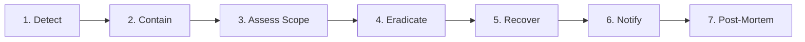

# ExzaEstate — Incident Response Plan (IRP)

> **Document Version:** 1.0.0  
> **Status:** Active / Production Ready  
> **Authority:** `agent/security.md` §13, §16 (Item 21)  
> **Target System:** ExzaEstate Enterprise Multi-Tenant ERP & Accounting Platform

---

## 1. Objectives & Scope

This Incident Response Plan establishes an operational protocol for detecting, containing, investigating, and recovering from information security and data integrity incidents affecting ExzaEstate cloud infrastructure, backend APIs, desktop client deployments, database clusters, or tenant data partitions.

---

## 2. Incident Response Team Roles & Responsibilities

In the event of a security incident, the designated primary contacts assume command according to the following matrix:

| Role                               | Primary Contact       | Responsibilities                                                                                                                 |
| :--------------------------------- | :-------------------- | :------------------------------------------------------------------------------------------------------------------------------- |
| **Incident Commander (IC)**        | Head of Engineering   | Leads the response, coordinates team actions, authorizes containment actions, and manages timelines.                             |
| **Lead Security Engineer**         | Security Lead         | Conducts forensic analysis, reviews `security_events` and audit logs, identifies vulnerability root causes, and designs patches. |
| **Database Administrator (DBA)**   | Lead Backend Engineer | Manages database isolation, tenant session kills, backup restoration, point-in-time recovery, and RLS integrity validation.      |
| **Communications & Legal Officer** | CTO / Legal Counsel   | Coordinates customer notifications, regulatory disclosures, law enforcement communications, and public statements.               |

---

## 3. Seven-Phase Incident Response Lifecycle

### Phase 1: Detect (Identification & Triaging)

- **Monitoring Sources:**
  - Automated alerts from `SecurityEventLogger` (rate limit triggers, repeated failed logins, token reuse flags).
  - Cloudflare WAF / CDN threshold breach alerts (DDoS spikes, SQLi attempt patterns).
  - Anomaly detection on financial ledger postings (out-of-balance entries, unauthorized reversal spikes).
  - User and researcher reports via `security@exzaestate.com`.
- **Triage Criteria:**
  - **SEV-1 (Critical):** Data breach, cross-tenant isolation breach (RLS bypass), unauthorized modification of immutable ledgers, ransomware.
  - **SEV-2 (High):** Account takeover of administrative role (MD/GM), denial of service affecting production, active brute-force bypass.
  - **SEV-3 (Medium):** Isolated rate limit abuse, low-privilege token leakage without lateral movement.
  - **SEV-4 (Low):** Minor misconfiguration or informational alert.

### Phase 2: Contain (Immediate Damage Limitation)

- **Session Revocation:** Trigger global session revocation for affected accounts via `POST /api/v1/auth/logout-all` or direct Redis session eviction (`redis-cli KEYS "session:*" | xargs redis-cli DEL`).
- **Credential Rotation:** Rotate compromised JWT access/refresh secrets, database credentials, or third-party API keys (SMS/Mail).
- **Network Isolation:** Block malicious source IP addresses or CIDR blocks at the Cloudflare / WAF edge.
- **Tenant Lockdown:** In the event of confirmed tenant compromise, set tenant status to `SUSPENDED` via System Admin realm to halt mutations while preserving read-only forensic state.

### Phase 3: Assess Scope (Forensics & Impact Analysis)

- Query the append-only `audit_logs` and `security_events` tables for the affected `company_id` and timeframe.
- Determine exactly which records (customer PII, bookings, journals, vouchers) were read or mutated.
- Cross-verify PostgreSQL Write-Ahead Logs (WAL) for unauthorized schema modifications.

### Phase 4: Eradicate (Root Cause Elimination)

- Develop and peer-review a targeted hotfix for the vulnerability.
- Verify the patch with strict automated tests in a staging environment.
- Run `pnpm check:all` and `pnpm check:prelaunch` quality gates before deploying the hotfix.
- Verify the vulnerability vector is closed via automated regression testing.

### Phase 5: Recover (Restoration & Reconciliation)

- If database tampering occurred, restore to a clean point-in-time state using the documented backup drill runbook (`docs/security/BACKUP_RESTORE_DRILL.md`).
- **Financial Reconciliation Requirement:** Verify financial integrity before reopening the system:
  1. Enforce Double-entry balance: `SUM(debit) === SUM(credit)` across all journal entries.
  2. Verify Customer Statement balance matches AR ledger and aging report (`[AT-14]`).
  3. Verify bank reconciliation matches cleared statement totals.
- Re-enable tenant mutation access once the Incident Commander approves.

### Phase 6: Notify (Regulatory & Stakeholder Disclosure)

- Notify affected company managing directors within 24 hours of confirming a PII breach.
- Provide a clear, honest, and specific report: what data was affected, what steps were taken to contain it, and what actions the customer should take (e.g. password resets).
- Fulfill applicable statutory and regulatory breach reporting requirements.

### Phase 7: Post-Mortem & Review (Continuous Hardening)

- Hold a blameless post-incident review within 5 business days.
- Produce a formal post-mortem document: Timeline of events, root cause analysis, what worked, what failed, and preventive action items.
- Update `agent/security.md`, code standards, or CI quality gates to guarantee the incident cannot recur.

---

## 4. Emergency Contacts & Communication Channels

- **Internal Emergency Bridge:** Dedicated secure chat channel `#incident-room` + voice conference.
- **Security Escalation Email:** `security@exzaestate.com` (monitored 24/7/365).
- **Database Emergency Access:** Restricted to Incident Commander and DBA via encrypted SSH bastion with hardware 2FA.
