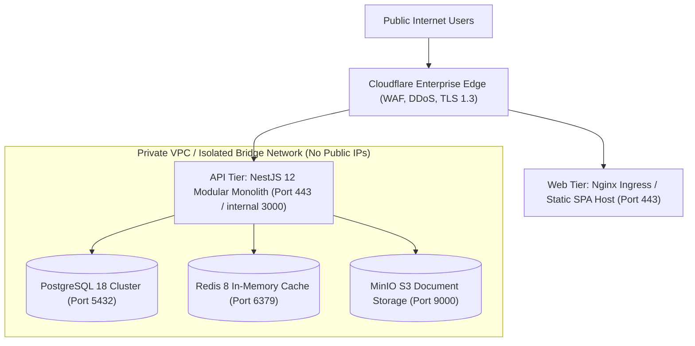

# ExzaEstate — Production Infrastructure Hardening & Network Isolation

> **Document Version:** 1.0.0  
> **Status:** Active / Production Ready  
> **Authority:** `agent/security.md` §10, §16 (Items 17 & 18)  
> **Target Environment:** Multi-Tenant Enterprise Production Deployment

---

## 1. Network Topology & Demilitarized Zone (DMZ)

The ExzaEstate production environment enforces strict network tiering with zero direct public access to persistence or cache layers:

---

## 2. Web Application Firewall (WAF) & Edge Rules

1. **DDoS Mitigation & Rate Limiting:**
   - General API endpoints: Maximum 600 requests per minute per IP address.
   - Authentication & Login endpoints (`/api/v1/auth/login`, `/api/v1/auth/forgot-password`): Strictly rate-limited to **20 requests per minute per IP**.
2. **Managed WAF Rule Sets:**
   - OWASP Core Rule Set (CRS) active in blocking mode (detects SQL Injection, Cross-Site Scripting, Local File Inclusion, Remote Code Execution).
   - Known bot mitigation and Cloudflare Turnstile CAPTCHA challenge triggered after anomalous request patterns.
3. **Geo-Blocking & ASN Filtering:**
   - Administrative endpoints (`/system-realm/*`) restricted to internal corporate IP ranges and authorized VPN subnets.

---

## 3. Database Least-Privilege & Connection Security

In accordance with `docker/postgres-init/01-init-roles.sql` and `agent/architecture.md` §4:

| Role            | Login | Superuser |    BypassRLS    | Privileges                                                   | Purpose                                                                     |
| :-------------- | :---: | :-------: | :-------------: | :----------------------------------------------------------- | :-------------------------------------------------------------------------- |
| `exza_app`      |  Yes  |  **No**   | **NOBYPASSRLS** | DML only (`SELECT, INSERT, UPDATE, DELETE`) on tenant tables | Runtime application traffic. Strictly subject to PostgreSQL RLS policies.   |
| `exza_worker`   |  Yes  |  **No**   | **NOBYPASSRLS** | DML only on queue, outbox, and event tables                  | Background workers and job consumers.                                       |
| `exza_migrator` |  Yes  |    Yes    |       Yes       | DDL (`CREATE, ALTER, DROP, MIGRATE`)                         | CI/CD migration pipeline only. Not used by application code during runtime. |
| `exza_system`   |  Yes  |    Yes    |       Yes       | System realm tables only                                     | Super Admin platform provisioning.                                          |

- Database connections must enforce TLS: `sslmode=require` or `sslmode=verify-full`.
- PostgreSQL and Redis listen strictly on `127.0.0.1` or internal private VPC overlay IP addresses (`10.0.x.x`).

---

## 4. Host & Container Security

1. **Unprivileged Containers:**
   - All Docker images run as unprivileged non-root users (`USER node:node` or `USER 10001:10001`).
2. **Read-Only Root Filesystem:**
   - Application containers mount their root filesystems as read-only (`--read-only`), utilizing `/tmp` for temporary ephemeral scratch files only.
3. **No Capabilities:**
   - Containers drop all default Linux capabilities (`cap_drop: [ALL]`), retaining only necessary network binding privileges.
